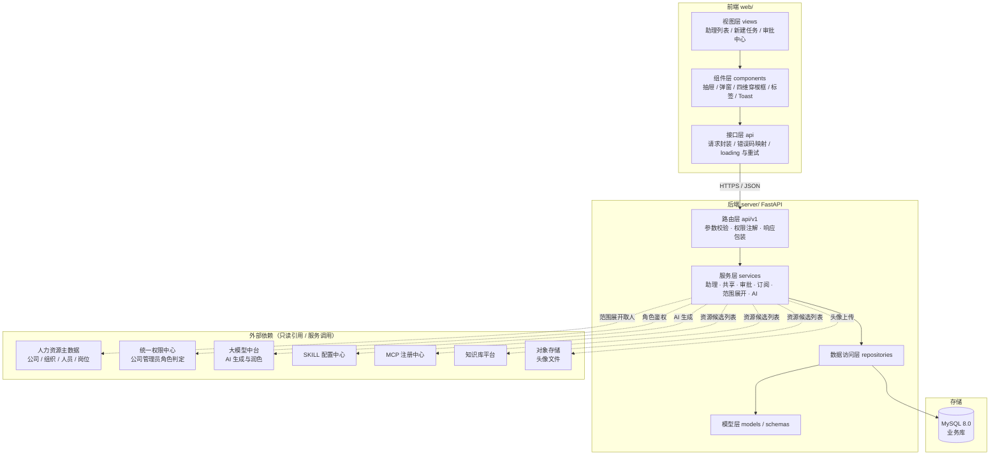
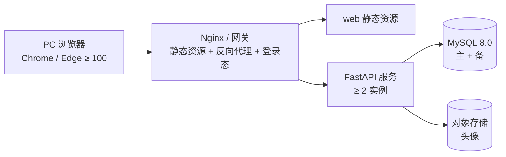
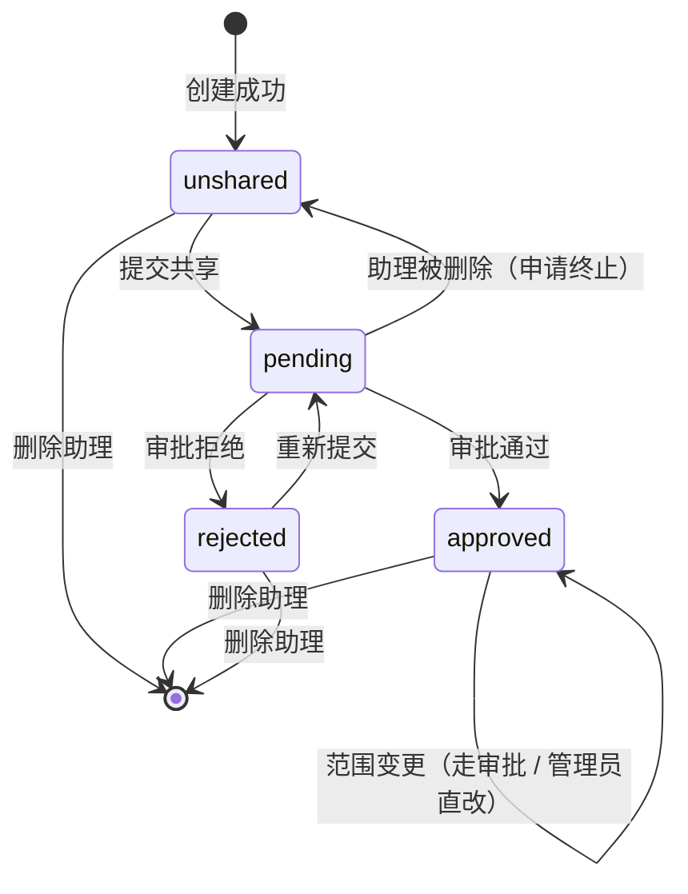
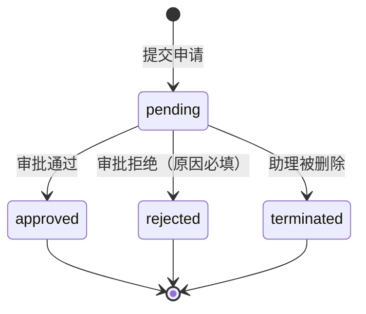
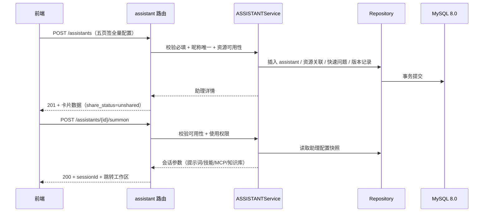
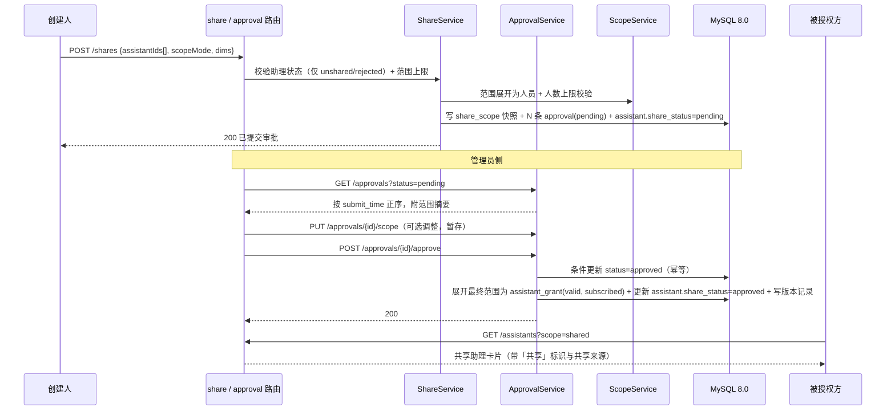

# 助理团助理创建与共享授权 · 总体架构设计 v1.0

## 1. 文档信息

| 项目 | 内容 |
|------|------|
| 文档名称 | 总体架构设计 |
| 版本 | v1.0 |
| 日期 | 2026-10-30 |
| 需求依据 | [需求说明书-v1.2](./需求说明书-v1.2.md) |
| 后端技术栈 | Python 3.10+ + FastAPI + SQLAlchemy 2.0 + Alembic + MySQL 8.0 |
| 前端技术栈 | Vue 3.5 + TypeScript + Vite 6 + Element Plus + Pinia + Vue Router（原型仅作视觉与交互基线） |
| 本期范围 | 需求说明书 v1.2 定义的 13 个功能点（F-EXP-001~005 / F-LIB-001~002 / F-SHR-001~003 / F-APR-001~003） |

### 1.1 相关文档

| 文档 | 说明 |
|------|------|
| [02-数据库设计.md](./02-数据库设计.md) | ER 关系、14 张表字段定义、索引与约束 |
| [03-接口设计.md](./03-接口设计.md) | RESTful 接口清单、出入参、错误码、状态机约束 |
| [需求说明书-v1.2.md](./需求说明书-v1.2.md) | 原始需求（功能点、EARS 需求、验收标准） |

---

## 2. 术语与命名对照

| 业务术语 | 数据库 / 代码命名 | 说明 |
|----------|------------------|------|
| 助理（旧称「数字员工」） | `assistant` | 页面文案与需求文档统一为「助理」，代码 / 表名统一用 `assistant` |
| 我的助理 | `scope=mine` | 创建人为当前登录用户的助理集合 |
| 共享助理 | `scope=shared` | 经审批通过并按范围授权给当前用户的助理 |
| 召唤 | `summon` | 创建会话并携带助理配置 |
| 共享范围 / 授权范围 | `share_scope` | 「范围授权 RANGE / 公开 PUBLIC」双模式 |
| 被授权方 | `grant` 记录的 `user_id` | 授权范围最终展开到人后的使用者 |
| 订阅 / 移除 | `subscribe_status` | 被授权方对共享助理的自主可见性开关 |
| 共享申请 / 审批单 | `approval` | 本期仅 `share`（首次共享）与 `scope_change`（范围变更）两类 |

---

## 3. 项目目录结构

调整前 `font/` 下只有需求文档 + 纯静态原型，无工程骨架，且目录名疑似拼写错误（`font` → `front`）。调整后：

```
20261026-助理管理授权/
├── README.md                          # 目录导览与本地启动说明
├── docs/                              # 设计与需求文档
│   ├── 需求说明书-v1.2.md
│   ├── 01-总体架构设计.md
│   ├── 02-数据库设计.md
│   └── 03-接口设计.md
├── prototype/                         # UI 原型（原样保留，双击 index.html 可运行）
│   ├── index.html                     # SPA 入口（图标精灵 + 侧栏 + 路由）
│   ├── 索引.md
│   ├── css/{common.css, assistant.css}
│   ├── js/common.js                   # Mock 数据 + 路由 + 通用组件
│   ├── pages/{D-AT-LIST.js, D-AT-NEWTASK.js}
│   └── _legacy/                       # 历史 v2 草稿归档，不参与运行
├── web/                               # 前端工程（本期以原型为基线改造接入 API）
│   └── src/
│       ├── api/                       # 接口封装（与 03-接口设计 一一对应）
│       ├── components/                # 通用组件（抽屉/弹窗/穿梭框/标签/Toast）
│       ├── layouts/                   # 布局壳（侧栏 + 视角切换 + 内容区）
│       ├── router/                    # 路由表与标题守卫
│       ├── stores/                    # Pinia 状态（当前用户 / 待审批角标）
│       ├── styles/                    # 设计令牌与全局样式
│       ├── types/                     # 接口响应、错误码、共享范围等类型定义
│       └── views/                     # 页面级视图（助理列表/新建任务/审批中心）
├── server/                            # 后端工程
│   ├── app/
│   │   ├── main.py                    # FastAPI 应用装配入口
│   │   ├── api/v1/                    # 路由层（仅做参数校验与响应包装）
│   │   ├── core/                      # 配置、鉴权、异常、日志、分页
│   │   ├── models/                    # SQLAlchemy ORM 模型（对应 02-数据库设计）
│   │   ├── schemas/                   # Pydantic 出入参模型
│   │   ├── services/                  # 领域服务（助理/共享/审批/订阅/范围展开）
│   │   └── repositories/              # 数据访问层（SQL 与 ORM 查询收敛在此）
│   ├── migrations/                    # Alembic 迁移脚本
│   └── tests/                         # 单元测试 + 接口测试
└── deploy/                            # 部署物（Dockerfile、compose、环境变量样例、建库脚本）
```

### 3.1 目录职责约束

| 目录 | 允许做 | 禁止做 |
|------|--------|--------|
| `app/api/v1` | 解析请求、权限注解、调用 service、包装响应 | 写业务判断、直接写 SQL |
| `app/services` | 状态机流转、范围展开、事务编排、领域校验 | 拼接 HTTP 响应、依赖 FastAPI Request 对象 |
| `app/repositories` | ORM 查询与持久化 | 业务规则判断、跨领域编排 |
| `app/models` | 表结构映射与枚举定义 | 存放业务方法 |
| `prototype` | 只读参考与评审 | 在其上直接开发生产代码 |

### 3.2 本地运行

| 组件 | 命令 | 工作目录 | 端口 |
|------|------|---------|------|
| 后端 | `conda activate Agent` 后 `python -m uvicorn app.main:app --host 127.0.0.1 --port 8000 --reload --reload-dir app` | `server/` | 8000 |
| 前端 | `npm run dev` | `web/` | 5173（`/api` 代理到 8000） |

前置：`deploy/mysql/assistant_mysql.sql` 建库建表；`server/.env` 由 `.env.example` 复制后填 `DB_PASSWORD`；`web/` 首次运行先 `npm install`。

运行时可访问 `/docs`（Swagger UI）、`/redoc`、`/openapi.json`，三者由 FastAPI 依据路由与 Pydantic 模型实时生成。完整步骤与验证命令见 [README「本地运行」](../README.md#本地运行)。

---

## 4. 系统定位与范围边界

### 4.1 本期范围（In Scope）

| 模块 | 覆盖能力 |
|------|----------|
| assistant 助理管理 | 手动创建（5 页签：基础信息 / 提示词 / SKILL / MCP / 知识库）、列表查询（全部 / 我的 / 共享）、召唤、编辑、删除 |
| library 助理库管理 | 共享助理移除、重新订阅 |
| share 共享授权 | 共享提交（范围授权 / 公开）、共享状态查询、被拒后重新提交、已共享助理范围调整（员工走审批 / 管理员直接生效）、平台预置助理范围配置（管理员） |
| approval 共享审批 | 待审批列表（列表 / 卡片双视图）、审批详情与范围调整、审批通过 / 拒绝 |
| AI 生成 | 描述 / 标签 / 提示词 / 召唤快速问题的生成与润色（4.1.1.0） |

### 4.2 明确不做（Out of Scope，与需求 2.6 一致）

助理停用 / 复制 / 导出、助理市场与跨公司共享、审批历史与多级流转、独立授权管理后台、分类字典后台管理（仅支持表单内新增）、提示词版本回滚、SKILL/MCP/知识库自身配置、效果统计报表、移动端适配、组织人员主数据维护。

> **与原型差异说明**：原型中另含「下架申请（offline / offline_pending）」「第三方接入（thirdparty）」「版本记录详情」「审批中心含下架 / 范围变更类型」等能力，需求说明书 v1.2 已将其列为非范围或未定义。架构上仅做**字段与枚举预留**，不建接口、不建流程，详见第 8 章。

---

## 5. 总体架构

### 5.1 分层视图



### 5.2 关键架构特征

| 特征 | 实现方式 |
|------|----------|
| 公司级数据隔离 | 所有业务表带 `company_id`，服务层从登录态注入，仓储层强制拼接过滤条件，禁止跨公司读取 |
| 授权范围最终落到人 | 范围快照保存四维原始选择（组织 / 角色 / 岗位 / 人员），审批通过时展开为人员级授权关系 `assistant_grant`，后续查询走人员级联表，避免每次实时递归组织树 |
| 范围快照不可变 | 提交时固化范围快照（含公开标记），组织架构与人员后续变动不影响已提交申请 |
| 审批单幂等 | 服务层以「状态机 + 条件更新」保证重复请求返回首次结果（`UPDATE ... WHERE status='pending'`，影响行数为 0 时读当前状态回放），不引入独立幂等键表 |
| 订阅与授权解耦 | 移除 / 重新订阅只改 `subscribe_status`，不动授权关系；创建人删除助理时授权关系置为 `invalid`，被授权方不可再订阅 |
| 多租户软删除 | 助理、审批单、授权关系均采用 `deleted_at` 逻辑删除，历史会话与审计可追溯 |
| 前端契约稳定 | 所有列表接口统一分页与错误码结构，前端错误码映射表与后端枚举同源 |

### 5.3 部署形态



- 服务无状态，横向扩容；待审批角标实时按库内 `approval` 状态统计。
- 数据库主备 + 每日全量备份，满足审计日志保留 ≥ 12 个月。
- 可用性目标 ≥ 99.5%，接口 P95 指标见需求 5.1。

---

## 6. 模块划分

### 6.1 后端模块与路由边界

| 模块 | 路由前缀 | 核心服务 | 对应功能点 |
|------|---------|----------|-----------|
| assistant | `/api/v1/assistants` | `ASSISTANTService` | F-EXP-001~005 |
| resource | `/api/v1/resources` | `ResourceCatalogService` | SKILL / MCP / 知识库候选列表 |
| category | `/api/v1/categories` | `CategoryService` | 分类字典（含表单内新增） |
| scope | `/api/v1/scopes` | `ScopeService` | 组织树 / 角色 / 岗位 / 人员候选、范围展开与上限校验 |
| library | `/api/v1/assistants/{id}/subscription` | `SubscriptionService` | F-LIB-001~002 |
| share | `/api/v1/shares` | `ShareService` | F-SHR-001~003、范围调整 |
| approval | `/api/v1/approvals` | `ApprovalService` | F-APR-001~003 |
| ai | `/api/v1/ai` | `AiAssistService` | 4.1.1.0 AI 生成 |
| common | `/api/v1/common` | — | 待审批角标、字典、上传预签名 |

### 6.2 服务层职责矩阵

| 服务 | 主要职责 | 不负责 |
|------|----------|--------|
| `ASSISTANTService` | 创建 / 编辑 / 删除助理，版本号推进，删除影响面统计，召唤前置校验 | 审批流转、授权展开 |
| `ScopeService` | 四维范围校验（上限 50/50/50/200）、范围展开为人员清单、范围摘要与人数计算、公开模式人数 | 决定谁有权审批 |
| `ShareService` | 首次共享提交、重新提交、范围变更提交（员工走审批 / 管理员直改）、平台预置助理范围配置 | 审批决策 |
| `ApprovalService` | 待审批列表、详情、范围调整暂存、通过 / 拒绝、终止（助理被删除时） | 编辑助理配置 |
| `SubscriptionService` | 移除、重新订阅、授权有效性校验 | 修改授权范围 |
| `AiAssistService` | 四字段生成 / 润色，字段长度与数量约束收敛，失败降级 | 保存助理 |

### 6.3 前端页面与路由

| 页面 | 路由标识 | 对应原型 | 说明 |
|------|---------|---------|------|
| 助理团列表 | `D-AT-LIST` | 已有 | 三范围切换、分类筛选、搜索、卡片操作 |
| 助理创建 / 编辑抽屉 | 列表页内抽屉 | 已有 | 5 页签 + 底部取消 / 保存 |
| 共享提交弹窗 | 列表页内弹窗 | 已有 | 已选助理 + 范围授权 / 公开 + 预览 |
| 共享范围弹窗 | 列表页内弹窗 | 已有 | 已共享助理与平台预置助理共用组件 |
| 审批中心 | `D-AT-APPR` | 已有（列表页内嵌） | 独立页面 + 列表 / 卡片双视图 + 返回列表 |
| 审批详情抽屉 | 审批中心内抽屉 | 已有 | 配置只读 + 范围可调 + 通过 / 拒绝 |
| 新建任务 / 召唤 | `D-AT-NEWTASK` | 已有 | 输入框底部助理选择器 |

> 改造原则：原型仅作为视觉与交互基线，生产前端在 `web/`（Vue 3 + TypeScript + Element Plus）中重建；`prototype/` 不再修改，评审仍可双击打开。

---

## 7. 关键设计决策

| 编号 | 决策 | 理由 | 代价 |
|------|------|------|------|
| D-01 | 授权范围采用「快照（四维原始选择）+ 展开（人员级授权）」两层存储 | 快照满足审批可追溯与不可变；展开满足列表查询性能（避免每次递归组织树） | 范围变更需重算展开结果 |
| D-02 | 「移除 / 重新订阅」只改订阅状态，不新增审批 | 需求明确重新订阅不触发审批，授权在审批通过时已生效 | 需区分 `grant_status` 与 `subscribe_status` 两个维度 |
| D-03 | 批量勾选 N 个助理提交共享时，落库拆分为 N 条审批单，共享同一 `batch_no` 与同一范围快照 | 审批列表与详情均按单助理维度展示，单助理单一待审批申请的状态机最简单，与原型一致 | 批量审批需前端按 `batch_no` 聚合（本期不做批量通过） |
| D-04 | 审批单类型本期只实现 `share` 与 `scope_change` | 需求 v1.2 将下架纳入非范围，但正文出现「范围变更审批」，故保留 `scope_change` | `offline` 类型仅保留枚举位，不建流程 |
| D-05 | 平台预置助理复用同一套 `assistant_share_scope`，仅授权人为管理员且立即生效 | 需求要求四处共享范围组件统一 | 需在服务层按助理来源分支权限校验 |
| D-06 | 助理昵称唯一性用「公司 + 昵称 + 未删除」唯一索引兜底，同时在服务层前置校验 | 并发创建时数据库约束是唯一可靠保证 | 冲突需转换为业务错误码 |
| D-07 | 待审批数量角标按库内 `approval.status='pending'` 实时统计 | 角标需与列表数据严格一致，本期数据量小，不走缓存 | 数据量增大后需评估加索引或缓存 |
| D-08 | AI 生成不计入助理保存事务，失败仅提示不阻断 | 需求 5.4 要求提示词优化不可用时降级可保存 | 生成结果可能未采纳 |
| D-09 | 头像上传采用「预签名直传对象存储 + 保存 URL」 | 避免大文件过服务层，2MB 限制在预签名阶段校验 | 需清理未引用的孤儿文件 |
| D-10 | 逻辑删除统一 `deleted_at`，删除后关联授权置 `invalid`、待审批单置 `terminated` | 需求要求删除后不可重新订阅，且历史会话可查看 | 所有查询必须带 `deleted_at IS NULL` |

---

## 8. 权限模型

### 8.1 角色与数据权限

| 角色 | 判定来源 | 数据可见范围 | 可执行操作 |
|------|---------|-------------|-----------|
| 普通员工（创建人） | 登录态 | 本人创建的助理、被授权且订阅的共享助理、平台预置助理 | 创建 / 编辑 / 删除自建助理、召唤、提交共享、调整自建已共享助理的范围（走审批）、移除与重新订阅 |
| 被授权方 | `assistant_grant` 命中 | 被授权且 `subscribe_status=subscribed` 的助理（只读配置） | 召唤、移除、重新订阅 |
| 公司管理员 | 统一权限中心 | 本公司全部助理与全部待审批申请 | 审批通过 / 拒绝、调整审批范围、直接配置平台预置助理与本公司助理的范围 |

### 8.2 权限校验落点

| 校验点 | 实现位置 | 规则 |
|--------|---------|------|
| 登录态 | 网关 + `core/security.py` | 会话失效返回 401，前端跳登录并回跳 |
| 公司隔离 | `repositories` 统一注入 `company_id` | 跨公司访问返回 404（不暴露存在性） |
| 助理归属 | `ASSISTANTService.assert_owner` | 非创建人编辑 / 删除返回 403 `ASSISTANT_NOT_OWNER` |
| 管理员 | `core/deps.py` 依赖注入 | 非管理员访问审批接口返回 403 `NO_PERMISSION`，前端隐藏入口 |
| 授权有效性 | `SubscriptionService` | 召唤 / 订阅前校验 `grant_status=valid` |
| 范围上限 | `ScopeService` | 组织 ≤ 50、角色 ≤ 50、岗位 ≤ 50、人员 ≤ 200 |

---

## 9. 状态机

### 9.1 助理共享状态（`assistant.share_status`）



> 说明：`approved` 状态下发起范围变更时，助理共享状态保持 `approved` 不变，变更过程由独立的 `scope_change` 审批单承载，避免影响被授权方的正常使用。

### 9.2 审批单状态（`approval.status`）



- 终态不可再流转；重复决策返回首次结果（幂等）。

### 9.3 授权关系与订阅状态

| 维度 | 字段 | 取值 | 流转 |
|------|------|------|------|
| 授权有效性 | `grant.grant_status` | `valid` / `invalid` | 审批通过展开为 `valid`；助理删除、范围收紧未命中时置 `invalid` |
| 订阅状态 | `grant.subscribe_status` | `subscribed` / `removed` | 授权生效时默认 `subscribed`；被授权方移除置 `removed`；重新订阅回 `subscribed` |

组合语义：

| grant_status | subscribe_status | 在「共享助理 · 已订阅」 | 在「共享助理 · 已移除」 | 可召唤 | 可重新订阅 |
|--------------|------------------|------------------------|------------------------|--------|-----------|
| valid | subscribed | 可见 | 不可见 | 是 | — |
| valid | removed | 不可见 | 可见 | 否 | 是 |
| invalid | removed | 不可见 | 可见（置灰） | 否 | 否 |

### 9.4 范围模式（`share_scope.scope_mode`）

| 取值 | 语义 | 校验 |
|------|------|------|
| `RANGE` | 范围授权，四维选择后展开为人员 | 至少 1 个对象，且受上限约束 |
| `PUBLIC` | 公开，全公司可用 | 无需选择，授权人数 = 公司在职人数 |

---

## 10. 核心链路时序

### 10.1 创建 → 召唤



### 10.2 共享提交 → 审批 → 授权生效 → 被授权方订阅



### 10.3 编辑与删除的传导

| 操作 | 对授权关系 | 对审批单 | 对被授权方 |
|------|-----------|---------|-----------|
| 创建人编辑助理 | 不变 | 不变（进行中的审批详情读最新配置） | 下次加载看到最新配置 |
| 创建人删除助理 | 全部置 `invalid` | `pending` → `terminated` | 从共享助理与全部范围移除，不可重新订阅 |
| 创建人调整范围（员工） | 审批通过后重算 | 新建 `scope_change` 单 | 命中者新增 / 未命中者失效 |
| 管理员调整范围 | 立即重算 | 无单据，写版本记录 | 立即生效 |

---

## 11. 非功能性落地

| 需求项 | 架构落地 |
|--------|---------|
| 保存接口 P95 ≤ 800ms | 单事务写入；资源可用性校验批量查询；昵称唯一走唯一索引而非全表扫描 |
| 列表首屏 ≤ 2s（12 卡片） | 列表接口只返回卡片字段，提示词等大字段不进列表响应；分页 12 条 |
| 待审批列表 ≤ 1s（20 条） | `(company_id, status, submit_time)` 复合索引；范围摘要走快照表关联 |
| 提示词优化 ≤ 8s | AI 调用独立超时 8s，失败快速降级；不占用助理保存事务 |
| 并发 ≥ 200，TPS ≥ 50 | 无状态服务横向扩容；待审批角标按库内状态实时统计 |
| 审计留存 ≥ 12 个月 | `sys_audit_log` 按季度分区，归档冷存储 |
| 幂等 | 审批决策与订阅操作以「条件更新 + 状态回放」保证，重复请求返回首次结果 |
| 越权防护 | 服务层统一 `assert_owner` / `assert_admin` / `assert_company` 三段校验 |
| 敏感信息 | 提示词仅创建人与审批管理员可见；列表接口不返回 `prompt` 字段 |

---

## 12. 演进与预留

| 预留项 | 预留方式 | 启用成本 |
|--------|---------|---------|
| 下架申请 | `approval.approval_type` 枚举已含 `offline`；`assistant.share_status` 预留 `offline_pending` / `offline` | 中：需补状态机分支与前端入口 |
| 第三方接入 | `assistant.source` 枚举已含 `thirdparty` | 低：仅需接入表单与来源标识 |
| 审批多级 / 审批历史 | `approval` 主键与 `batch_no` 已支持扩展为流转链 | 中：需新增审批任务表 |
| 提示词版本回滚 | `assistant_version_history` 已存版本号与操作类型 | 中：需存配置快照 |
| 独立授权管理后台 | `assistant_share_scope` + `assistant_grant` 已可支撑关系查询 | 中：仅需新增查询接口与页面 |
| 批量审批 | `batch_no` 已支持按批聚合 | 低 |

---

## 13. 待确认事项

| 编号 | 事项 | 当前假设 |
|------|------|---------|
| Q-01 | 「我的助理」范围下是否存在状态筛选下拉（F-SHR-002 提到状态筛选，F-EXP-002 未提） | 按 F-SHR-002 实现，状态筛选仅在 `scope=mine` 生效 |
| Q-02 | 范围变更审批单的审批详情是否复用共享审批详情 | 复用同一详情组件，类型标识区分 |
| Q-03 | 公开模式下的「授权人数」是否需要实时展示全公司人数 | 是，取主数据在职人数，失败时展示「全公司可用」 |
| Q-04 | 组织 / 角色 / 岗位维度变更后，已通过授权的助理是否自动重算 | 不自动重算，仅在下次范围编辑或审批通过时重算（快照语义） |
