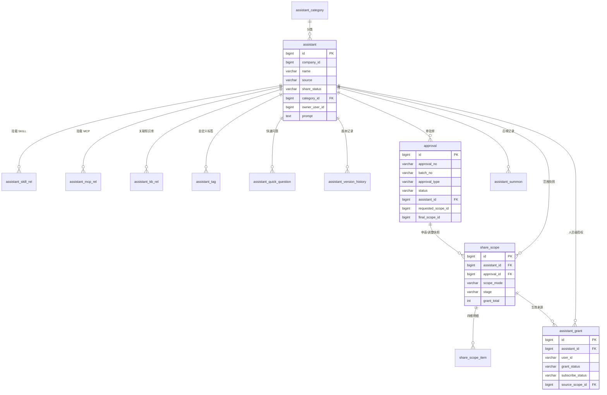

# 助理团助理创建与共享授权 · 数据库设计 v1.2

## 1. 文档信息


| 项目     | 内容                                                                                   |
| ---------- | ---------------------------------------------------------------------------------------- |
| 数据库   | MySQL 8.0                                                                              |
| 版本     | v1.2 / 2026-11-12                                                                      |
| ORM      | SQLAlchemy 2.0（声明式模型，见 `server/app/models`）                                   |
| 迁移     | Alembic（脚本见 `server/migrations`）                                                  |
| 字符集   | utf8mb4                                                                                |
| 命名规范 | 表名小写下划线；主键统一 `id BIGINT AUTO_INCREMENT`；时间统一 `DATETIME`（默认 `CURRENT_TIMESTAMP`）；布尔用 `TINYINT(1)`；JSON 用 `JSON`；逻辑删除 `deleted_at` |
| 表数量   | 14 张（业务 12 张 + 支撑 2 张）                                                        |

### 1.1 表清单


| 序号 | 表名                     | 中文名                   | 类型 |
| ------ | -------------------------- | -------------------------- | ------ |
| 1    | `assistant_category`        | 助理分类字典             | 业务 |
| 2    | `assistant`                 | 助理主表                 | 业务 |
| 3    | `assistant_skill_rel`       | 助理-SKILL 关联          | 业务 |
| 4    | `assistant_mcp_rel`         | 助理-MCP 关联            | 业务 |
| 5    | `assistant_kb_rel`          | 助理-知识库关联          | 业务 |
| 6    | `assistant_tag`             | 助理自定义标签           | 业务 |
| 7    | `assistant_quick_question`  | 召唤快速问题             | 业务 |
| 8    | `assistant_version_history` | 助理版本与操作记录       | 业务 |
| 9    | `share_scope`            | 共享范围快照（主）       | 业务 |
| 10   | `share_scope_item`       | 共享范围快照明细（四维） | 业务 |
| 11   | `assistant_grant`           | 人员级授权与订阅关系     | 业务 |
| 12   | `approval`               | 审批单                   | 业务 |
| 13   | `assistant_summon`          | 召唤记录                 | 支撑 |
| 14   | `sys_audit_log`          | 操作审计日志             | 支撑 |

---

## 2. ER 关系



**核心关系说明**

1. 一个助理有 1 个分类，分类为公司级字典（本迭代内置 5 个，管理员可新增）。
2. 一个助理的能力组成落在 3 张关联表 + 1 张标签表 + 1 张快速问题表，均按 `assistant_id` 级联删除。
3. `share_scope` 是**范围快照**，通过 `stage` 区分三态：`requested`（申请时快照）、`adjusted`（管理员审批前调整）、`effective`（审批通过后生效）。`approval_id` 为空且 `stage=effective` 表示管理员直接配置（平台内置助理或管理员直改）。
4. `share_scope_item` 保存四维原始选择，`assistant_grant` 保存展开后的人员级结果，两者是「快照 → 展开」关系。
5. 一个助理同一时刻最多 1 条 `pending` 审批单，由 `pending_flag` 生成列配合唯一索引保证。

---

## 3. 枚举与取值约定


| 枚举                            | 取值                                                                                                | 说明                                                   |
| --------------------------------- | ----------------------------------------------------------------------------------------------------- | -------------------------------------------------------- |
| `assistant.source`                 | `platform` 平台内置 / `custom` 自建 / `thirdparty` 第三方接入（预留）                               | 页面上的「共享 shared」是查询时派生的视图来源，不落库  |
| `assistant.share_status`           | `unshared` / `pending` / `approved` / `rejected` / `offline_pending` / `offline`                    | 见架构文档 9.1                                         |
| `assistant.pending_type`           | `share` 共享审批 / `change` 调整审批 / `scope` 授权审批 / `offline` 下架审批                        | 审批中状态的子类，提交审批时写入，审批结束后置空         |
| `assistant.reject_type`            | `share` / `change` / `scope` / `offline`                                                            | 已拒绝状态的子类，审批拒绝时写入，重新提交时置空         |
| `assistant.has_shared`             | `0` 未共享成功过 / `1` 曾共享成功过                                                                 | 决定版本号口径（首次记 V1.0.0）与删除资格               |
| `assistant.version`                | `V{主}.{次}.{尾}`，如 `V1.0.2`；空串表示「未发布」                                                   | 仅在审批通过时生成或推进，尾号到 99 进位                |
| `share_scope.scope_mode`        | `RANGE` 范围授权 / `PUBLIC` 公开                                                                    | 公开时 `scope_item` 为空，`grant_total` 取公司在职人数 |
| `share_scope.stage`             | `requested` / `adjusted` / `effective`                                                              |                                                        |
| `share_scope_item.dim`          | `org` / `role` / `position` / `user`                                                                | 四维                                                   |
| `assistant_grant.grant_status`     | `valid` / `invalid`                                                                                 | 助理删除或范围收紧未命中时置 `invalid`                 |
| `assistant_grant.subscribe_status` | `subscribed` / `removed`                                                                            | 被授权方自主开关                                       |
| `approval.approval_type`        | `share` 共享申请 / `scope` 授权申请 / `change` 调整申请 / `offline` 下架申请                        | 与页面类型标识一一对应                                  |
| `approval.status`               | `pending` / `approved` / `rejected` / `terminated`                                                  | `terminated` 仅因助理被删除                            |
| `assistant_version_history.action` | `create` / `update` / `share_submit` / `share_approve` / `share_reject` / `change_submit` / `change_approve` / `change_reject` / `scope_change` / `scope_reject` / `offline_submit` / `offline_approve` / `offline_reject` / `delete` |                                                        |

> 枚举统一用 `VARCHAR + CHECK` 约束（不用 MySQL 原生 `ENUM` 类型），便于后续加值不锁表；MySQL 8.0.16 起 `CHECK` 约束默认生效。ORM 侧以 Python `StrEnum` 暴露。

---

## 4. 建表语句

### 4.1 assistant_category · 助理分类字典

```sql
CREATE TABLE `assistant_category` (
    `id`          BIGINT       NOT NULL AUTO_INCREMENT COMMENT '主键 ID，自增',
    `company_id`  BIGINT       NOT NULL COMMENT '公司 ID，多租户隔离字段',
    `name`        VARCHAR(10)  NOT NULL COMMENT '分类名称，≤10 字符，公司内唯一',
    `sort_no`     INT          NOT NULL DEFAULT 0 COMMENT '排序号，升序展示，值越小越靠前',
    `is_builtin`  TINYINT      NOT NULL DEFAULT 0 COMMENT '是否系统内置，内置分类不允许删除',
    `created_by`  BIGINT       NULL COMMENT '创建人用户 ID；系统初始化数据为空',
    `created_at`  DATETIME     NOT NULL DEFAULT CURRENT_TIMESTAMP COMMENT '创建时间',
    `deleted_at`  DATETIME     NULL COMMENT '逻辑删除时间，非空表示已删除',
    -- 等价 PG: CREATE UNIQUE INDEX ... WHERE deleted_at IS NULL
    `active_flag` TINYINT GENERATED ALWAYS AS (IF(`deleted_at` IS NULL, 1, NULL)) STORED
                  COMMENT '生效行标记生成列：未删除为 1、已删除为 NULL，配合唯一索引实现部分唯一',
    PRIMARY KEY (`id`),
    UNIQUE KEY `uk_category_company_name` (`company_id`, `name`, `active_flag`)
) ENGINE = InnoDB DEFAULT CHARSET = utf8mb4 COLLATE = utf8mb4_0900_ai_ci
  COMMENT = '助理分类字典；内置协同办公/人资/智慧云仓/环安/经营管理，管理员可在表单内新增';
```

### 4.2 assistant · 助理主表

```sql
CREATE TABLE `assistant` (
    `id`                 BIGINT       NOT NULL AUTO_INCREMENT COMMENT '主键 ID，自增',
    `company_id`         BIGINT       NOT NULL COMMENT '公司 ID，多租户隔离字段',
    `name`               VARCHAR(20)  NOT NULL COMMENT '昵称，2-20 字符，公司内唯一',
    `avatar_type`        VARCHAR(10)  NOT NULL DEFAULT 'char'
                         COMMENT 'char=预置字符头像，image=本地上传（2MB 内 image/*）',
    `avatar_char`        VARCHAR(2)   NULL COMMENT '预置字符头像字符，avatar_type=char 时使用',
    `avatar_url`         VARCHAR(512) NULL COMMENT '上传头像地址，avatar_type=image 时使用',
    `avatar_color`       VARCHAR(16)  NOT NULL DEFAULT '#3685F2' COMMENT '头像背景色，十六进制色值如 #3685F2',
    `description`        VARCHAR(200) NOT NULL COMMENT '描述，10-200 字符，列表截断 60 字',
    `category_id`        BIGINT       NOT NULL COMMENT '所属分类 ID，外键指向 assistant_category.id',
    `source`             VARCHAR(16)  NOT NULL
                         COMMENT 'platform 平台内置 / custom 自建 / thirdparty 第三方接入（预留）；shared 为查询视图，不落库',
    `owner_user_id`      BIGINT       NULL COMMENT '创建人；平台内置助理为空',
    `owner_name`         VARCHAR(64)  NULL COMMENT '创建人姓名快照；平台内置助理为空',
    `owner_dept_name`    VARCHAR(128) NULL COMMENT '创建人所属部门名称快照；平台内置助理为空',
    `prompt`             TEXT         NOT NULL COMMENT '提示词，必填，≤4000 字符',
    `share_status`       VARCHAR(16)  NOT NULL DEFAULT 'unshared'
                         COMMENT '共享状态：unshared 未共享 / pending 审批中 / approved 已共享 / rejected 已拒绝 / offline_pending 下架审批中 / offline 已下架',
    `pending_type`       VARCHAR(16)  NULL
                         COMMENT '审批子类：share 共享审批 / change 调整审批 / scope 授权审批 / offline 下架审批；仅审批中有值',
    `reject_type`        VARCHAR(16)  NULL
                         COMMENT '拒绝子类：share / change / scope / offline；仅已拒绝有值',
    `has_shared`         TINYINT      NOT NULL DEFAULT 0
                         COMMENT '是否曾共享成功过：决定版本号生成口径（首次记 V1.0.0）与删除资格',
    `version`            VARCHAR(16)  NOT NULL DEFAULT '' COMMENT '当前版本号，V{主版本}.{次版本}.{尾号}，如 V1.0.0；空串表示「未发布」，仅在审批通过时推进',
    `authorized_count`   INT          NOT NULL DEFAULT 0 COMMENT '已生效授权人数，冗余字段，由 assistant_grant 统计回写',
    `offline_reason`     VARCHAR(200) NULL COMMENT '下架原因，仅下架审批中 / 已下架有值',
    `last_reject_reason` VARCHAR(200) NULL COMMENT '最近一次审批拒绝原因，仅 rejected 状态有值',
    `last_approver_name` VARCHAR(64)  NULL COMMENT '最近一次审批人姓名',
    `last_approve_time`  DATETIME     NULL COMMENT '最近一次审批完成时间',
    `created_by`         BIGINT       NOT NULL COMMENT '创建人用户 ID，平台内置助理为 0（系统）',
    `created_at`         DATETIME     NOT NULL DEFAULT CURRENT_TIMESTAMP COMMENT '创建时间',
    `updated_at`         DATETIME     NOT NULL DEFAULT CURRENT_TIMESTAMP COMMENT '最后更新时间',
    `deleted_at`         DATETIME     NULL COMMENT '逻辑删除；删除后关联授权置 invalid、待审批单置 terminated',
    -- 等价 PG: uk_assistant_company_name ... WHERE deleted_at IS NULL
    `active_flag`        TINYINT GENERATED ALWAYS AS (IF(`deleted_at` IS NULL, 1, NULL)) STORED
                         COMMENT '生效行标记生成列：未删除为 1、已删除为 NULL，配合唯一索引实现部分唯一',
    PRIMARY KEY (`id`),
    UNIQUE KEY `uk_assistant_company_name` (`company_id`, `name`, `active_flag`),
    KEY `idx_assistant_list_mine` (`company_id`, `owner_user_id`, `created_at` DESC),
    KEY `idx_assistant_list_platform` (`company_id`, `category_id`, `created_at` DESC),
    KEY `idx_assistant_status` (`company_id`, `share_status`),
    CONSTRAINT `fk_assistant_category` FOREIGN KEY (`category_id`) REFERENCES `assistant_category` (`id`),
    CONSTRAINT `ck_assistant_avatar_type` CHECK (`avatar_type` IN ('char', 'image')),
    CONSTRAINT `ck_assistant_source` CHECK (`source` IN ('platform', 'custom', 'thirdparty')),
    CONSTRAINT `ck_assistant_share_status` CHECK (`share_status` IN ('unshared', 'pending', 'approved', 'rejected', 'offline_pending', 'offline')),
    CONSTRAINT `ck_assistant_pending_type` CHECK (`pending_type` IS NULL OR `pending_type` IN ('share', 'change', 'scope', 'offline')),
    CONSTRAINT `ck_assistant_reject_type` CHECK (`reject_type` IS NULL OR `reject_type` IN ('share', 'change', 'scope', 'offline'))
) ENGINE = InnoDB DEFAULT CHARSET = utf8mb4 COLLATE = utf8mb4_0900_ai_ci
  COMMENT = '助理（页面称「助理」「数字员工」）主表';
```

### 4.3 ~ 4.5 能力组成关联表（SKILL / MCP / 知识库）

```sql
CREATE TABLE `assistant_skill_rel` (
    `id`            BIGINT       NOT NULL AUTO_INCREMENT COMMENT '主键 ID，自增',
    `assistant_id`     BIGINT       NOT NULL COMMENT '助理 ID，外键指向 assistant.id，级联删除',
    `resource_id`   VARCHAR(64)  NOT NULL COMMENT 'SKILL 资源 ID，来源为平台技能中心',
    `resource_name` VARCHAR(128) NOT NULL COMMENT 'SKILL 资源名称快照，用于列表直接展示',
    `sort_no`       INT          NOT NULL DEFAULT 0 COMMENT '展示顺序，按保存时选择顺序写入',
    `created_at`    DATETIME     NOT NULL DEFAULT CURRENT_TIMESTAMP COMMENT '创建时间',
    PRIMARY KEY (`id`),
    UNIQUE KEY `uk_assistant_skill` (`assistant_id`, `resource_id`),
    CONSTRAINT `fk_skill_assistant` FOREIGN KEY (`assistant_id`) REFERENCES `assistant` (`id`) ON DELETE CASCADE
) ENGINE = InnoDB DEFAULT CHARSET = utf8mb4 COLLATE = utf8mb4_0900_ai_ci
  COMMENT = '助理挂载的 SKILL，单个助理上限 20 个，保存时校验资源在线';

CREATE TABLE `assistant_mcp_rel` (
    `id`            BIGINT       NOT NULL AUTO_INCREMENT COMMENT '主键 ID，自增',
    `assistant_id`     BIGINT       NOT NULL COMMENT '助理 ID，外键指向 assistant.id，级联删除',
    `resource_id`   VARCHAR(64)  NOT NULL COMMENT 'MCP 服务资源 ID，来源为平台 MCP 中心',
    `resource_name` VARCHAR(128) NOT NULL COMMENT 'MCP 服务名称快照，用于列表直接展示',
    `resource_type` VARCHAR(32)  NULL COMMENT 'MCP 服务类型，如 http / sse / stdio',
    `sort_no`       INT          NOT NULL DEFAULT 0 COMMENT '展示顺序，按保存时选择顺序写入',
    `created_at`    DATETIME     NOT NULL DEFAULT CURRENT_TIMESTAMP COMMENT '创建时间',
    PRIMARY KEY (`id`),
    UNIQUE KEY `uk_assistant_mcp` (`assistant_id`, `resource_id`),
    CONSTRAINT `fk_mcp_assistant` FOREIGN KEY (`assistant_id`) REFERENCES `assistant` (`id`) ON DELETE CASCADE
) ENGINE = InnoDB DEFAULT CHARSET = utf8mb4 COLLATE = utf8mb4_0900_ai_ci
  COMMENT = '助理挂载的 MCP 服务，单个助理上限 20 个';

CREATE TABLE `assistant_kb_rel` (
    `id`            BIGINT       NOT NULL AUTO_INCREMENT COMMENT '主键 ID，自增',
    `assistant_id`     BIGINT       NOT NULL COMMENT '助理 ID，外键指向 assistant.id，级联删除',
    `resource_id`   VARCHAR(64)  NOT NULL COMMENT '知识库资源 ID，来源为平台知识库',
    `resource_name` VARCHAR(128) NOT NULL COMMENT '知识库名称快照，用于列表直接展示',
    `sort_no`       INT          NOT NULL DEFAULT 0 COMMENT '展示顺序，按保存时选择顺序写入',
    `created_at`    DATETIME     NOT NULL DEFAULT CURRENT_TIMESTAMP COMMENT '创建时间',
    PRIMARY KEY (`id`),
    UNIQUE KEY `uk_assistant_kb` (`assistant_id`, `resource_id`),
    CONSTRAINT `fk_kb_assistant` FOREIGN KEY (`assistant_id`) REFERENCES `assistant` (`id`) ON DELETE CASCADE
) ENGINE = InnoDB DEFAULT CHARSET = utf8mb4 COLLATE = utf8mb4_0900_ai_ci
  COMMENT = '助理关联的知识库，单个助理上限 10 个，需校验当前用户访问权限';
```

> 三张表保留 `resource_name` 快照，避免被引用资源改名或下线后审批详情、列表展示失去名称。

### 4.6 assistant_tag · 助理自定义标签

```sql
CREATE TABLE `assistant_tag` (
    `id`         BIGINT      NOT NULL AUTO_INCREMENT COMMENT '主键 ID，自增',
    `assistant_id`  BIGINT      NOT NULL COMMENT '助理 ID，外键指向 assistant.id，级联删除',
    `name`       VARCHAR(8)  NOT NULL COMMENT '标签名，1-8 字符；同一助理内唯一',
    `sort_no`    INT         NOT NULL DEFAULT 0 COMMENT '展示顺序，按保存时标签输入顺序写入',
    `created_at` DATETIME    NOT NULL DEFAULT CURRENT_TIMESTAMP COMMENT '创建时间',
    PRIMARY KEY (`id`),
    UNIQUE KEY `uk_assistant_tag` (`assistant_id`, `name`),
    KEY `idx_tag_name` (`name`),
    CONSTRAINT `fk_tag_assistant` FOREIGN KEY (`assistant_id`) REFERENCES `assistant` (`id`) ON DELETE CASCADE
) ENGINE = InnoDB DEFAULT CHARSET = utf8mb4 COLLATE = utf8mb4_0900_ai_ci
  COMMENT = '助理自定义标签；单个助理上限 5 个，单个标签 1-8 字符，去重，支持 AI 生成（REQ-EXP-AI-003/004）与列表按标签模糊搜索';
```

> `idx_tag_name` 支撑列表 `keyword` 对标签的模糊搜索（`LIKE '%kw%'`），与 `assistant.name` 搜索做 OR 合并；标签不做公司级字典，天然归属于助理。

### 4.7 assistant_quick_question · 召唤快速问题

```sql
CREATE TABLE `assistant_quick_question` (
    `id`         BIGINT       NOT NULL AUTO_INCREMENT COMMENT '主键 ID，自增',
    `assistant_id`  BIGINT       NOT NULL COMMENT '助理 ID，外键指向 assistant.id，级联删除',
    `content`    VARCHAR(200) NOT NULL COMMENT '快速问题内容，≤200 字符，同一助理内去重',
    `sort_no`    INT          NOT NULL DEFAULT 0 COMMENT '展示顺序，升序排列，值越小越靠前',
    `created_at` DATETIME     NOT NULL DEFAULT CURRENT_TIMESTAMP COMMENT '创建时间',
    PRIMARY KEY (`id`),
    KEY `idx_qq_assistant` (`assistant_id`, `sort_no`),
    CONSTRAINT `fk_qq_assistant` FOREIGN KEY (`assistant_id`) REFERENCES `assistant` (`id`) ON DELETE CASCADE
) ENGINE = InnoDB DEFAULT CHARSET = utf8mb4 COLLATE = utf8mb4_0900_ai_ci
  COMMENT = '召唤后欢迎区展示的快速问题，上限 6 条，去重';
```

### 4.8 assistant_version_history · 版本与操作记录

```sql
CREATE TABLE `assistant_version_history` (
    `id`            BIGINT       NOT NULL AUTO_INCREMENT COMMENT '主键 ID，自增',
    `assistant_id`     BIGINT       NOT NULL COMMENT '助理 ID，外键指向 assistant.id，级联删除',
    `version`       VARCHAR(16)  NOT NULL COMMENT '记录时的版本号，如 V1.0.0；未发布阶段填「未发布」',
    `action`        VARCHAR(32)  NOT NULL COMMENT '操作类型：create 创建 / update 编辑 / share_submit 共享提交 / share_approve 共享审批通过 / share_reject 共享审批被拒 / change_submit 提交变更审批 / change_approve 变更审批通过 / change_reject 变更审批被拒 / scope_change 授权范围变更 / scope_reject 授权范围变更被拒 / offline_submit 提交下架 / offline_approve 下架生效 / offline_reject 下架被拒 / delete 删除',
    `operator_id`   BIGINT       NULL COMMENT '操作人用户 ID；系统自动记录（如审批回写）为空',
    `operator_name` VARCHAR(64)  NOT NULL COMMENT '操作人姓名快照；系统记录填「系统」',
    `remark`        VARCHAR(200) NULL COMMENT '操作备注，如审批意见摘要、调整说明',
    `created_at`    DATETIME     NOT NULL DEFAULT CURRENT_TIMESTAMP COMMENT '记录时间',
    PRIMARY KEY (`id`),
    KEY `idx_version_assistant` (`assistant_id`, `created_at` DESC),
    CONSTRAINT `fk_version_assistant` FOREIGN KEY (`assistant_id`) REFERENCES `assistant` (`id`) ON DELETE CASCADE,
    CONSTRAINT `ck_version_action` CHECK (`action` IN ('create', 'update', 'share_submit', 'share_approve', 'share_reject', 'change_submit', 'change_approve', 'change_reject', 'scope_change', 'scope_reject', 'offline_submit', 'offline_approve', 'offline_reject', 'delete'))
) ENGINE = InnoDB DEFAULT CHARSET = utf8mb4 COLLATE = utf8mb4_0900_ai_ci
  COMMENT = '助理版本与操作流水，用于详情页版本记录展示；不存配置快照，不支持回滚';
```

### 4.9 share_scope · 共享范围快照（主）

```sql
CREATE TABLE `share_scope` (
    `id`             BIGINT      NOT NULL AUTO_INCREMENT COMMENT '主键 ID，自增',
    `company_id`     BIGINT      NOT NULL COMMENT '公司 ID，多租户隔离字段',
    `assistant_id`      BIGINT      NOT NULL COMMENT '助理 ID，外键指向 assistant.id',
    `approval_id`    BIGINT      NULL COMMENT '为空且 stage=effective 表示管理员直接配置（平台内置助理 / 管理员范围直改）',
    `scope_mode`     VARCHAR(16) NOT NULL DEFAULT 'RANGE' COMMENT '范围模式：RANGE 指定组织/角色/岗位/人员 / PUBLIC 全员公开',
    `stage`          VARCHAR(16) NOT NULL COMMENT '范围阶段：requested 提交时申请范围 / adjusted 审批前管理员调整 / effective 最终生效范围',
    `org_count`      INT         NOT NULL DEFAULT 0 COMMENT '组织维度选择数量',
    `role_count`     INT         NOT NULL DEFAULT 0 COMMENT '角色维度选择数量',
    `position_count` INT         NOT NULL DEFAULT 0 COMMENT '岗位维度选择数量',
    `user_count`     INT         NOT NULL DEFAULT 0 COMMENT '人员维度直接选择数量',
    `grant_total`    INT         NOT NULL DEFAULT 0 COMMENT '展开后授权人数；PUBLIC 模式下为公司在职人数',
    `created_by`     BIGINT      NOT NULL COMMENT '创建人用户 ID；系统生成时填 0',
    `created_at`     DATETIME    NOT NULL DEFAULT CURRENT_TIMESTAMP COMMENT '创建时间',
    PRIMARY KEY (`id`),
    KEY `idx_scope_assistant_stage` (`assistant_id`, `stage`, `created_at` DESC),
    KEY `idx_scope_approval` (`approval_id`),
    CONSTRAINT `fk_scope_assistant` FOREIGN KEY (`assistant_id`) REFERENCES `assistant` (`id`),
    CONSTRAINT `ck_scope_mode` CHECK (`scope_mode` IN ('RANGE', 'PUBLIC')),
    CONSTRAINT `ck_scope_stage` CHECK (`stage` IN ('requested', 'adjusted', 'effective'))
) ENGINE = InnoDB DEFAULT CHARSET = utf8mb4 COLLATE = utf8mb4_0900_ai_ci
  COMMENT = '共享范围快照；requested=提交时申请范围，adjusted=审批前管理员调整，effective=最终生效范围';
```

### 4.10 share_scope_item · 共享范围快照明细

```sql
CREATE TABLE `share_scope_item` (
    `id`         BIGINT       NOT NULL AUTO_INCREMENT COMMENT '主键 ID，自增',
    `scope_id`   BIGINT       NOT NULL COMMENT '范围快照 ID，外键指向 share_scope.id，级联删除',
    `dim`        VARCHAR(16)  NOT NULL COMMENT '范围维度：org 组织 / role 角色 / position 岗位 / user 人员',
    `item_id`    VARCHAR(64)  NOT NULL COMMENT '外部主数据 ID（组织/角色/岗位/人员），不做外键，来源为主数据平台',
    `item_name`  VARCHAR(128) NOT NULL COMMENT '维度项名称快照（组织/角色/岗位/人员名称），用于审批详情展示',
    `created_at` DATETIME     NOT NULL DEFAULT CURRENT_TIMESTAMP COMMENT '创建时间',
    PRIMARY KEY (`id`),
    UNIQUE KEY `uk_scope_item` (`scope_id`, `dim`, `item_id`),
    KEY `idx_scope_item_scope` (`scope_id`),
    CONSTRAINT `fk_scope_item_scope` FOREIGN KEY (`scope_id`) REFERENCES `share_scope` (`id`) ON DELETE CASCADE,
    CONSTRAINT `ck_scope_item_dim` CHECK (`dim` IN ('org', 'role', 'position', 'user'))
) ENGINE = InnoDB DEFAULT CHARSET = utf8mb4 COLLATE = utf8mb4_0900_ai_ci
  COMMENT = '范围快照的四维原始选择；组织/角色/岗位仅用于批量展开人员，最终生效颗粒为 user';
```

### 4.11 assistant_grant · 人员级授权与订阅关系

```sql
CREATE TABLE `assistant_grant` (
    `id`               BIGINT       NOT NULL AUTO_INCREMENT COMMENT '主键 ID，自增',
    `company_id`       BIGINT       NOT NULL COMMENT '公司 ID，多租户隔离字段',
    `assistant_id`        BIGINT       NOT NULL COMMENT '助理 ID，外键指向 assistant.id',
    `user_id`          VARCHAR(64)  NOT NULL COMMENT '被授权用户 ID，来源为主数据平台',
    `user_name`        VARCHAR(64)  NOT NULL COMMENT '被授权用户姓名快照',
    `dept_name`        VARCHAR(128) NULL COMMENT '被授权用户所属部门名称快照',
    `grant_status`     VARCHAR(16)  NOT NULL DEFAULT 'valid' COMMENT '授权状态：valid 生效 / invalid 失效（助理删除或范围调整后失效）',
    `subscribe_status` VARCHAR(16)  NOT NULL DEFAULT 'subscribed'
                       COMMENT '被授权方自主开关：subscribed 已订阅 / removed 已移除；移除不触发审批',
    `source_scope_id`  BIGINT       NULL COMMENT '来源范围快照 ID，外键指向 share_scope.id',
    `grant_time`       DATETIME     NOT NULL DEFAULT CURRENT_TIMESTAMP
                       COMMENT '授权生效时间，共享助理列表按其倒序排列',
    `subscribe_time`   DATETIME     NOT NULL DEFAULT CURRENT_TIMESTAMP COMMENT '最近一次订阅/移除操作时间',
    `updated_at`       DATETIME     NOT NULL DEFAULT CURRENT_TIMESTAMP COMMENT '最后更新时间',
    PRIMARY KEY (`id`),
    UNIQUE KEY `uk_grant_assistant_user` (`assistant_id`, `user_id`),
    KEY `idx_grant_user_sub` (`company_id`, `user_id`, `subscribe_status`),
    KEY `idx_grant_assistant` (`assistant_id`, `grant_status`),
    CONSTRAINT `fk_grant_assistant` FOREIGN KEY (`assistant_id`) REFERENCES `assistant` (`id`),
    CONSTRAINT `fk_grant_scope` FOREIGN KEY (`source_scope_id`) REFERENCES `share_scope` (`id`),
    CONSTRAINT `ck_grant_status` CHECK (`grant_status` IN ('valid', 'invalid')),
    CONSTRAINT `ck_grant_subscribe` CHECK (`subscribe_status` IN ('subscribed', 'removed'))
) ENGINE = InnoDB DEFAULT CHARSET = utf8mb4 COLLATE = utf8mb4_0900_ai_ci
  COMMENT = '授权范围展开后的人员级关系；被授权方的「共享助理」列表以此表为准';
```

### 4.12 approval · 审批单

```sql
CREATE TABLE `approval` (
    `id`                 BIGINT       NOT NULL AUTO_INCREMENT COMMENT '主键 ID，自增',
    `approval_no`        VARCHAR(32)  NOT NULL COMMENT '审批单号，全局唯一，供页面展示与检索',
    `batch_no`           VARCHAR(32)  NULL COMMENT '批量勾选 N 个助理提交时共享同一批次号，落库为 N 条审批单',
    `company_id`         BIGINT       NOT NULL COMMENT '公司 ID，多租户隔离字段',
    `approval_type`      VARCHAR(16)  NOT NULL DEFAULT 'share' COMMENT '审批类型：share 共享申请 / scope 授权申请 / change 调整申请 / offline 下架申请',
    `assistant_id`          BIGINT       NOT NULL COMMENT '助理 ID，外键指向 assistant.id',
    `assistant_version`     VARCHAR(16)  NOT NULL COMMENT '提交时的助理版本快照，用于审批详情识别配置已变更；未发布为空串',
    `status`             VARCHAR(16)  NOT NULL DEFAULT 'pending' COMMENT '审批状态：pending 待审批 / approved 通过 / rejected 拒绝 / terminated 已终止',
    `submitter_id`       BIGINT       NOT NULL COMMENT '提交人用户 ID',
    `submitter_name`     VARCHAR(64)  NOT NULL COMMENT '提交人姓名快照',
    `submitter_dept`     VARCHAR(128) NULL COMMENT '提交人所属部门名称快照',
    `submit_time`        DATETIME     NOT NULL DEFAULT CURRENT_TIMESTAMP COMMENT '提交时间',
    `change_note`        VARCHAR(200) NULL COMMENT '申请说明 / 变更说明，审批详情展示',
    `requested_scope_id` BIGINT       NULL COMMENT '提交时申请的范围快照 ID，外键指向 share_scope.id',
    `final_scope_id`     BIGINT       NULL COMMENT '审批通过后实际生效的范围快照（含管理员调整）；等于 requested 表示未调整',
    `approver_id`        BIGINT       NULL COMMENT '审批人用户 ID，未审批时为空',
    `approver_name`      VARCHAR(64)  NULL COMMENT '审批人姓名快照，未审批时为空',
    `approve_time`       DATETIME     NULL COMMENT '审批完成时间，未审批时为空',
    `reject_reason`      VARCHAR(200) NULL COMMENT '仅 rejected 状态有值，1-200 字符，必填',
    `created_at`         DATETIME     NOT NULL DEFAULT CURRENT_TIMESTAMP COMMENT '创建时间',
    `updated_at`         DATETIME     NOT NULL DEFAULT CURRENT_TIMESTAMP COMMENT '最后更新时间',
    -- 等价 PG: uk_approval_pending_assistant ... WHERE status = 'pending'
    -- 保证同一助理同一时间只允许一条待审批申请（REQ-SHR-SUBMIT-011）
    `pending_flag`       TINYINT GENERATED ALWAYS AS (IF(`status` = 'pending', 1, NULL)) STORED
                         COMMENT '待审批标记生成列：status=pending 为 1、其他状态为 NULL，配合唯一索引保证单助理仅一条待审批单',
    PRIMARY KEY (`id`),
    UNIQUE KEY `uk_approval_no` (`approval_no`),
    UNIQUE KEY `uk_approval_pending_assistant` (`assistant_id`, `pending_flag`),
    KEY `idx_approval_pending_list` (`company_id`, `status`, `submit_time`),
    KEY `idx_approval_batch` (`batch_no`),
    KEY `idx_approval_assistant` (`assistant_id`, `submit_time` DESC),
    CONSTRAINT `fk_approval_assistant` FOREIGN KEY (`assistant_id`) REFERENCES `assistant` (`id`),
    CONSTRAINT `fk_approval_req_scope` FOREIGN KEY (`requested_scope_id`) REFERENCES `share_scope` (`id`),
    CONSTRAINT `fk_approval_final_scope` FOREIGN KEY (`final_scope_id`) REFERENCES `share_scope` (`id`),
    CONSTRAINT `ck_approval_type` CHECK (`approval_type` IN ('share', 'scope', 'change', 'offline')),
    CONSTRAINT `ck_approval_status` CHECK (`status` IN ('pending', 'approved', 'rejected', 'terminated'))
) ENGINE = InnoDB DEFAULT CHARSET = utf8mb4 COLLATE = utf8mb4_0900_ai_ci
  COMMENT = '共享审批单；实现 share 共享申请、scope 授权申请、change 调整申请、offline 下架申请四类';
```

> 关键约束：`uk_approval_pending_assistant` 保证**同一助理同一时间只允许一条待审批申请**（需求 REQ-SHR-SUBMIT-011）。

### 4.13 assistant_summon · 召唤记录

```sql
CREATE TABLE `assistant_summon` (
    `id`            BIGINT       NOT NULL AUTO_INCREMENT COMMENT '主键 ID，自增',
    `company_id`    BIGINT       NOT NULL COMMENT '公司 ID，多租户隔离字段',
    `assistant_id`     BIGINT       NOT NULL COMMENT '被召唤的助理 ID，外键指向 assistant.id',
    `user_id`       BIGINT       NOT NULL COMMENT '召唤用户 ID',
    `session_id`    VARCHAR(64)  NOT NULL COMMENT '会话 ID，每次召唤生成一个独立会话',
    `session_title` VARCHAR(128) NULL COMMENT '会话标题快照，用于召唤记录列表展示',
    `created_at`    DATETIME     NOT NULL DEFAULT CURRENT_TIMESTAMP COMMENT '召唤时间',
    PRIMARY KEY (`id`),
    KEY `idx_summon_user` (`company_id`, `user_id`, `created_at` DESC),
    CONSTRAINT `fk_summon_assistant` FOREIGN KEY (`assistant_id`) REFERENCES `assistant` (`id`)
) ENGINE = InnoDB DEFAULT CHARSET = utf8mb4 COLLATE = utf8mb4_0900_ai_ci
  COMMENT = '召唤记录；召唤不修改助理配置，每次召唤生成独立会话';
```

### 4.14 sys_audit_log · 操作审计日志

```sql
CREATE TABLE `sys_audit_log` (
    `id`            BIGINT       NOT NULL AUTO_INCREMENT COMMENT '主键 ID，自增（与 created_at 组成联合主键）',
    `company_id`    BIGINT       NOT NULL COMMENT '公司 ID，多租户隔离字段',
    `operator_id`   BIGINT       NULL COMMENT '操作人用户 ID；系统自动任务为空',
    `operator_name` VARCHAR(64)  NULL COMMENT '操作人姓名快照；系统自动任务为空',
    `action`        VARCHAR(48)  NOT NULL COMMENT '操作动作编码，如 assistant_create / share_submit / grant_remove / approval_approve',
    `object_type`   VARCHAR(32)  NOT NULL COMMENT '操作对象类型，如 assistant / approval / grant',
    `object_id`     VARCHAR(64)  NULL COMMENT '操作对象 ID，与 object_type 组合定位对象',
    `before_value`  JSON         NULL COMMENT '变更前授权范围等结构化快照',
    `after_value`   JSON         NULL COMMENT '变更后授权范围等结构化快照',
    `client_ip`     VARCHAR(64)  NULL COMMENT '客户端 IP 地址，含 IPv6',
    `created_at`    DATETIME     NOT NULL DEFAULT CURRENT_TIMESTAMP COMMENT '操作时间，RANGE COLUMNS 分区键',
    PRIMARY KEY (`id`, `created_at`),
    KEY `idx_audit_object` (`object_type`, `object_id`, `created_at` DESC),
    KEY `idx_audit_operator` (`company_id`, `operator_id`, `created_at` DESC)
) ENGINE = InnoDB DEFAULT CHARSET = utf8mb4 COLLATE = utf8mb4_0900_ai_ci
  COMMENT = '操作审计，覆盖助理创建/编辑/删除/召唤、共享提交/重提、移除/重新订阅、审批通过与拒绝；按月分区，保留 ≥12 个月'
  PARTITION BY RANGE COLUMNS (`created_at`) (
    PARTITION `p2026q4` VALUES LESS THAN ('2027-01-01'),
    PARTITION `p_max`   VALUES LESS THAN (MAXVALUE)
  );
```

---

## 5. 索引与性能设计


| 场景                                          | 支撑索引                                                                                      | 预估                                           |
| ----------------------------------------------- | ----------------------------------------------------------------------------------------------- | ------------------------------------------------ |
| 「全部」范围列表（平台 + 我的 + 已订阅共享）  | `idx_assistant_list_platform` 取平台；`idx_assistant_list_mine` 取自建；`idx_grant_user_sub` 取共享 | 走三段 UNION 后内存合并排序，单页 12 条        |
| 「我的助理」列表 + 状态筛选                   | `idx_assistant_list_mine` + `idx_assistant_status`                                                  |                                                |
| 「共享助理」列表（已订阅 / 已移除）           | `idx_grant_user_sub`（组合索引 `company_id, user_id, subscribe_status`，SQL 侧固定附加 `grant_status='valid'`）                                         | 覆盖分页主键                                   |
| 待审批列表（本公司、pending、按提交时间正序） | `idx_approval_pending_list`                                                                   | 单页 20 条                                     |
| 待审批数量角标                                | 同索引 count；Redis 缓存 60s + 决策后主动失效                                                 |                                                |
| 审批详情范围展示                              | `idx_scope_approval` + `idx_scope_item_scope`                                                 | 一次 join 取四维明细                           |
| 助理详情版本记录                              | `idx_version_assistant`                                                                          |                                                |
| 列表关键词搜索（昵称 + 标签）                 | `idx_tag_name` + `uk_assistant_company_name` 前缀                                                | 标签命中后回捞 `assistant_id`，与昵称命中做 UNION |
| 昵称重复校验                                  | `uk_assistant_company_name`（生成列 `active_flag` + 唯一索引 `company_id, name, active_flag`）                                                           | 唯一索引冲突转业务错误码                       |
| 审计按对象追溯                                | `idx_audit_object`                                                                            | 分区裁剪                                       |

**大字段隔离**：列表接口不返回 `assistant.prompt`（≤4000 字符），仅在详情 / 审批详情接口返回。

---

## 6. 关键数据一致性规则


| 编号 | 规则                                      | 实现方式                                                                                                                                                                 |
| ------ | ------------------------------------------- | -------------------------------------------------------------------------------------------------------------------------------------------------------------------------- |
| C-01 | 同一助理同一时刻最多一条 `pending` 审批单 | STORED 生成列 `pending_flag`（`status='pending'` 为 1、否则为 NULL）+ 组合唯一索引 `uk_approval_pending_assistant (assistant_id, pending_flag)` 实现部分唯一；服务层提交前先查后写，冲突捕获转 `ASSISTANT_STATUS_CHANGED`                                                                      |
| C-02 | 助理昵称公司内唯一                        | STORED 生成列 `active_flag`（`deleted_at IS NULL` 为 1、否则为 NULL）+ 组合唯一索引 `uk_assistant_company_name (company_id, name, active_flag)` 实现部分唯一；保存冲突转 `ASSISTANT_NAME_DUPLICATED`                                                                                                                        |
| C-03 | 审批通过必须与授权展开同事务              | 同一 DB 事务内更新 `approval` → 写 `share_scope(effective)` → upsert `assistant_grant` → 更新 `assistant.share_status` 与 `authorized_count` → 写 `assistant_version_history` |
| C-04 | 审批决策幂等                              | `UPDATE approval SET status=? WHERE id=? AND status='pending'`，受影响行数为 0 时读当前状态返回首次结果                                                                  |
| C-05 | 范围收紧后未命中人员失效                  | 重算时对 old grant 集合与新展开集合做差集，差集置 `grant_status='invalid'`，不物理删除                                                                                   |
| C-06 | 助理删除的级联影响                        | 单事务内：`assistant.deleted_at` → 全部 `assistant_grant.grant_status='invalid'` → `pending` 审批单 `status='terminated'` → 写版本记录与审计                                |
| C-07 | 订阅状态与授权解耦                        | 移除 / 重新订阅只更新 `subscribe_status` 与 `subscribe_time`，不触碰 `grant_status` 与 `share_scope`                                                                     |
| C-08 | 范围快照不可变                            | `share_scope` 与 `share_scope_item` 只新增不更新；调整生成新的 `stage='adjusted'` 记录                                                                                   |
| C-09 | 公开模式授权人数                          | `share_scope.grant_total` = 主数据在职人数；`assistant_grant` 采用「虚拟全公司」标记，不逐人落库（见 Q-05）                                                                 |
| C-10 | 所有查询必须带 `deleted_at IS NULL`       | Repository 基类统一注入；`assistant_grant` 不软删，靠 `grant_status` 表达                                                                                                   |
| C-11 | 标签数量与长度上限                        | `assistant_tag.name` 长度由 `VARCHAR(8)` 兜底；数量 ≤5 与去重由服务层校验，唯一索引 `uk_assistant_tag` 兜底重复；标签整体替换式保存（先删后插），随助理保存同事务             |

---

## 7. 初始化数据

```sql
-- 分类字典（本迭代内置 5 个）
INSERT INTO `assistant_category` (`company_id`, `name`, `sort_no`, `is_builtin`) VALUES
  (1, '协同办公', 10, 1),
  (1, '人资',     20, 1),
  (1, '智慧云仓', 30, 1),
  (1, '环安',     40, 1),
  (1, '经营管理', 50, 1);
```

> 平台内置助理（智能会议助理 / AI 陪练助理 / AI 面试助理 / 人效分析助理 / 智慧云仓助理 / 环安合规助理）由平台侧初始化脚本导入，`source='platform'`、`owner_user_id` 为空、`share_status='approved'`。
>
> 平台内置助理的自定义标签随主数据一并导入 `assistant_tag`（如智能会议助理 → 会议 / 纪要），标签与助理同生命周期，`ON DELETE CASCADE` 清理。

---

## 8. 待确认事项


| 编号 | 事项                                             | 当前假设                                                                                                                                | 影响                                              |
| ------ | -------------------------------------------------- | ----------------------------------------------------------------------------------------------------------------------------------------- | --------------------------------------------------- |
| Q-05 | 公开模式下被授权人是否需要逐人落 `assistant_grant`  | 不落库，列表查询时对 `share_status=approved` 且 `effective.scope_mode=PUBLIC` 的助理整体可见；订阅移除时再按需落一条 `removed` 例外记录 | 影响「共享助理」查询 SQL 与移除逻辑               |
| Q-06 | `assistant.authorized_count` 是实时统计还是冗余回写 | 冗余回写，审批通过 / 范围变更时重算                                                                                                     | 影响删除确认弹窗「已共享给 N 个授权对象」的准确性 |
| Q-07 | 公司 ID 来源                                     | 从登录态 token 解析，测试数据固定为 1                                                                                                   | —                                                |
| Q-08 | 组织 / 角色 / 岗位 / 人员主数据是否落本地库      | 不落库，实时调主数据服务；`share_scope_item` 仅存 ID 与名称快照                                                                         | 影响范围回显时的失效标注逻辑                      |
