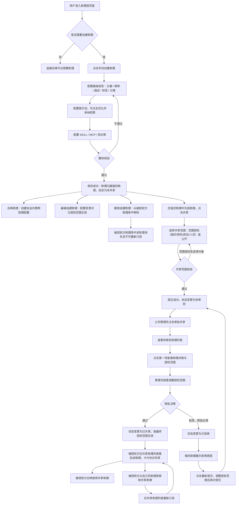

# 乐石数智助理-助理团助理创建与共享授权 需求说明书 v1.0

## 1. 文档信息与修改记录

### 1.1 文档信息

| 项目     | 内容       |
| ---------- | ------------ |
| 文档版本 | V1.2       |
| 作者     | 王巧聪     |
| 创建日期 | 2026-10-26 |
| 最后更新 | 2026-10-29 |
| 审批人   | 待确认     |
| 审批日期 | 待确认     |

### 1.2 修改记录

| 版本 | 日期       | 修改人 | 修改内容                                                                                                                                                                                                                                                                                                                                                                                                                                                                                                   |
| ------ | ------------ | -------- | ------------------------------------------------------------------------------------------------------------------------------------------------------------------------------------------------------------------------------------------------------------------------------------------------------------------------------------------------------------------------------------------------------------------------------------------------------------------------------------------------------------ |
| V1.0 | 2026-10-26 | 王巧聪 | 初始版本，输出助理团手动创建助理、召唤、共享提交、共享审批与共享状态闭环需求                                                                                                                                                                                                                                                                                                                                                                                                                               |
| V1.1 | 2026-10-26 | 王巧聪 | 按需求确认意见修订：补充助理编辑与删除、共享助理对被授权方可见并标识「共享」、被授权方移除与重新订阅；助理分类明确为可扩展字典项，本迭代内置 5 个默认分类                                                                                                                                                                                                                                                                                                                                                  |
| V1.2 | 2026-10-29 | 王巧聪 | 按调整后原型同步修订：① 管理员可对平台预置助理进行范围授权（直接生效）；② 所属分类支持管理员在创建/编辑表单中手动新增；③ 头像支持本地上传并按现有头像尺寸展示；④ 审批中心升级为独立页面，支持列表/卡片双视图与「返回列表」；⑤ 共享范围组件全链路统一为「范围授权 / 公开」双模式（创建向导共享设置、共享提交弹窗、共享范围弹窗、审批详情范围调整四处一致），已共享助理操作按钮文案调整为「共享范围」；⑥ 新增 AI 生成能力：描述、自定义标签、提示词、召唤快速问题均支持一键生成/润色，规则详见 4.1.1.0 |

## 2. 产品概述

### 2.1 背景与机会

乐石数智助理的「助理团」当前只提供平台预置的数字员工（智能会议助理、AI 陪练助理、AI 面试官、人效助理、智慧云仓助理、环安合规助理等），用户可以在卡片上点击「召唤」直接使用。该模式存在三方面限制：

- **能力覆盖不足**：预置助理面向通用场景，无法覆盖部门长尾需求（如某事业部专属的报价审核口径、某工厂专属的环安检查清单），用户缺少自助沉淀业务经验的入口。
- **个人经验无法资产化**：员工把业务方法论写在个人提示词文本、聊天记录或本地文档中，既无法在工作台内复用，也无法沉淀为可被他人召唤的助理。
- **共享缺少边界与把关**：助理一旦需要给他人使用，就涉及"谁能用"的授权问题。当前没有授权范围定义，也没有审批关口，业务侧无法对助理外流做管控；即使共享被拒绝，提交人也拿不到拒绝原因，无法闭环修改。

本次迭代在助理团页面新增「手动创建助理」能力，把"创建配置 → 召唤使用 → 共享提交 → 管理员审批 → 状态回传与重新提交"收敛成一条完整链路。

### 2.2 产品目标

| 目标编号 | 目标描述                   | 量化口径                                                                                                                       |
| ---------- | ---------------------------- | -------------------------------------------------------------------------------------------------------------------------------- |
| G-01     | 创建链路短，配置可控       | 从点击「手动创建助理」到保存成功的操作时长 ≤ 3 分钟；创建入口在助理团页面内点击 ≤ 1 次可达                                   |
| G-02     | 助理能力组成可完整配置     | 单个助理可配置的能力组成覆盖提示词、SKILL、MCP、知识库 4 类，4 类在创建面板中 100% 可达                                        |
| G-03     | 提示词质量可提升           | 提示词优化请求响应时间 ≤ 8 秒，优化失败时创建流程 100% 可继续保存                                                             |
| G-04     | 授权范围可精确到人与组织   | 单次共享授权范围支持按组织、按人员两类维度同时选择，授权范围在审批详情中 100% 可查看与调整                                     |
| G-05     | 审批闭环可追溯             | 提交后的共享申请 100% 出现在公司管理员待审批列表；拒绝原因必填率 100%；被拒绝助理 100% 具备重新提交入口                        |
| G-06     | 共享助理可被识别与自主管理 | 审批通过后被授权方在助理列表中 100% 可识别共享助理（卡片标识「共享」）；移除与重新订阅各 ≤ 2 次点击完成                       |
| G-07     | 助理资产可维护且变更可传导 | 创建人可编辑与删除自建助理；编辑后配置对已授权范围实时生效；创建人删除助理后被授权方侧 100% 不可再重新订阅                     |
| G-08     | 分类可扩展                 | 本迭代内置 5 个默认分类；分类采用字典化管理，后续新增分类无需改动前端页面结构（新增分类后创建表单与列表筛选在 1 次刷新内可用） |

### 2.3 目标用户

| 角色                       | 特征                                                                                                   | 核心诉求                                                                                                                           |
| ---------------------------- | -------------------------------------------------------------------------------------------------------- | ------------------------------------------------------------------------------------------------------------------------------------ |
| 助理创建人（业务员工，P0） | 熟悉本岗位业务，日常在助理团页面召唤助理处理会议、招聘、核算、合规等任务；不具备配置平台能力的技术背景 | 用表单化配置把个人经验做成助理；创建后立刻能召唤使用；需要共享时能按人或组织精确授权，并能看到审批进展与被拒原因                   |
| 公司管理员（P0）           | 负责本公司范围内的助理共享把关，关注授权范围是否越界                                                   | 一处集中看到全部待审批助理；审批前能看到助理完整配置与授权范围；可按需收敛或扩大授权范围；拒绝时能把原因说清楚                     |
| 被授权方（助理使用人，P0） | 因组织或人员授权而获得共享助理使用权的员工；助理列表中原有的平台预置助理已不能满足其部门场景           | 能在助理列表中一眼区分共享助理与自建助理；能像使用自建助理一样召唤共享助理；不需要的共享助理可从自己的助理库移除，需要时可重新订阅 |

### 2.4 核心价值主张

把"平台预置助理"扩展为"平台预置 + 用户自建 + 授权共享"，用一套表单让业务员工把经验做成可召唤的助理，用一套授权与审批机制让助理在可控边界内流转，用「共享」标识与订阅管理让被授权方自主管理自己的助理库，且共享结果对提交人完全透明。

### 2.5 产品范围 (In Scope)

- 助理手动创建：头像（预置字符头像或本地上传图片，按现有头像尺寸展示）、昵称、描述、自定义标签、所属分类的配置；提示词、SKILL、MCP、知识库四类能力组成的配置与保存；描述、自定义标签、提示词、召唤快速问题均支持 AI 生成/润色（规则见 4.1.1.0）。所属分类取值为字典项，本迭代内置协同办公、人资、智慧云仓、环安、经营管理 5 个默认分类；公司管理员可在创建/编辑表单的分类下拉中手动新增分类（名称去重校验，新增后全公司可用）。
- 助理团列表：全部 / 我的助理 / 共享助理三个列表范围切换、分类筛选、关键词搜索、助理卡片展示；共享助理卡片标识「共享」。
- 助理召唤：在助理卡片点击「召唤」创建会话并携带助理配置，自建助理与共享助理召唤行为一致。
- 助理编辑：创建人可修改自建助理的基础信息与四类能力组成，修改对已授权范围实时生效。
- 助理删除：创建人可删除自建助理；删除后该助理从所有被授权方的助理库中移除且不可重新订阅。
- 共享提交：在「我的助理」内勾选助理，共享范围支持「范围授权」（按组织、角色、岗位、人员四维选择）与「公开」（全公司可用）两种方式，选择后提交共享审批；创建向导中的「提交共享申请」与本弹窗使用同一套共享范围组件。
- 共享状态：在「我的助理」列表展示未共享 / 待审批 / 已共享 / 已拒绝状态，展示拒绝原因。
- 重新提交：被拒绝的助理可基于原授权范围调整后重新提交审批。
- 共享范围调整：已共享助理的创建人可通过卡片「共享范围」按钮调整范围（员工提交范围变更审批，管理员通过后生效；公司管理员调整直接生效）；平台预置助理由公司管理员通过「授权范围」入口直接配置范围并立即生效。
- 共享助理订阅管理：被授权方可将共享助理从自己的助理库移除，并在共享助理列表中重新订阅。
- 共享审批（公司管理员）：助理团页面「审批中心」独立页面入口（带待审批数量角标），支持列表 / 卡片两种视图与「返回列表」，待审批助理列表、助理详情与共享范围（可调整，支持公开 / 范围授权）、审批通过、审批拒绝（原因必填）。

### 2.6 明确的非范围 (Out of Scope)

| 序号 | 非范围内容                                   | 说明                                                                                                                  |
| ------ | ---------------------------------------------- | ----------------------------------------------------------------------------------------------------------------------- |
| 1    | 助理停用、助理复制、助理导出                 | 本迭代提供创建、编辑、删除能力，不含停用与复制                                                                        |
| 2    | 助理市场、公开广场、跨公司共享               | 本迭代共享范围限定在本公司内部                                                                                        |
| 3    | 审批历史与已处理列表、审批撤回、多级审批流转 | 审批只保留"待审批 → 已通过 / 已拒绝"单级单次决策                                                                     |
| 4    | 共享范围变更的独立管理界面与变更历史查询     | 本迭代支持创建人/管理员通过「共享范围」弹窗调整范围（员工走范围变更审批），不提供独立的授权关系管理页面与变更历史报表 |
| 5    | 分类字典的管理后台（编辑、删除、排序）       | 管理员可在创建/编辑表单内手动新增分类（含去重校验）；分类的编辑、删除、排序仍由管理后台承接                           |
| 6    | 提示词版本管理、历史对比与回滚               | 提示词优化只做"当前内容 → 优化结果"的一次性采纳                                                                      |
| 7    | SKILL、MCP、知识库自身的创建与配置           | 创建面板只做已存在资源的检索与勾选引用                                                                                |
| 8    | 助理调用效果评估、评分、使用量统计报表       | 本迭代不做效果类数据统计与展示                                                                                        |
| 9    | 移动端与小屏适配                             | 仅适配 PC 端桌面浏览器，分辨率要求见 5.3                                                                              |
| 10   | 组织架构与人员主数据的维护                   | 组织树与人员数据只读引用主数据                                                                                        |

### 2.7 依赖说明

| 依赖项                                          | 类型       | 来源方              | SLA/可用性                      | 责任人   | 交付时间  |
| ------------------------------------------------- | ------------ | --------------------- | --------------------------------- | ---------- | ----------- |
| 用户与组织架构主数据（公司 / 部门 / 人员）      | 数据依赖   | 人力资源主数据平台  | 查询接口可用性 ≥ 99.5%         | 后端开发 | v1.0 交付 |
| 公司管理员角色与权限判定                        | 系统依赖   | 统一权限中心        | 可用性 ≥ 99.5%                 | 后端开发 | v1.0 交付 |
| 提示词优化（AI 优化）服务                       | 第三方能力 | 大模型中台          | 响应时间 ≤ 8 秒，成功率 ≥ 99% | 算法开发 | v1.0 交付 |
| SKILL 配置中心（可挂载 SKILL 列表）             | 系统依赖   | 助理底座 SKILL 服务 | 可用性 ≥ 99.5%                 | 后端开发 | v1.0 交付 |
| MCP 服务注册中心（可挂载 MCP 列表）             | 系统依赖   | 助理底座 MCP 服务   | 可用性 ≥ 99.5%                 | 后端开发 | v1.0 交付 |
| 知识库服务（可选知识库列表）                    | 系统依赖   | 知识库平台          | 可用性 ≥ 99.5%                 | 后端开发 | v1.0 交付 |
| 头像文件存储与访问                              | 系统依赖   | 对象存储服务        | 可用性 ≥ 99.9%                 | 后端开发 | v1.0 交付 |
| 助理分类字典（内置 5 个默认分类，支持后台扩展） | 数据依赖   | 系统字典服务        | 可用性 ≥ 99.5%                 | 后端开发 | v1.0 交付 |
| 共享授权关系与订阅关系存储                      | 系统依赖   | 助理底座共享服务    | 可用性 ≥ 99.5%                 | 后端开发 | v1.0 交付 |

## 3. 核心流程与用户故事

### 3.1 核心业务流程

### 3.2 用户故事地图

| 史诗     | 用户故事 ID | 用户故事                                                                                                                               | 优先级 | 验收标准概要                                                                       |
| ---------- | ------------- | ---------------------------------------------------------------------------------------------------------------------------------------- | -------- | ------------------------------------------------------------------------------------ |
| 助理创建 | US-001      | 作为业务员工，我想在助理团页面手动创建自定义助理，填写头像、昵称、描述、自定义标签和所属分类，以便把我的岗位能力沉淀成一个可召唤的助理 | P0     | 创建入口可见可点；5 类基础信息可填写并校验；保存后助理出现在我的助理列表           |
| 助理创建 | US-002      | 作为业务员工，我想在创建时为助理配置提示词、SKILL、MCP 和知识库，以便助理具备完整的工作能力                                            | P0     | 4 类能力组成均可在创建面板配置；保存后配置完整回显                                 |
| 助理创建 | US-003      | 作为业务员工，我想在填写提示词时一键优化提示词，以便提示词表达更专业、更可执行                                                         | P1     | 优化结果以对比方式展示；可采纳或放弃；优化失败不影响保存                           |
| 助理召唤 | US-004      | 作为业务员工，我想在助理卡片上点击召唤，以便立即在会话中启用这个助理                                                                   | P0     | 召唤后创建会话并携带助理配置；任务列表新增记录                                     |
| 助理召唤 | US-005      | 作为业务员工，我想在助理团页面查看全部助理与我的助理，并按分类和关键词筛选，以便快速找到目标助理                                       | P0     | 全部 / 我的助理可切换；分类与搜索生效；卡片信息完整                                |
| 共享授权 | US-006      | 作为助理创建人，我想勾选助理并按组织或人员选择授权范围后提交共享，以便把助理开放给指定范围的人使用                                     | P0     | 可勾选多个未共享助理；组织与人员可同时选择；提交后状态变更为待审批                 |
| 共享授权 | US-007      | 作为助理创建人，我想在"我的助理"里看到每个助理的共享审批状态和被拒原因，以便知道共享进展                                               | P0     | 4 种状态可见；被拒绝时展示拒绝原因                                                 |
| 共享授权 | US-008      | 作为助理创建人，我想在被拒绝后调整授权范围并重新提交，以便修正问题后再次申请                                                           | P0     | 重新提交回显上次授权范围；提交后状态回到待审批                                     |
| 共享审批 | US-009      | 作为公司管理员，我想在助理团看到"审批共享"入口并查看待审批助理列表，以便集中处理共享申请                                               | P0     | 管理员可见按钮并带待审批数量；列表按提交时间排序                                   |
| 共享审批 | US-010      | 作为公司管理员，我想查看待审批助理的详情与授权范围，并可修改授权范围，以便判断共享是否越界                                             | P0     | 助理配置只读可见；授权范围可增删；授权范围不可清空为空                             |
| 共享审批 | US-011      | 作为公司管理员，我想审批通过或拒绝共享申请，拒绝时必须填写原因，以便把控共享边界并把结论回传给提交人                                   | P0     | 通过后状态为已共享；拒绝未填原因不可提交；原因在提交人侧可见                       |
| 助理维护 | US-012      | 作为助理创建人，我想编辑自己创建的助理（含基础信息与四类能力组成），以便在业务口径变化时持续优化助理                                   | P0     | 编辑面板回显原配置；保存后对所有使用方生效；已共享助理编辑不影响共享状态           |
| 助理维护 | US-013      | 作为助理创建人，我想删除自己创建的助理，以便清理不再使用的助理                                                                         | P0     | 删除前二次确认；删除后从我的助理与他人共享列表中同时消失；存在待审批申请时一并终止 |
| 共享使用 | US-014      | 作为被授权方，我想在助理列表的「共享助理」范围看到被授权给我的助理，并识别出哪些是共享的，以便与自建助理区分                           | P0     | 共享助理范围可见被授权助理；卡片标识「共享」并展示共享来源创建人                   |
| 共享使用 | US-015      | 作为被授权方，我想把不需要的共享助理从自己的助理库移除，以便保持助理库整洁                                                             | P1     | 移除后从共享助理范围消失；不删除助理本身与他人授权                                 |
| 共享使用 | US-016      | 作为被授权方，我想在共享助理列表中重新订阅已移除的助理，以便需要时快速恢复使用                                                         | P1     | 可重新订阅的助理可见且可一键订阅；订阅后回到已订阅状态                             |

### 3.3 功能模块与功能点划分

| 模块       | 模块英文名称 | 功能点 ID | 功能点名称                   | 功能类型 | 关联用户故事           | 简要说明                                                                                             |
| ------------ | -------------- | ----------- | ------------------------------ | ---------- | ------------------------ | ------------------------------------------------------------------------------------------------------ |
| 助理管理   | assistant    | F-EXP-001 | 助理手动创建                 | 新增     | US-001、US-002、US-003 | 通过抽屉式表单配置基础信息与提示词、SKILL、MCP、知识库四类能力组成并保存，保存后归属创建人           |
| 助理管理   | assistant    | F-EXP-002 | 助理团助理列表查询           | 查询     | US-005、US-014         | 展示全部、我的助理、共享助理三个范围，支持分类筛选与关键词搜索，卡片展示助理信息、共享标识与召唤入口 |
| 助理管理   | assistant    | F-EXP-003 | 助理召唤                     | 新增     | US-004、US-014         | 在助理卡片点击召唤后创建会话，并在会话中携带该助理的配置                                             |
| 助理管理   | assistant    | F-EXP-004 | 助理编辑                     | 编辑     | US-012                 | 创建人修改自建助理的基础信息与四类能力组成，变更对已授权范围实时生效                                 |
| 助理管理   | assistant    | F-EXP-005 | 助理删除                     | 删除     | US-013                 | 创建人删除自建助理，同步移除全部授权与被授权方助理库中的记录                                         |
| 助理库管理 | library      | F-LIB-001 | 共享助理移除                 | 删除     | US-015                 | 被授权方将共享助理从自己的助理库移除，不影响助理本身与授权关系                                       |
| 助理库管理 | library      | F-LIB-002 | 共享助理重新订阅             | 新增     | US-016                 | 被授权方对已移除且授权仍有效的共享助理重新订阅                                                       |
| 共享授权   | share        | F-SHR-001 | 助理共享提交                 | 新增     | US-006                 | 勾选未共享助理，按组织、人员选择授权范围后提交共享审批                                               |
| 共享授权   | share        | F-SHR-002 | 我的助理共享状态查询         | 查询     | US-007                 | 在我的助理列表展示共享状态标签、拒绝原因与状态筛选，并提供共享操作入口                               |
| 共享授权   | share        | F-SHR-003 | 共享审批重新提交             | 编辑     | US-008                 | 对被拒绝的助理回显原授权范围，调整后重新提交共享审批                                                 |
| 共享审批   | approval     | F-APR-001 | 待审批助理列表查询           | 查询     | US-009                 | 公司管理员通过"审批共享"入口查看本公司待审批助理列表                                                 |
| 共享审批   | approval     | F-APR-002 | 待审批助理详情与授权范围调整 | 编辑     | US-010                 | 查看助理配置详情与授权范围，并对授权范围做增删调整                                                   |
| 共享审批   | approval     | F-APR-003 | 共享审批决策                 | 审批     | US-011                 | 对共享申请执行通过或拒绝，拒绝时必须填写原因                                                         |

## 4. 功能需求详述

### 本章功能点索引

| 功能点 ID | 功能点名称                   | 快速跳转 |
| ----------- | ------------------------------ | ---------- |
| F-EXP-001 | 助理手动创建                 | 4.1.1    |
| F-EXP-002 | 助理团助理列表查询           | 4.1.2    |
| F-EXP-003 | 助理召唤                     | 4.1.3    |
| F-EXP-004 | 助理编辑                     | 4.1.4    |
| F-EXP-005 | 助理删除                     | 4.1.5    |
| F-LIB-001 | 共享助理移除                 | 4.2.1    |
| F-LIB-002 | 共享助理重新订阅             | 4.2.2    |
| F-SHR-001 | 助理共享提交                 | 4.3.1    |
| F-SHR-002 | 我的助理共享状态查询         | 4.3.2    |
| F-SHR-003 | 共享审批重新提交             | 4.3.3    |
| F-APR-001 | 待审批助理列表查询           | 4.4.1    |
| F-APR-002 | 待审批助理详情与授权范围调整 | 4.4.2    |
| F-APR-003 | 共享审批决策                 | 4.4.3    |

### 4.0 全局通用规则

**术语统一**

- 「助理」等同于页面上的「数字员工」，指可在助理团被召唤的 AI 角色。
- 「召唤」指在助理卡片点击召唤按钮后创建一条会话，并在该会话中加载该助理的配置。
- 「我的助理」指当前登录用户手动创建的助理集合，创建人固定为当前用户。
- 「共享助理」指经共享审批通过后被授权给当前用户的助理，其配置归创建人所有，被授权方只读，卡片标识「共享」。
- 「被授权方」指授权范围内命中某共享助理的组织节点下的员工或直接授权的具体人员。
- 「移除 / 重新订阅」是被授权方对共享助理的订阅关系操作：移除后从自己的助理库隐藏，重新订阅后恢复可见与可召唤。

**共享状态与文案统一**

| 状态值   | 状态文案 | 颜色规范 | 可执行操作         |
| ---------- | ---------- | ---------- | -------------------- |
| unshared | 未共享   | 中性灰   | 共享               |
| pending  | 待审批   | 警示橙   | 无（不可重复提交） |
| approved | 已共享   | 成功绿   | 无                 |
| rejected | 已拒绝   | 失败红   | 重新提交           |

**共享标识与订阅状态**

- 「共享」标识仅出现在被授权方视角的共享助理卡片上，用于区分助理来源，与创建人视角的共享审批状态角标互不替代。同一张卡片若同时为共享来源，仅展示「共享」标识，不展示审批状态角标。
- 订阅状态描述被授权方与共享助理的关系：

| 状态值     | 状态文案 | 可见性                                     | 可执行操作         |
| ------------ | ---------- | -------------------------------------------- | -------------------- |
| subscribed | 已订阅   | 在「共享助理」范围与「全部」范围可见       | 召唤、从助理库移除 |
| removed    | 已移除   | 仅在被授权方主动切换到「已移除」筛选时可见 | 重新订阅           |

- 助理来源类型统一取值：platform（平台预置）、custom（我的助理自建）、shared（被授权共享），卡片角标分别展示「敬请期待」、「共享状态角标」、「共享」。

**交互统一规则**

- 所有提交类按钮（保存、提交、审批通过、审批拒绝）点击后进入 loading 状态并禁止重复点击，请求结束后恢复。
- 抽屉或弹窗内已有填写内容时，点击取消、关闭图标、遮罩层均需二次确认，文案统一为「退出后已填内容不会保存，是否确认退出？」。
- 列表统一提供加载中、空态、加载失败三种状态；加载失败时展示「加载失败，点击重试」并提供重试入口。
- 表单校验采用「即时校验 + 保存时整体校验」双层校验：输入框失焦即时提示，保存时命中第一个错误项并自动定位与滚动到该字段。
- 成功操作统一使用轻提示（Toast），失败提示使用弹窗或行内错误提示，不使用仅颜色变化表达成功与失败。

**共享范围组件统一规则**

- 共享范围组件由「范围授权 / 公开」两种方式组成，单选切换，默认「范围授权」，在全链路四处场景使用同一套组件与交互：① 创建向导「提交共享申请」的共享范围设置；② 「我的助理」勾选后的共享提交弹窗（含被拒后重新提交）；③ 已共享助理卡片「共享范围」弹窗 / 平台预置助理「授权范围」弹窗；④ 审批详情中的「调整授权范围」编辑器。
- 「范围授权」：按组织、角色、岗位、人员四个维度批量选择（页签穿梭框），来源维度（组织/角色/岗位）会把人员展开带进「按人员」页签，最终生效颗粒是人员，可在人员页签继续增删；来源维度去重，同一人员被多个维度覆盖时只展示一次并标注全部来源。
- 「公开」：全公司可用，无需选择范围，隐藏范围选择区；授权人数按全公司人数计算。
- 已选对象实时展示授权范围预览（chips 形式，公开时展示「公开 · 全公司可用」），支持单个移除与一键清空；范围为空时展示空态提示。
- 单次范围上限：组织节点 ≤ 50 个、角色/岗位各 ≤ 50 项、人员 ≤ 200 人，超出时提示「授权范围超出上限，请减少选择」并阻止提交。
- 「范围授权」方式下范围不得为空：至少选择 1 项，否则提交/保存类按钮置灰；「公开」方式下无此限制。
- 保存或提交后，范围（含公开标记）作为快照写入审批单或助理记录。

**异常统一处理**

- 接口失败统一提示失败原因；无明确原因的提示「操作失败，请稍后重试」，并保留用户已填写内容。
- 登录态失效（会话过期）时跳转登录页，登录成功后回到助理团页面。
- 无操作权限时提示「暂无操作权限」，并隐藏对应操作入口。
- 数据已被他人变更（如审批单被其他管理员处理）时，提示最新状态并刷新当前列表。

### 4.1 助理管理 (assistant)

#### F-EXP-001 助理手动创建

- **功能 ID**：F-EXP-001
- **关联用户故事**：US-001、US-002、US-003
- **功能描述**：允许用户在助理团页面通过抽屉式表单创建一个自定义助理，配置头像、昵称、描述、自定义标签、所属分类等基础信息，并完成提示词、SKILL、MCP、知识库四类能力组成的配置，保存后助理所有权归属创建人并进入「我的助理」。
- **前置条件**：用户已登录并处于助理团页面；用户具备助理创建权限；网络连接正常。
- **后置条件**：系统创建一条助理记录，创建人为当前登录用户，共享状态为 unshared；助理同时出现在助理团「全部」与「我的助理」列表首位；→ 触发 [share] F-SHR-002 展示共享状态。
- **主要流程**：
  1. 用户在助理团页面点击「手动创建助理」按钮
  2. 系统打开创建助理抽屉，默认展示「基础信息」页签
  3. 用户配置头像、昵称、描述、自定义标签、所属分类
  4. 用户在「提示词」「SKILL」「MCP」「知识库」页签之间切换，按 4.1.1 各子流程完成能力组成配置
  5. 用户点击「保存」
  6. 系统执行整体校验，校验通过后创建助理、关闭抽屉、在列表首位插入助理卡片并提示「创建成功」
- **异常与分支流程**：
  - 昵称在同一公司内已存在 → 拒绝保存，昵称输入框下方提示「助理昵称已存在，请修改」
  - 必填项（昵称、描述、所属分类、提示词）存在未填写 → 阻止保存，自动定位到第一个未填写项并提示「请完善必填信息」
  - 用户在有已填内容时点击取消或关闭抽屉 → 弹出二次确认，确认退出后不保存任何内容
  - 保存请求失败（含网络异常、服务异常） → 保留全部已填内容，提示「保存失败，请稍后重试」
  - 头像上传失败 → 保留其他内容，头像区域提示「头像上传失败，请重新上传」
  - 当前登录用户不具备创建权限 → 助理团页面不展示「手动创建助理」入口
  - 已选 SKILL、MCP 或知识库在保存时已被下线或删除 → 提示对应资源「已不可用，请重新选择」并阻止保存
- **业务规则**：
  - 助理创建人固定为当前登录用户，不允许在表单中修改
  - 助理昵称在同一公司范围内唯一
  - 提示词为唯一必填的能力组成项；SKILL、MCP、知识库为选填，可多选，均未选择时不影响保存
  - 各页签独立校验：切换页签时对当前页签已填内容做即时校验并给出错误提示，但不阻断切换
  - 保存成功后共享状态初始化为 unshared，不允许在创建时直接填写授权范围
  - 一个助理最多挂载 20 个 SKILL、20 个 MCP 服务、10 个知识库
  - → 引用 [share] F-SHR-001 共享提交时只允许选择 unshared 或 rejected 状态的助理
- **子流程分组**：
  - **AI 生成能力（描述 / 标签 / 提示词 / 快速问题）**：见 4.1.1.0
  - **提示词配置**：见 4.1.1.1
  - **SKILL 配置**：见 4.1.1.2
  - **MCP 配置**：见 4.1.1.3
  - **知识库配置**：见 4.1.1.4
- **页面交互说明**：
  - 入口：助理团页面标题区右侧「手动创建助理」主按钮，与「审批共享」按钮并排（后者仅公司管理员可见）
  - 容器：右侧抽屉，宽度 720px，顶部为抽屉标题「手动创建助理」，下方为 5 个页签（基础信息 / 提示词 / SKILL / MCP / 知识库），页签名称后展示已配置数量角标（基础信息页签展示完成状态勾）
  - 底部操作区固定：左侧「取消」，右侧「保存」；保存按钮在必填项未完成时保持可点击（点击后触发定位提示），保存中置为 loading
  - 头像区域：提供系统预置字符头像点选与「上传」位；点击上传位选择本地图片（仅 image/*，单文件 ≤ 2MB，超限提示「图片不能超过 2MB」），上传后转为 dataURL 实时预览并高亮选中态；上传图片在列表卡片、详情、共享范围 chip、审批列表/详情等所有头像位按现有头像尺寸（36/40/52px）裁剪展示，圆角与现有一致
  - 昵称输入框右侧实时展示「已输入字数 / 20」
  - 所属分类为下拉选择；公司管理员视角下拉末尾固定展示「＋ 新增分类」选项，选中后弹出新增加分类弹窗（输入分类名称，≤ 10 字符，空值与重复分类拦截；确认后写入分类字典、下拉自动选中新分类、列表分类筛选页签同步出现；取消则恢复选择前的分类）；普通员工不展示该入口
  - 自定义标签为标签输入控件：输入后回车生成标签，标签右侧带删除图标，达到 5 个后输入框置灰并提示「最多添加 5 个标签」；标签行右侧提供「AI 生成」按钮（规则见 4.1.1.0）
  - 描述与标签的 AI 生成按钮位于对应字段标签行右侧，提示词与快速问题的 AI 生成按钮位于能力配置页签内，均为「✨AI 生成」样式（规则见 4.1.1.0）
  - 页签切换不丢失已填内容；保存失败后重新打开抽屉仍保留上次内容，便于重试
- **页面字段说明**：

| 字段       | 字段英文名称 | 类型                           | 必填 | 说明                                                                                       |
| ------------ | -------------- | -------------------------------- | ------ | -------------------------------------------------------------------------------------------- |
| 头像       | avatar       | 图片选择（预置头像或本地上传） | 否   | 支持 image/*，单文件 ≤ 2MB；上传图片按现有头像尺寸体系展示；未选择时使用系统默认头像      |
| 昵称       | nickname     | 文本输入框                     | 是   | 2-20 字符，同一公司内唯一                                                                  |
| 描述       | description  | 多行文本输入框                 | 是   | 10-200 字符，列表卡片截断展示前 60 字符；支持 AI 生成/润色（见 4.1.1.0）                   |
| 自定义标签 | tags         | 标签输入（多值）               | 否   | 最多 5 个，单个标签 1-8 字符；支持 AI 生成/润色（见 4.1.1.0）                              |
| 所属分类   | category     | 下拉选择                       | 是   | 取值为分类字典项；公司管理员可在下拉中选择「＋ 新增分类」手动添加（名称 ≤ 10 字符、去重） |
| 创建人     | creatorName  | 展示                           | -    | 自动回填当前登录用户姓名，不可编辑                                                         |
| 创建时间   | createTime   | 展示                           | -    | 保存成功后由系统生成                                                                       |

- **EARS格式需求列表**：

| 需求ID             | 需求描述                                                                                               | EARS模式 |
| -------------------- | -------------------------------------------------------------------------------------------------------- | ---------- |
| REQ-EXP-CREATE-001 | 当用户在助理团页面点击「手动创建助理」时，系统应当打开创建助理抽屉并默认展示基础信息页签               | 事件驱动 |
| REQ-EXP-CREATE-002 | 当用户切换创建面板页签时，系统应当保留各页签已填写的内容                                               | 事件驱动 |
| REQ-EXP-CREATE-003 | 当用户点击「保存」时，系统应当对基础信息与提示词、SKILL、MCP、知识库各页签执行整体校验                 | 事件驱动 |
| REQ-EXP-CREATE-004 | 当整体校验通过时，系统应当创建助理记录并将创建人设置为当前登录用户                                     | 事件驱动 |
| REQ-EXP-CREATE-005 | 当助理创建成功时，系统应当将共享状态初始化为未共享并将助理插入我的助理列表首位                         | 事件驱动 |
| REQ-EXP-CREATE-006 | 当用户输入的昵称在同一公司内已存在时，系统应当拒绝保存并在昵称输入框下方提示「助理昵称已存在，请修改」 | 条件异常 |
| REQ-EXP-CREATE-007 | 当必填项存在未填写时，系统应当阻止保存并自动定位到第一个未填写项给出提示                               | 条件异常 |
| REQ-EXP-CREATE-008 | 当用户在有已填内容时关闭创建抽屉时，系统应当弹出二次确认，并在确认退出后不保存任何内容                 | 条件异常 |
| REQ-EXP-CREATE-009 | 当保存请求失败时，系统应当保留全部已填内容并提示「保存失败，请稍后重试」                               | 条件异常 |
| REQ-EXP-CREATE-010 | 当当前登录用户不具备助理创建权限时，系统应当隐藏「手动创建助理」入口                                   | 状态驱动 |
| REQ-EXP-CREATE-011 | 系统应当将助理创建人固定为当前登录用户且不允许修改                                                     | 通用需求 |
| REQ-EXP-CREATE-012 | 系统应当保证助理昵称在同一公司范围内唯一                                                               | 通用需求 |
| REQ-EXP-CREATE-013 | 系统应当将单个助理可挂载的 SKILL 上限限制为 20 个、MCP 服务上限限制为 20 个、知识库上限限制为 10 个    | 通用需求 |

##### 4.1.1.0 AI 生成能力（描述 / 自定义标签 / 提示词 / 召唤快速问题）

- **功能描述**：创建/编辑助理抽屉中的描述、自定义标签、提示词、召唤快速问题四个字段均提供「✨AI 生成」按钮，AI 生成区分「字段为空」与「字段已有内容」两种模式：为空时根据关联字段联动生成草稿，已有内容时在现有内容基础上润色补充，避免覆盖用户已有表达意图。
- **前置条件**：用户已打开创建/编辑助理抽屉；AI 生成服务可用。
- **主要流程（分字段规则）**：

| 字段         | 为空时（生成模式）                                                   | 已有内容时（润色模式）                                                  | 关联输入                           |
| -------------- | ---------------------------------------------------------------------- | ------------------------------------------------------------------------- | ------------------------------------ |
| 助理描述     | 根据助理名称 + 所属分类联动生成 10-200 字描述草稿，写入描述输入框    | 在现有描述内容基础上润色补充生成，保持原意图并优化表达                  | 名称、分类、已有描述               |
| 自定义标签   | 根据助理名称+所属分类、描述自动生成 5 个标签（单个 ≤ 8 字符，去重） | 根据已有标签内容润色生成，在已有标签基础上补充优化至 5 个               | 名称、分类、描述、已有标签         |
| 提示词       | 根据助理名称、描述、分类、标签润色补充生成提示词草稿                 | 根据提示词现有内容，结合助理名称、描述润色补充生成                      | 名称、描述、分类、标签、已有提示词 |
| 召唤快速问题 | 根据助理名称、描述生成快速问题建议（去重合并，上限 6 条）            | 在已有快速问题基础上结合名称、描述润色补充生成，去重后合并（上限 6 条） | 名称、描述、已有快速问题           |

- **通用交互规则**：
  - 各 AI 生成按钮位于对应字段标签行右侧（描述、标签）或能力配置区标题行右侧（提示词、快速问题），样式统一为「✨AI 生成」
  - 点击后生成结果直接写入对应输入框/标签区，用户可继续手动编辑；再次点击按当前最新内容重新生成
  - 生成成功统一 Toast 提示「已生成草稿/建议，可继续编辑」；无可新增内容时（如标签已满 5 个、快速问题已满 6 条）提示对应上限文案
  - 生成内容遵循各字段既有校验规则（描述 10-200 字符、单个标签 ≤ 8 字符且总数 ≤ 5、提示词 ≤ 4000 字符、快速问题 ≤ 6 条）
- **异常与分支流程**：
  - AI 生成请求失败 → 提示「AI 生成失败，请稍后重试」，保留输入框原内容不变
  - 生成请求进行中 → 按钮呈 loading 状态，禁止重复点击
  - 名称、描述等关联字段均为空时 → 使用默认兜底输入生成（如名称兜底为「业务助理」），不阻断生成
- **EARS格式需求列表**：

| 需求ID         | 需求描述                                                                                                           | EARS模式 |
| ---------------- | -------------------------------------------------------------------------------------------------------------------- | ---------- |
| REQ-EXP-AI-001 | 当描述为空且用户点击描述的「AI 生成」时，系统应当根据助理名称与所属分类联动生成描述草稿并写入描述输入框            | 事件驱动 |
| REQ-EXP-AI-002 | 当描述已有内容且用户点击描述的「AI 生成」时，系统应当基于现有描述内容润色补充生成新描述                            | 事件驱动 |
| REQ-EXP-AI-003 | 当自定义标签为空且用户点击标签的「AI 生成」时，系统应当根据助理名称与描述自动生成 5 个标签                         | 事件驱动 |
| REQ-EXP-AI-004 | 当自定义标签已有内容且用户点击标签的「AI 生成」时，系统应当根据已有标签内容润色生成，补充至多 5 个且与已有标签去重 | 事件驱动 |
| REQ-EXP-AI-005 | 当提示词为空且用户点击提示词的「AI 生成」时，系统应当根据助理名称、描述、分类、标签润色补充生成提示词草稿          | 事件驱动 |
| REQ-EXP-AI-006 | 当提示词已有内容且用户点击提示词的「AI 生成」时，系统应当根据提示词现有内容结合助理名称、描述润色补充生成          | 事件驱动 |
| REQ-EXP-AI-007 | 当召唤快速问题为空且用户点击其「AI 生成」时，系统应当根据助理名称、描述生成快速问题建议                            | 事件驱动 |
| REQ-EXP-AI-008 | 当召唤快速问题已有内容且用户点击其「AI 生成」时，系统应当在已有问题基础上润色补充，去重合并且不超过 6 条           | 事件驱动 |
| REQ-EXP-AI-009 | 当 AI 生成成功时，系统应当将结果写入对应输入框并提示用户可继续编辑，再次点击时以最新内容重新生成                   | 事件驱动 |
| REQ-EXP-AI-010 | 当 AI 生成请求失败时，系统应当保留原内容并提示「AI 生成失败，请稍后重试」                                          | 条件异常 |
| REQ-EXP-AI-011 | 当 AI 生成请求进行中时，系统应当将按钮置为 loading 状态并禁止重复点击                                              | 状态驱动 |
| REQ-EXP-AI-012 | 系统应当保证 AI 生成内容满足对应字段的长度与数量校验规则                                                           | 通用需求 |

##### 4.1.1.1 提示词配置

- **主要流程**：
  1. 用户切换到「能力配置」区域
  2. 用户在提示词编辑框中输入该助理的角色设定与工作规则，或点击「AI 生成」按钮生成/润色提示词草稿（规则见 4.1.1.0）
  3. 用户可继续手动编辑提示词，右下角实时展示字数
- **异常与分支流程**：
  - AI 生成请求失败 → 提示「AI 生成失败，请稍后重试」，保留原提示词内容
  - 提示词为空保存 → 阻止保存并定位到提示词输入框，提示「请填写提示词」
- **业务规则**：
  - 提示词为必填项，长度 ≤ 4000 字符
  - AI 生成结果直接写入编辑框，可继续编辑；再次点击以当前内容为输入重新生成（为空时生成 / 有内容时润色，见 4.1.1.0）
  - AI 生成失败不阻断保存，用户可手动填写后保存
- **页面字段说明**：

| 字段        | 字段英文名称 | 类型           | 必填 | 说明                                              |
| ------------- | -------------- | ---------------- | ------ | --------------------------------------------------- |
| 提示词      | prompt       | 多行文本输入框 | 是   | ≤ 4000 字符，右上角展示实时字数与「AI 生成」按钮 |
| AI 生成按钮 | btnAiPrompt  | 按钮           | -    | 生成/润色规则见 4.1.1.0                           |

- **EARS格式需求列表**：

| 需求ID             | 需求描述                                                                        | EARS模式 |
| -------------------- | --------------------------------------------------------------------------------- | ---------- |
| REQ-EXP-CREATE-014 | 当用户切换到能力配置区域时，系统应当展示提示词编辑框、实时字数与「AI 生成」按钮 | 事件驱动 |
| REQ-EXP-CREATE-015 | 当用户点击「AI 生成」时，系统应当按 4.1.1.0 规则生成或润色提示词并写入编辑框    | 事件驱动 |
| REQ-EXP-CREATE-016 | 当提示词为空保存时，系统应当阻止保存并定位到提示词输入框提示「请填写提示词」    | 条件异常 |
| REQ-EXP-CREATE-017 | 当 AI 生成失败时，系统应当保留原提示词并允许用户手动填写后保存                  | 条件异常 |
| REQ-EXP-CREATE-018 | 系统应当将提示词长度限制为 4000 字符以内并实时展示字数                          | 通用需求 |

##### 4.1.1.2 SKILL 配置

- **主要流程**：
  1. 用户切换到「SKILL」页签
  2. 系统加载可挂载的 SKILL 列表，展示 SKILL 名称与简介
  3. 用户在搜索框输入关键词检索目标 SKILL
  4. 用户勾选需要的 SKILL，页签角标实时更新已选数量
  5. 用户取消勾选已选 SKILL，已选数量同步减少
- **异常与分支流程**：
  - SKILL 列表加载失败 → 展示「加载失败，点击重试」，点击后重新加载
  - 搜索无匹配结果 → 展示「未找到匹配的 SKILL」空态
  - 已选数量达到 20 个后再勾选 → 提示「最多挂载 20 个 SKILL」，本次勾选不生效
  - 已选 SKILL 在保存时已被下线 → 阻止保存并提示「所选 SKILL 已不可用，请重新选择」
- **业务规则**：
  - SKILL 为选填项，支持多选与取消选择
  - 每个助理最多挂载 20 个 SKILL
  - 已勾选 SKILL 在切换页签后保持勾选状态
- **页面字段说明**：

| 字段             | 字段英文名称  | 类型       | 必填 | 说明                       |
| ------------------ | --------------- | ------------ | ------ | ---------------------------- |
| SKILL 搜索关键词 | skillKeyword  | 文本输入框 | 否   | 支持按 SKILL 名称模糊搜索  |
| SKILL 名称       | skillName     | 展示       | -    | 展示于列表项左侧           |
| SKILL 简介       | skillDesc     | 展示       | -    | 单行截断展示               |
| 选择状态         | skillSelected | 复选框     | 否   | 勾选即挂载，取消勾选即移除 |

- **EARS格式需求列表**：

| 需求ID             | 需求描述                                                                                   | EARS模式 |
| -------------------- | -------------------------------------------------------------------------------------------- | ---------- |
| REQ-EXP-CREATE-023 | 当用户切换到 SKILL 页签时，系统应当加载并展示可挂载的 SKILL 列表                           | 事件驱动 |
| REQ-EXP-CREATE-024 | 当用户勾选或取消勾选 SKILL 时，系统应当实时更新页签上的已选数量                            | 事件驱动 |
| REQ-EXP-CREATE-025 | 当用户在 SKILL 搜索框输入关键词时，系统应当按 SKILL 名称模糊过滤列表                       | 事件驱动 |
| REQ-EXP-CREATE-026 | 当 SKILL 列表加载失败时，系统应当展示「加载失败，点击重试」并提供重试入口                  | 条件异常 |
| REQ-EXP-CREATE-027 | 当搜索关键词无匹配 SKILL 时，系统应当展示「未找到匹配的 SKILL」空态                        | 条件异常 |
| REQ-EXP-CREATE-028 | 当已选 SKILL 数量达到 20 个时，系统应当提示「最多挂载 20 个 SKILL」并拒绝本次勾选          | 条件异常 |
| REQ-EXP-CREATE-029 | 当所选 SKILL 在保存时已不可用时，系统应当提示「所选 SKILL 已不可用，请重新选择」并阻止保存 | 条件异常 |

##### 4.1.1.3 MCP 配置

- **主要流程**：
  1. 用户切换到「MCP」页签
  2. 系统加载可挂载的 MCP 服务列表，展示服务名称与服务类型
  3. 用户在搜索框输入关键词检索目标 MCP 服务
  4. 用户勾选需要的 MCP 服务，页签角标实时更新已选数量
  5. 用户取消勾选已选 MCP 服务，已选数量同步减少
- **异常与分支流程**：
  - MCP 列表加载失败 → 展示「加载失败，点击重试」，点击后重新加载
  - 搜索无匹配结果 → 展示「未找到匹配的 MCP 服务」空态
  - 已选数量达到 20 个后再勾选 → 提示「最多挂载 20 个 MCP 服务」，本次勾选不生效
  - 已选 MCP 服务在保存时已被下线 → 阻止保存并提示「所选 MCP 服务已不可用，请重新选择」
- **业务规则**：
  - MCP 服务为选填项，支持多选与取消选择
  - 每个助理最多挂载 20 个 MCP 服务
  - 已勾选 MCP 服务在切换页签后保持勾选状态
- **页面字段说明**：

| 字段           | 字段英文名称 | 类型       | 必填 | 说明                       |
| ---------------- | -------------- | ------------ | ------ | ---------------------------- |
| MCP 搜索关键词 | mcpKeyword   | 文本输入框 | 否   | 支持按服务名称模糊搜索     |
| 服务名称       | mcpName      | 展示       | -    | 展示于列表项左侧           |
| 服务类型       | mcpType      | 展示       | -    | 展示于服务名称右侧标签     |
| 选择状态       | mcpSelected  | 复选框     | 否   | 勾选即挂载，取消勾选即移除 |

- **EARS格式需求列表**：

| 需求ID             | 需求描述                                                                                       | EARS模式 |
| -------------------- | ------------------------------------------------------------------------------------------------ | ---------- |
| REQ-EXP-CREATE-030 | 当用户切换到 MCP 页签时，系统应当加载并展示可挂载的 MCP 服务列表                               | 事件驱动 |
| REQ-EXP-CREATE-031 | 当用户勾选或取消勾选 MCP 服务时，系统应当实时更新页签上的已选数量                              | 事件驱动 |
| REQ-EXP-CREATE-032 | 当用户在 MCP 搜索框输入关键词时，系统应当按服务名称模糊过滤列表                                | 事件驱动 |
| REQ-EXP-CREATE-033 | 当 MCP 服务列表加载失败时，系统应当展示「加载失败，点击重试」并提供重试入口                    | 条件异常 |
| REQ-EXP-CREATE-034 | 当搜索关键词无匹配 MCP 服务时，系统应当展示「未找到匹配的 MCP 服务」空态                       | 条件异常 |
| REQ-EXP-CREATE-035 | 当已选 MCP 服务数量达到 20 个时，系统应当提示「最多挂载 20 个 MCP 服务」并拒绝本次勾选         | 条件异常 |
| REQ-EXP-CREATE-036 | 当所选 MCP 服务在保存时已不可用时，系统应当提示「所选 MCP 服务已不可用，请重新选择」并阻止保存 | 条件异常 |

##### 4.1.1.4 知识库配置

- **主要流程**：
  1. 用户切换到「知识库」页签
  2. 系统加载当前用户可访问的知识库列表，展示知识库名称与文档数量
  3. 用户在搜索框输入关键词检索目标知识库
  4. 用户勾选需要关联的知识库，页签角标实时更新已选数量
  5. 用户取消勾选已选知识库，已选数量同步减少
- **异常与分支流程**：
  - 知识库列表加载失败 → 展示「加载失败，点击重试」，点击后重新加载
  - 当前用户无任何可访问知识库 → 展示「暂无可关联的知识库」空态
  - 搜索无匹配结果 → 展示「未找到匹配的知识库」空态
  - 已选数量达到 10 个后再勾选 → 提示「最多关联 10 个知识库」，本次勾选不生效
  - 已选知识库在保存时已删除或无权限 → 阻止保存并提示「所选知识库已不可用，请重新选择」
- **业务规则**：
  - 知识库为选填项，支持多选与取消选择
  - 每个助理最多关联 10 个知识库
  - 只能关联当前用户具备访问权限的知识库
- **页面字段说明**：

| 字段             | 字段英文名称  | 类型       | 必填 | 说明                       |
| ------------------ | --------------- | ------------ | ------ | ---------------------------- |
| 知识库搜索关键词 | kbKeyword     | 文本输入框 | 否   | 支持按知识库名称模糊搜索   |
| 知识库名称       | kbName        | 展示       | -    | 展示于列表项左侧           |
| 文档数量         | documentCount | 展示       | -    | 展示于知识库名称右侧       |
| 选择状态         | kbSelected    | 复选框     | 否   | 勾选即关联，取消勾选即移除 |

- **EARS格式需求列表**：

| 需求ID             | 需求描述                                                                                               | EARS模式 |
| -------------------- | -------------------------------------------------------------------------------------------------------- | ---------- |
| REQ-EXP-CREATE-037 | 当用户切换到知识库页签时，系统应当加载并展示当前用户可访问的知识库列表                                 | 事件驱动 |
| REQ-EXP-CREATE-038 | 当用户勾选或取消勾选知识库时，系统应当实时更新页签上的已选数量                                         | 事件驱动 |
| REQ-EXP-CREATE-039 | 当用户在知识库搜索框输入关键词时，系统应当按知识库名称模糊过滤列表                                     | 事件驱动 |
| REQ-EXP-CREATE-040 | 当知识库列表加载失败时，系统应当展示「加载失败，点击重试」并提供重试入口                               | 条件异常 |
| REQ-EXP-CREATE-041 | 当当前用户无任何可访问知识库时，系统应当展示「暂无可关联的知识库」空态                                 | 条件异常 |
| REQ-EXP-CREATE-042 | 当已选知识库数量达到 10 个时，系统应当提示「最多关联 10 个知识库」并拒绝本次勾选                       | 条件异常 |
| REQ-EXP-CREATE-043 | 当所选知识库在保存时已删除或当前用户无权限时，系统应当提示「所选知识库已不可用，请重新选择」并阻止保存 | 条件异常 |
| REQ-EXP-CREATE-044 | 系统应当只允许用户关联其具备访问权限的知识库                                                           | 通用需求 |

#### F-EXP-002 助理团助理列表查询

- **功能 ID**：F-EXP-002
- **关联用户故事**：US-005
- **功能描述**：在助理团页面以卡片列表展示当前用户可见的助理，支持「全部」「我的助理」「共享助理」三个范围切换、分类页签筛选与关键词搜索，卡片承载头像、昵称、来源标识、标签、描述摘要与召唤入口。
- **前置条件**：用户已登录并进入助理团页面。
- **后置条件**：无数据变更；用户在卡片上点击「召唤」时 → 触发 [assistant] F-EXP-003。
- **主要流程**：
  1. 用户进入助理团页面，系统默认展示「全部」范围下全部可见助理卡片
  2. 系统在页面顶部展示分类页签（全部 / 协同办公 / 人资 / 智慧云仓 / 环安 / 经营管理）与搜索框
  3. 用户点击分类页签，系统按分类过滤列表
  4. 用户在搜索框输入关键词，系统按昵称与标签模糊过滤列表
  5. 用户切换到「我的助理」范围，系统展示当前登录用户创建的助理
  6. 用户切换到「共享助理」范围，系统展示被授权给当前用户且处于已订阅状态的助理，卡片上展示「共享」标识
- **异常与分支流程**：
  - 「全部」范围下无任何助理 → 展示「暂无可用助理」空态
  - 「我的助理」范围下无助理 → 展示「你还没有创建助理，点击手动创建助理开始」空态，并附创建入口按钮
  - 「共享助理」范围下无任何被授权助理 → 展示「暂无共享给你的助理」空态
  - 共享助理的原始助理已被创建人删除 → 该卡片从共享助理范围实时移除，用户停留在列表时展示提示「有 1 个共享助理已被创建人删除」
  - 搜索关键词无匹配结果 → 展示「未找到匹配的助理」空态，并附清空搜索关键词入口
  - 列表加载失败 → 展示「加载失败，点击重试」，点击后重新加载
  - 卡片头像加载失败 → 展示系统默认头像占位，不影响其他信息展示
- **业务规则**：
  - 「全部」范围展示的助理集合 = 平台预置助理 ∪ 当前登录用户自建助理 ∪ 被授权且已订阅的共享助理
  - 「我的助理」范围仅展示创建人为当前登录用户的助理
  - 「共享助理」范围仅展示被授权给当前用户且订阅状态为 subscribed 的助理；被移除（removed）的共享助理不在该范围默认展示
  - 排序规则：「全部」范围按平台预置助理在前、我的助理按创建时间倒序、共享助理按授权生效时间倒序排列；「我的助理」范围按创建时间倒序；「共享助理」范围按授权生效时间倒序
  - 描述文本超过 60 字符时截断并追加省略号
  - 卡片角标按助理来源区分：平台预置助理展示「敬请期待」，自建助理展示共享状态角标，共享助理展示「共享」标识并在卡片底部展示「共享自 {创建人姓名}」
  - 共享助理卡片的配置以助理创建人最新保存的版本为准，被授权方不可编辑
  - 分类页签与搜索条件叠加生效，切换范围时保留已选分类与搜索关键词
  - 已移除的共享助理仅在切换「已移除」筛选时可见，该筛选仅存在于「共享助理」范围
  - 已共享（approved）状态的自建助理卡片操作按钮文案为「共享范围」，点击打开共享范围弹窗：回显当前共享范围（含公开状态），组件为「范围授权 / 公开」双模式（见 4.0 共享范围组件统一规则）；员工调整后提交范围变更审批，管理员通过后生效
  - 平台预置助理仅公司管理员可见「授权范围」按钮，点击后在同款组件中配置范围，保存后直接生效并记录版本历史
  - → 引用 [library] F-LIB-001 共享助理卡片的移除操作入口
- **页面交互说明**：
  - 页面标题区展示「助理团 BETA」标识与一句话说明，右侧为公司管理员可见的「审批共享」按钮（→ 引用 [approval] F-APR-001）
  - 分类页签为横向平铺文本页签，选中项展示下划线且文字加粗；页签与「共 N 个助理团 · 点击卡片可召唤」统计文案同一行展示
  - 助理卡片为三列栅格布局，每行 3 张卡片；卡片 hover 时投影加深
  - 卡片内容自上而下为：头像 + 昵称 + 状态角标、标签行、描述摘要、创建人身份行 + 召唤按钮
  - 「我的助理」范围下卡片左上角展示勾选框，用于共享提交的多选（→ 引用 [share] F-SHR-001）；「全部」与「共享助理」范围下不展示勾选框
  - 「共享助理」范围顶部展示「已订阅 / 已移除」切换，默认「已订阅」
  - 共享助理卡片右上角展示「共享」浅色标识，卡片底部展示「共享自 {创建人姓名} · {部门}」，卡片操作区展示「召唤」与「移除」两个按钮
  - 召唤按钮为深色圆角按钮，固定在卡片右下角；「移除」为文字按钮，位于召唤按钮左侧
  - 列表滚动到底部时按分页加载下一批，单页展示 12 张卡片
- **页面字段说明**：

| 字段         | 字段英文名称    | 类型       | 必填 | 说明                                                               |
| -------------- | ----------------- | ------------ | ------ | -------------------------------------------------------------------- |
| 列表范围     | scopeType       | 页签切换   | 是   | 取值为 all（全部）、mine（我的助理）、shared（共享助理），默认 all |
| 分类页签     | category        | 页签切换   | 否   | 取值同创建表单分类字段，默认「全部」                               |
| 搜索关键词   | keyword         | 文本输入框 | 否   | 支持按昵称与标签模糊搜索                                           |
| 头像         | avatar          | 展示       | -    | 加载失败时展示默认头像                                             |
| 昵称         | nickname        | 展示       | -    | 卡片标题                                                           |
| 状态角标     | shareStatus     | 展示       | -    | 平台预置助理固定展示「敬请期待」，自建助理展示共享状态文案         |
| 标签         | tags            | 展示       | -    | 最多展示 3 个，超出部分以「+N」展示                                |
| 描述         | description     | 展示       | -    | 超过 60 字符截断                                                   |
| 创建人身份   | creatorTitle    | 展示       | -    | 展示创建人姓名与岗位身份，如「王晓明 · 数字员工」                 |
| 助理来源     | AssistantSource | 展示       | -    | 取值为 platform（平台预置）、custom（自建）、shared（被授权共享）  |
| 共享标识     | isShared        | 展示       | -    | 共享助理卡片展示「共享」标识，取值为布尔值                         |
| 共享来源     | sharedFrom      | 展示       | -    | 仅共享助理展示，格式为「共享自 {创建人姓名} · {部门}」            |
| 订阅状态筛选 | subscribeFilter | 页签切换   | 否   | 仅共享助理范围可用，取值为 subscribed、removed，默认 subscribed    |
| 助理总数     | totalCount      | 展示       | -    | 展示为「共 N 个助理团」                                            |

- **EARS格式需求列表**：

| 需求ID           | 需求描述                                                                                                                      | EARS模式 |
| ------------------ | ------------------------------------------------------------------------------------------------------------------------------- | ---------- |
| REQ-EXP-LIST-001 | 当用户进入助理团页面时，系统应当默认展示全部范围内可见的助理卡片列表                                                          | 事件驱动 |
| REQ-EXP-LIST-002 | 当用户点击分类页签时，系统应当按所选分类过滤助理列表                                                                          | 事件驱动 |
| REQ-EXP-LIST-003 | 当用户在搜索框输入关键词时，系统应当按昵称与标签模糊过滤助理列表                                                              | 事件驱动 |
| REQ-EXP-LIST-004 | 当用户切换到我的助理范围时，系统应当仅展示创建人为当前登录用户的助理                                                          | 事件驱动 |
| REQ-EXP-LIST-005 | 当列表展示助理卡片时，系统应当在卡片上展示头像、昵称、状态角标、标签、描述摘要、创建人身份与召唤按钮                          | 通用需求 |
| REQ-EXP-LIST-006 | 当我的助理范围下无助理时，系统应当展示引导创建的空态文案与创建入口                                                            | 条件异常 |
| REQ-EXP-LIST-007 | 当搜索关键词无匹配助理时，系统应当展示「未找到匹配的助理」空态并提供清空关键词入口                                            | 条件异常 |
| REQ-EXP-LIST-008 | 当列表加载失败时，系统应当展示「加载失败，点击重试」并支持重新加载                                                            | 条件异常 |
| REQ-EXP-LIST-009 | 当卡片头像加载失败时，系统应当展示系统默认头像占位                                                                            | 条件异常 |
| REQ-EXP-LIST-010 | 系统应当保证全部范围展示的助理集合为平台预置助理、当前用户自建助理与被授权且已订阅共享助理的并集                              | 通用需求 |
| REQ-EXP-LIST-011 | 系统应当将我的助理范围内的助理按创建时间倒序排列                                                                              | 通用需求 |
| REQ-EXP-LIST-012 | 系统应当在我的助理范围下为每张助理卡片展示共享状态角标                                                                        | 状态驱动 |
| REQ-EXP-LIST-013 | 当用户切换到共享助理范围时，系统应当展示被授权给当前用户且订阅状态为已订阅的助理                                              | 事件驱动 |
| REQ-EXP-LIST-014 | 当共享助理卡片展示时，系统应当展示「共享」标识与共享来源创建人信息                                                            | 通用需求 |
| REQ-EXP-LIST-015 | 当用户切换已订阅与已移除筛选时，系统应当按订阅状态过滤共享助理列表                                                            | 事件驱动 |
| REQ-EXP-LIST-016 | 当共享助理范围下无被授权助理时，系统应当展示「暂无共享给你的助理」空态                                                        | 条件异常 |
| REQ-EXP-LIST-017 | 当共享助理的原始助理被创建人删除时，系统应当从被授权方列表实时移除该卡片并提示                                                | 条件异常 |
| REQ-EXP-LIST-018 | 系统应当保证共享助理卡片展示的配置为助理创建人最新保存的版本                                                                  | 通用需求 |
| REQ-EXP-LIST-019 | 当助理为已共享状态时，系统应当在卡片上展示「共享范围」按钮，点击后打开回显当前范围且支持「范围授权/公开」双模式的共享范围弹窗 | 事件驱动 |
| REQ-EXP-LIST-020 | 当当前用户为公司管理员且助理为平台预置时，系统应当展示「授权范围」按钮，保存后范围直接生效                                    | 状态驱动 |
| REQ-EXP-LIST-021 | 当当前用户非管理员时，系统应当不展示平台预置助理的范围配置入口                                                                | 状态驱动 |

#### F-EXP-003 助理召唤

- **功能 ID**：F-EXP-003
- **关联用户故事**：US-004
- **功能描述**：用户在助理卡片上点击「召唤」后，系统创建一条新的会话任务并加载该助理的提示词与能力组成，使用户可以直接以该助理身份开展对话。
- **前置条件**：用户已登录并处于助理团页面；目标助理处于可用状态。
- **后置条件**：系统创建一条会话记录，左侧任务列表新增该会话并置顶；页面跳转到会话工作区；→ 触发 [assistant] F-EXP-002 列表中的召唤入口。
- **主要流程**：
  1. 用户在助理卡片上点击「召唤」
  2. 系统校验该助理可用性与当前用户使用权限
  3. 系统创建新会话，会话标题默认为「召唤 {助理昵称}」
  4. 系统在会话中加载该助理的提示词、SKILL、MCP 与知识库配置
  5. 系统跳转到会话工作区，左侧任务列表新增该会话记录并置顶
- **异常与分支流程**：
  - 助理已被删除或下线 → 提示「该助理已不可用」，并移除当前列表中的该卡片
  - 当前用户无该助理使用权限 → 提示「暂无该助理使用权限」
  - 会话创建失败 → 提示「召唤失败，请稍后重试」，停留在助理团页面
  - 召唤请求进行中重复点击同一卡片 → 忽略后续点击，按钮呈 loading 状态
- **业务规则**：
  - 召唤不修改助理本身的任何配置
  - 同一助理可被重复召唤，每次召唤生成一条新的独立会话
  - 召唤生成的会话归属当前登录用户，进入其左侧任务列表
  - 平台预置助理、自建助理与共享助理的召唤行为一致；被授权方移除共享助理后不可召唤
  - → 引用 [assistant] F-EXP-002 卡片召唤按钮为本功能唯一入口
- **页面交互说明**：
  - 点击召唤后按钮立即进入 loading 并展示「召唤中」文案，防重复点击
  - 召唤成功后页面整体跳转到会话工作区，不做中途停留
  - 召唤失败使用轻提示反馈，卡片保持原状态
- **页面字段说明**：

| 字段         | 字段英文名称      | 类型 | 必填 | 说明                                            |
| -------------- | ------------------- | ------ | ------ | ------------------------------------------------- |
| 会话标题     | sessionTitle      | 展示 | -    | 默认「召唤 {助理昵称}」，创建后可在会话内重命名 |
| 所属助理     | assistantId       | 展示 | -    | 会话与助理的关联标识，会话内展示助理昵称与头像  |
| 会话创建时间 | sessionCreateTime | 展示 | -    | 由系统生成，用于任务列表排序                    |

- **EARS格式需求列表**：

| 需求ID             | 需求描述                                                                          | EARS模式 |
| -------------------- | ----------------------------------------------------------------------------------- | ---------- |
| REQ-EXP-SUMMON-001 | 当用户在助理卡片点击「召唤」时，系统应当校验该助理的可用性与当前用户的使用权限    | 事件驱动 |
| REQ-EXP-SUMMON-002 | 当校验通过时，系统应当创建一条新会话并加载该助理的提示词、SKILL、MCP 与知识库配置 | 事件驱动 |
| REQ-EXP-SUMMON-003 | 当会话创建成功时，系统应当跳转到会话工作区并在左侧任务列表置顶新增该会话          | 事件驱动 |
| REQ-EXP-SUMMON-004 | 当召唤的助理已被删除或下线时，系统应当提示「该助理已不可用」并移除该助理卡片      | 条件异常 |
| REQ-EXP-SUMMON-005 | 当当前用户无该助理使用权限时，系统应当提示「暂无该助理使用权限」并阻止召唤        | 条件异常 |
| REQ-EXP-SUMMON-006 | 当会话创建失败时，系统应当提示「召唤失败，请稍后重试」并停留在助理团页面          | 条件异常 |
| REQ-EXP-SUMMON-007 | 当召唤请求进行中时，系统应当将召唤按钮置为 loading 状态并忽略重复点击             | 状态驱动 |
| REQ-EXP-SUMMON-008 | 系统应当保证召唤操作不修改助理本身的任何配置                                      | 通用需求 |
| REQ-EXP-SUMMON-009 | 系统应当为每次召唤生成一条独立会话记录                                            | 通用需求 |

#### F-EXP-004 助理编辑

- **功能 ID**：F-EXP-004
- **关联用户故事**：US-012
- **功能描述**：允许助理创建人编辑自己创建的助理，修改基础信息与提示词、SKILL、MCP、知识库四类能力组成，保存后变更对全部已授权使用方实时生效。
- **前置条件**：用户已登录；助理创建人为当前登录用户；助理未被删除。
- **后置条件**：助理配置更新为新版本并记录修改时间；已授权使用方看到的共享助理配置同步更新；助理的共享状态与已生效授权范围保持不变；→ 引用 [share] F-SHR-002 共享状态不受编辑影响。
- **主要流程**：
  1. 用户在「我的助理」卡片上点击「编辑」
  2. 系统打开与创建时一致的抽屉表单，回显该助理的当前配置
  3. 用户修改基础信息，或切换页签修改提示词、SKILL、MCP、知识库
  4. 用户点击「保存」
  5. 系统执行整体校验，校验通过后更新助理配置并提示「保存成功」
  6. 已授权使用方的共享助理卡片在下次加载时展示最新配置
- **异常与分支流程**：
  - 修改后的昵称与其他助理重名 → 提示「助理昵称已存在，请修改」并阻止保存
  - 必填项被清空 → 阻止保存并定位到该字段
  - 编辑期间该助理被其他端删除 → 提示「该助理已被删除」并关闭抽屉、刷新列表
  - 保存请求失败 → 保留全部修改内容，提示「保存失败，请稍后重试」
  - 当前用户不是该助理创建人 → 卡片不展示「编辑」入口
  - 编辑过程中取消 → 二次确认后丢弃修改，原配置不变
- **业务规则**：
  - 仅助理创建人可编辑；被授权方与管理员均不可编辑助理配置
  - 编辑不改变共享状态（unshared / pending / approved / rejected 保持不变）
  - 编辑不改变已生效的授权范围，也不影响进行中的审批单状态
  - 编辑后变更对已授权使用方实时生效，本迭代不提供版本回滚
  - 编辑不重置创建时间，仅更新最后修改时间
  - 编辑时助理已处于 approved 状态 → 保存前需在抽屉顶部展示变更影响提示
  - → 引用 [approval] F-APR-002 审批详情展示的助理配置为编辑后的最新配置
- **页面交互说明**：
  - 入口：「我的助理」范围卡片 hover 时在召唤按钮左侧出现「编辑」「删除」文字按钮；「全部」与「共享助理」范围不展示
  - 抽屉复用创建助理的结构（5 个页签 + 底部取消/保存），标题为「编辑助理」，打开时自动回显全部已配置内容
  - 助理已共享时，抽屉顶部展示提示条「该助理已共享给 N 个授权对象，保存后变更将立即对其生效」
  - 保存成功后关闭抽屉并就地刷新卡片信息，不跳转页面
- **页面字段说明**：

| 字段                 | 字段英文名称            | 类型             | 必填 | 说明                                   |
| ---------------------- | ------------------------- | ------------------ | ------ | ---------------------------------------- |
| 助理 ID              | assistantId             | 展示（只读）     | -    | 由卡片入口带入，不可修改               |
| 头像                 | avatar                  | 图片选择         | 否   | 回显当前头像，可替换                   |
| 昵称                 | nickname                | 文本输入框       | 是   | 2-20 字符，同一公司内唯一              |
| 描述                 | description             | 多行文本输入框   | 是   | 10-200 字符                            |
| 自定义标签           | tags                    | 标签输入（多值） | 否   | 回显当前标签，最多 5 个                |
| 所属分类             | category                | 下拉选择         | 是   | 取值为分类字典项                       |
| 提示词               | prompt                  | 多行文本输入框   | 是   | 回显当前提示词，≤ 4000 字符，支持优化 |
| SKILL / MCP / 知识库 | skillIds、mcpIds、kbIds | 多选（回显）     | 否   | 回显当前已选资源，可增删               |
| 最后修改时间         | updateTime              | 展示             | -    | 保存成功后由系统更新                   |

- **EARS格式需求列表**：

| 需求ID           | 需求描述                                                                                 | EARS模式 |
| ------------------ | ------------------------------------------------------------------------------------------ | ---------- |
| REQ-EXP-EDIT-001 | 当助理创建人在我的助理卡片点击「编辑」时，系统应当打开编辑抽屉并回显该助理的全部已有配置 | 事件驱动 |
| REQ-EXP-EDIT-002 | 当用户修改配置并点击「保存」时，系统应当执行整体校验                                     | 事件驱动 |
| REQ-EXP-EDIT-003 | 当校验通过时，系统应当更新助理配置与最后修改时间                                         | 事件驱动 |
| REQ-EXP-EDIT-004 | 当编辑保存成功时，系统应当保证已授权使用方获取到最新配置                                 | 事件驱动 |
| REQ-EXP-EDIT-005 | 当助理处于已共享状态时，系统应当在编辑抽屉顶部展示变更将立即生效的提示                   | 状态驱动 |
| REQ-EXP-EDIT-006 | 当修改后的昵称与其他助理重名时，系统应当阻止保存并提示「助理昵称已存在，请修改」         | 条件异常 |
| REQ-EXP-EDIT-007 | 当编辑期间该助理已被删除时，系统应当提示「该助理已被删除」并关闭抽屉刷新列表             | 条件异常 |
| REQ-EXP-EDIT-008 | 当保存请求失败时，系统应当保留修改内容并提示「保存失败，请稍后重试」                     | 条件异常 |
| REQ-EXP-EDIT-009 | 当当前用户不是助理创建人时，系统应当不展示编辑入口                                       | 状态驱动 |
| REQ-EXP-EDIT-010 | 系统应当保证编辑操作不改变助理的共享状态与已生效授权范围                                 | 通用需求 |
| REQ-EXP-EDIT-011 | 系统应当保证编辑不重置助理的创建时间                                                     | 通用需求 |

#### F-EXP-005 助理删除

- **功能 ID**：F-EXP-005
- **关联用户故事**：US-013
- **功能描述**：允许助理创建人删除自己创建的助理，删除后助理从本人与被授权方的助理库中同时移除，相关授权关系失效，未完成的共享审批申请同步终止。
- **前置条件**：用户已登录；助理创建人为当前登录用户；助理存在且未删除。
- **后置条件**：助理被逻辑删除且不再出现在任何列表；相关共享授权关系失效；待审批的共享申请终止并从待审批列表移除；被授权方不可再重新订阅该助理。
- **主要流程**：
  1. 用户在「我的助理」卡片上点击「删除」
  2. 系统弹出二次确认弹窗，展示删除影响说明
  3. 用户点击「确认删除」
  4. 系统删除助理、失效全部授权关系并终止待审批申请
  5. 系统移除该卡片并提示「已删除」，被授权方列表在下一次加载时不再展示该助理
- **异常与分支流程**：
  - 助理已共享时删除 → 确认弹窗展示「该助理已共享给 N 个授权对象，删除后将同时从他们的助理库移除」
  - 助理存在待审批申请时删除 → 确认弹窗展示「该助理有 1 条待审批申请，删除后申请将被终止」
  - 删除时助理已被删除 → 提示「该助理已被删除」并刷新列表
  - 删除请求失败 → 保留助理与授权关系，提示「删除失败，请稍后重试」
  - 当前用户不是创建人 → 不展示「删除」入口
- **业务规则**：
  - 仅助理创建人可删除助理；被授权方只能「移除」共享助理，不能删除助理本身
  - 删除为不可恢复操作，本迭代不提供回收站
  - 删除后授权关系全部失效，被授权方在「已移除」中也不再展示该助理，不可重新订阅
  - 删除时若存在待审批申请，申请状态置为终止，审批侧不可再处理该申请
  - 删除不影响历史会话记录，历史会话仍可查看
  - → 引用 [assistant] F-EXP-002 删除后从全部范围与共享助理范围同时消失
- **页面交互说明**：
  - 入口：「我的助理」卡片 hover 时的「删除」文字按钮，文案为失败红色
  - 确认弹窗标题为「确认删除该助理？」，正文展示助理昵称与删除影响说明，主按钮为红色「确认删除」，次按钮为「取消」
  - 删除成功后卡片以淡出动画移除，列表其余卡片自动补位
  - 若删除的是最后一个自建助理，列表回到「你还没有创建助理」空态
- **页面字段说明**：

| 字段           | 字段英文名称      | 类型         | 必填 | 说明                                     |
| ---------------- | ------------------- | -------------- | ------ | ------------------------------------------ |
| 助理 ID        | assistantId       | 展示（只读） | -    | 由卡片入口带入                           |
| 助理昵称       | nickname          | 展示         | -    | 在确认弹窗中展示，用于二次确认           |
| 共享授权对象数 | authorizedCount   | 展示         | -    | 在确认弹窗中展示影响范围，未共享时展示 0 |
| 待审批申请数   | pendingApplyCount | 展示         | -    | 大于 0 时在确认弹窗中提示申请将被终止    |

- **EARS格式需求列表**：

| 需求ID             | 需求描述                                                                             | EARS模式 |
| -------------------- | -------------------------------------------------------------------------------------- | ---------- |
| REQ-EXP-DELETE-001 | 当助理创建人在我的助理卡片点击「删除」时，系统应当弹出二次确认弹窗并展示删除影响说明 | 事件驱动 |
| REQ-EXP-DELETE-002 | 当用户确认删除时，系统应当删除该助理并使全部共享授权关系失效                         | 事件驱动 |
| REQ-EXP-DELETE-003 | 当助理删除成功时，系统应当从创建人与全部被授权方的助理列表中移除该助理               | 事件驱动 |
| REQ-EXP-DELETE-004 | 当被删除的助理存在待审批共享申请时，系统应当终止该申请并从待审批列表中移除           | 条件异常 |
| REQ-EXP-DELETE-005 | 当删除的助理已共享时，系统应当在确认弹窗中展示受影响的授权对象数量                   | 状态驱动 |
| REQ-EXP-DELETE-006 | 当删除请求失败时，系统应当保留助理与授权关系并提示「删除失败，请稍后重试」           | 条件异常 |
| REQ-EXP-DELETE-007 | 当助理已被删除时再次提交删除请求，系统应当提示「该助理已被删除」并刷新列表           | 条件异常 |
| REQ-EXP-DELETE-008 | 当当前用户不是助理创建人时，系统应当不展示删除入口                                   | 状态驱动 |
| REQ-EXP-DELETE-009 | 系统应当保证被授权方无法删除助理本身，仅可执行共享助理移除                           | 通用需求 |
| REQ-EXP-DELETE-010 | 系统应当保证删除后该助理不可被被授权方重新订阅                                       | 通用需求 |

### 4.2 助理库管理 (library)

#### F-LIB-001 共享助理移除

- **功能 ID**：F-LIB-001
- **关联用户故事**：US-015
- **功能描述**：允许被授权方将不需要的共享助理从自己的助理库中移除，移除后该助理不再出现在其「共享助理」默认视图与「全部」视图中，但不影响助理本身与其他人的授权关系。
- **前置条件**：用户已登录；用户为目标助理的被授权方且订阅状态为 subscribed。
- **后置条件**：该用户与助理的订阅状态变更为 removed；助理从其「共享助理」已订阅视图与「全部」视图中移除；创建人侧共享状态与授权范围不受影响；→ 引用 [library] F-LIB-002 支持重新订阅。
- **主要流程**：
  1. 用户在「共享助理」范围的助理卡片上点击「移除」
  2. 系统弹出二次确认弹窗，说明移除仅影响自己的助理库
  3. 用户点击「确认移除」
  4. 系统将该助理的订阅状态变更为 removed，卡片从已订阅视图移除
  5. 系统提示「已从你的助理库移除，可在「已移除」中重新订阅」
- **异常与分支流程**：
  - 移除时助理已被创建人删除 → 提示「该助理已被创建人删除」，直接从列表移除
  - 移除请求失败 → 卡片保留在列表并提示「移除失败，请稍后重试」
  - 用户在确认弹窗中点击取消 → 卡片保持原状态，不产生任何变更
  - 用户已移除全部共享助理 → 「共享助理」已订阅视图展示「暂无共享给你的助理」空态
- **业务规则**：
  - 移除仅影响当前用户自己的助理库，不改变创建人的共享状态、授权范围与其他被授权方的订阅关系
  - 移除为可逆操作，被移除助理仍可在「已移除」筛选中查看并重新订阅
  - 移除后该助理不可被召唤，已产生的历史会话不受影响
  - 移除操作不通知创建人
  - → 引用 [assistant] F-EXP-002 移除后卡片从共享助理范围与全部范围消失
- **页面交互说明**：
  - 入口：「共享助理」范围卡片召唤按钮左侧的「移除」文字按钮
  - 确认弹窗标题为「从你的助理库移除该助理？」，正文说明「移除后不影响该助理本身，可随时在「已移除」中重新订阅」
  - 移除成功后 Toast 右侧提供「去查看」入口，点击后切换至「已移除」筛选
  - 移除后卡片以淡出动画从当前列表消失
- **页面字段说明**：

| 字段     | 字段英文名称    | 类型         | 必填 | 说明                 |
| ---------- | ----------------- | -------------- | ------ | ---------------------- |
| 助理 ID  | assistantId     | 展示（只读） | -    | 由卡片入口带入       |
| 助理昵称 | nickname        | 展示         | -    | 在确认弹窗中展示     |
| 订阅状态 | subscribeStatus | 展示         | -    | 移除后取值为 removed |

- **EARS格式需求列表**：

| 需求ID             | 需求描述                                                                                 | EARS模式 |
| -------------------- | ------------------------------------------------------------------------------------------ | ---------- |
| REQ-LIB-REMOVE-001 | 当被授权方在共享助理卡片点击「移除」时，系统应当弹出二次确认弹窗并说明影响范围           | 事件驱动 |
| REQ-LIB-REMOVE-002 | 当用户确认移除时，系统应当将该助理的订阅状态变更为已移除                                 | 事件驱动 |
| REQ-LIB-REMOVE-003 | 当移除成功后，系统应当将该助理从当前用户的共享助理已订阅视图与全部视图中移除             | 事件驱动 |
| REQ-LIB-REMOVE-004 | 当移除成功时，系统应当提示「已从你的助理库移除，可在「已移除」中重新订阅」并提供跳转入口 | 事件驱动 |
| REQ-LIB-REMOVE-005 | 当移除的助理已被创建人删除时，系统应当提示「该助理已被创建人删除」并直接从列表移除       | 条件异常 |
| REQ-LIB-REMOVE-006 | 当移除请求失败时，系统应当保留卡片并提示「移除失败，请稍后重试」                         | 条件异常 |
| REQ-LIB-REMOVE-007 | 系统应当保证移除操作不改变创建人的共享状态、授权范围与其他被授权方的订阅关系             | 通用需求 |
| REQ-LIB-REMOVE-008 | 系统应当保证被移除的共享助理不可被召唤                                                   | 状态驱动 |

#### F-LIB-002 共享助理重新订阅

- **功能 ID**：F-LIB-002
- **关联用户故事**：US-016
- **功能描述**：允许被授权方在「共享助理」范围的「已移除」筛选中，对授权仍然有效的共享助理重新订阅，恢复其在自己助理库中的可见与可召唤能力。
- **前置条件**：用户已登录；目标助理的订阅状态为 removed；该用户的授权关系仍然有效（助理未被删除）。
- **后置条件**：订阅状态由 removed 变更为 subscribed；该助理重新出现在「共享助理」已订阅视图与「全部」视图中；→ 引用 [assistant] F-EXP-003 可再次召唤使用。
- **主要流程**：
  1. 用户在「共享助理」范围切换到「已移除」筛选
  2. 系统展示已移除的共享助理列表，每张卡片展示「重新订阅」按钮
  3. 用户点击「重新订阅」
  4. 系统校验该用户的授权关系是否仍然有效
  5. 校验通过后系统将订阅状态变更为 subscribed 并提示「已重新订阅」
  6. 该卡片从「已移除」列表移除并出现在「已订阅」列表中
- **异常与分支流程**：
  - 授权关系已失效（助理被创建人删除） → 「重新订阅」按钮不可用，卡片展示「该助理授权已失效」并置灰
  - 重新订阅请求失败 → 卡片保留在已移除列表，提示「重新订阅失败，请稍后重试」
  - 「已移除」筛选下无数据 → 展示「没有已移除的共享助理」空态
  - 用户连续点击重新订阅 → 按钮进入 loading 状态并忽略重复点击
- **业务规则**：
  - 重新订阅不产生新的共享审批流程，因为授权关系在审批通过时已生效
  - 只有授权关系仍有效的助理可被重新订阅；授权失效的助理仅可查看，不可订阅
  - 重新订阅后订阅时间更新为本次操作时间
  - 重新订阅不修改创建人的共享状态与授权范围
  - → 引用 [assistant] F-EXP-002 重新订阅后卡片回到共享助理已订阅视图
- **页面交互说明**：
  - 「已移除」筛选下的卡片样式置灰，操作区仅保留「重新订阅」按钮（主按钮样式）
  - 授权失效的卡片在描述下方展示一行灰色提示「该助理授权已失效」，操作按钮置灰不可点击
  - 重新订阅成功后 Toast 提示「已重新订阅」，并提供「去查看」入口跳转到「已订阅」筛选
- **页面字段说明**：

| 字段       | 字段英文名称        | 类型         | 必填 | 说明                                    |
| ------------ | --------------------- | -------------- | ------ | ----------------------------------------- |
| 助理 ID    | assistantId         | 展示（只读） | -    | 由卡片入口带入                          |
| 授权有效性 | authorizationStatus | 展示         | -    | 取值为 valid（有效）、invalid（已失效） |
| 订阅状态   | subscribeStatus     | 展示         | -    | 重新订阅后取值为 subscribed             |
| 订阅时间   | subscribeTime       | 展示         | -    | 重新订阅后更新为本次操作时间            |

- **EARS格式需求列表**：

| 需求ID            | 需求描述                                                                       | EARS模式 |
| ------------------- | -------------------------------------------------------------------------------- | ---------- |
| REQ-LIB-RESUB-001 | 当被授权方切换到共享助理范围的已移除筛选时，系统应当展示其已移除的共享助理列表 | 事件驱动 |
| REQ-LIB-RESUB-002 | 当用户点击「重新订阅」时，系统应当校验该用户对该助理的授权关系是否有效         | 事件驱动 |
| REQ-LIB-RESUB-003 | 当授权关系有效时，系统应当将订阅状态变更为已订阅并提示「已重新订阅」           | 事件驱动 |
| REQ-LIB-RESUB-004 | 当重新订阅成功时，系统应当将该助理移入已订阅视图并使其可被召唤                 | 事件驱动 |
| REQ-LIB-RESUB-005 | 当授权关系已失效时，系统应当展示「该助理授权已失效」并禁用重新订阅按钮         | 条件异常 |
| REQ-LIB-RESUB-006 | 当重新订阅请求失败时，系统应当保留卡片并提示「重新订阅失败，请稍后重试」       | 条件异常 |
| REQ-LIB-RESUB-007 | 当已移除筛选下无数据时，系统应当展示「没有已移除的共享助理」空态               | 条件异常 |
| REQ-LIB-RESUB-008 | 当重新订阅请求进行中时，系统应当将按钮置为 loading 并忽略重复点击              | 状态驱动 |
| REQ-LIB-RESUB-009 | 系统应当保证重新订阅不触发新的审批流程，也不修改创建人的共享状态与授权范围     | 通用需求 |

### 4.3 共享授权 (share)

#### F-SHR-001 助理共享提交

- **功能 ID**：F-SHR-001
- **关联用户故事**：US-006
- **功能描述**：允许助理创建人在「我的助理」列表中勾选一个或多个状态为未共享的助理，按组织、人员选择授权范围后提交共享审批申请，提交后助理状态变更为待审批。
- **前置条件**：用户已登录并处于助理团页面「我的助理」范围；被勾选的助理创建人为当前用户且共享状态为 unshared。
- **后置条件**：系统创建一条共享审批单，记录申请人、助理集合与授权范围快照；被勾选助理的共享状态变更为 pending；→ 触发 [approval] F-APR-001 待审批列表新增记录。
- **主要流程**：
  1. 用户在「我的助理」列表中勾选一个或多个未共享的助理卡片
  2. 用户点击列表上方的「共享」按钮
  3. 系统打开共享申请弹窗，展示已选助理数量与助理昵称列表
  4. 用户选择共享方式：「范围授权」（默认）或「公开」，组件与创建向导「提交共享申请」的共享范围设置完全一致
  5. 选择「范围授权」时，用户在组织、角色、岗位、人员四维穿梭框中选择共享对象；选择「公开」时隐藏范围选择区，无需选择对象
  6. 用户在授权范围预览区确认最终共享范围（公开时展示「公开 · 全公司可用」）
  7. 用户点击「提交」
  8. 系统校验授权范围后创建共享审批单，将助理状态变更为待审批并提示「已提交审批，等待管理员处理」
- **异常与分支流程**：
  - 未勾选任何助理 → 「共享」按钮置灰且不可点击
  - 已选助理中包含待审批或已共享状态的助理 → 该卡片勾选框置灰不可勾选，鼠标悬浮提示「待审批或已共享的助理不可重复提交」
  - 未选择任何授权范围即点击提交 → 提示「请至少选择一个组织或人员」，提交按钮保持置灰
  - 授权范围超出上限（组织 > 50 个或人员 > 200 人） → 提示「授权范围超出上限，请减少选择」并阻止提交
  - 提交时助理已被其他端变更为非未共享状态 → 提示「所选助理状态已变更，请刷新后重试」并刷新列表
  - 提交请求失败 → 保留已选授权范围，提示「提交失败，请稍后重试」
  - 组织树或人员选择器加载失败 → 展示「加载失败，点击重试」，其他已选维度内容保留
- **业务规则**：
  - 只有共享状态为 unshared 的助理允许发起首次共享提交；pending 与 approved 状态的助理不可再提交
  - 共享方式为「范围授权」时，共享范围 = 组织 ∪ 角色 ∪ 岗位 ∪ 人员展开后的人员集合，至少选择 1 项；为「公开」时无需选择，授权对象为全公司
  - 单次共享申请的组织节点 ≤ 50 个、角色/岗位各 ≤ 50 项、人员 ≤ 200 人
  - 同一助理在同一时间只允许存在一条待审批状态的共享申请
  - 提交后不支持撤回，也不支持在待审批期间修改授权范围
  - 授权范围快照在提交时固化，后续组织架构或人员变动不影响已提交申请的授权范围展示
  - → 引用 [share] F-SHR-002 提交成功后我的助理列表状态同步更新
- **页面交互说明**：
  - 勾选框位于「我的助理」卡片左上角，勾选后卡片描边高亮；列表上方出现操作条，展示「已选 N 个助理」与「共享」按钮
  - 共享申请弹窗宽度 640px，自上而下分为三块：已选助理区（头像 + 昵称横向排列，最多展示 6 个，超出展示「+N」）、授权范围区（「按组织」「按人员」两个复选开关，开启后展开对应选择器）、授权范围预览区（展示已选组织与人员标签，支持单个移除）
  - 组织树选择器以弹层形式展开，支持搜索与父子节点联动勾选
  - 人员选择器以弹层形式展开，支持按姓名或工号搜索，已选人员以标签形式回显在选择器顶部
  - 提交按钮在授权范围为空时置灰；提交成功后关闭弹窗、清空勾选、刷新列表状态标签
- **页面字段说明**：

| 字段         | 字段英文名称       | 类型                   | 必填 | 说明                                 |
| -------------- | -------------------- | ------------------------ | ------ | -------------------------------------- |
| 已选助理     | selectedassistants | 复选框多选（只读回显） | 是   | 至少 1 个，仅允许选择未共享状态助理  |
| 授权方式     | scopeMode          | 复选框（组织 / 人员）  | 是   | 至少勾选 1 类，两类可同时勾选        |
| 组织范围     | organizationIds    | 组织树多选             | 否   | 勾选「按组织」时必填，最多 50 个节点 |
| 人员范围     | userIds            | 人员选择器多选         | 否   | 勾选「按人员」时必填，最多 200 人    |
| 授权范围预览 | scopePreview       | 展示                   | -    | 展示已选组织与人员标签，支持单个移除 |

- **EARS格式需求列表**：

| 需求ID             | 需求描述                                                                                                   | EARS模式 |
| -------------------- | ------------------------------------------------------------------------------------------------------------ | ---------- |
| REQ-SHR-SUBMIT-001 | 当用户在我的助理列表中勾选未共享的助理卡片时，系统应当实时展示已选助理数量并激活「共享」按钮               | 事件驱动 |
| REQ-SHR-SUBMIT-002 | 当用户点击「共享」时，系统应当打开共享申请弹窗并回显已选助理                                               | 事件驱动 |
| REQ-SHR-SUBMIT-003 | 当用户选择「范围授权」时，系统应当展示组织、角色、岗位、人员四维穿梭框选择器；选择「公开」时隐藏范围选择区 | 事件驱动 |
| REQ-SHR-SUBMIT-004 | 当共享方式为「范围授权」且用户点击「提交」时，系统应当校验共享范围至少包含 1 个授权对象                    | 事件驱动 |
| REQ-SHR-SUBMIT-005 | 当校验通过时，系统应当创建共享审批单并将被勾选助理的共享状态变更为待审批                                   | 事件驱动 |
| REQ-SHR-SUBMIT-006 | 当用户未选择任何授权范围时，系统应当提示「请至少选择一个组织或人员」并阻止提交                             | 条件异常 |
| REQ-SHR-SUBMIT-007 | 当用户勾选待审批或已共享状态的助理时，系统应当将该勾选框置为不可选并提示原因                               | 条件异常 |
| REQ-SHR-SUBMIT-008 | 当授权范围的组织节点超过 50 个或人员超过 200 人时，系统应当提示「授权范围超出上限，请减少选择」并阻止提交  | 条件异常 |
| REQ-SHR-SUBMIT-009 | 当提交时助理状态已被其他入口变更时，系统应当提示「所选助理状态已变更，请刷新后重试」并刷新列表             | 条件异常 |
| REQ-SHR-SUBMIT-010 | 当提交请求失败时，系统应当保留已选授权范围并提示「提交失败，请稍后重试」                                   | 条件异常 |
| REQ-SHR-SUBMIT-011 | 系统应当保证同一助理在同一时间只存在一条待审批状态的共享申请                                               | 状态驱动 |
| REQ-SHR-SUBMIT-012 | 系统应当在提交时固化授权范围快照，后续组织或人员变动不影响已提交申请的授权范围                             | 通用需求 |
| REQ-SHR-SUBMIT-013 | 系统应当只允许对未共享状态的助理发起首次共享提交                                                           | 状态驱动 |
| REQ-SHR-SUBMIT-014 | 当用户选择「公开」提交时，系统应当免选范围生成共享审批单，审批单携带公开标记，授权对象为全公司             | 事件驱动 |

#### F-SHR-002 我的助理共享状态查询

- **功能 ID**：F-SHR-002
- **关联用户故事**：US-007
- **功能描述**：在「我的助理」列表中展示每个助理的共享审批状态，对被拒绝的助理展示拒绝原因，并提供按状态筛选与共享、重新提交的操作入口。
- **前置条件**：用户已登录并切换到助理团页面「我的助理」范围。
- **后置条件**：无数据变更；用户点击「共享」时 → 触发 [share] F-SHR-001；用户点击「重新提交」时 → 触发 [share] F-SHR-003。
- **主要流程**：
  1. 用户在助理团页面切换到「我的助理」范围
  2. 系统在每个助理卡片上展示共享状态角标（未共享 / 待审批 / 已共享 / 已拒绝）
  3. 用户使用状态筛选下拉选择目标状态，系统按状态过滤列表
  4. 用户对状态为已拒绝的助理查看拒绝原因
  5. 用户点击卡片上的操作入口执行下一步：未共享点击「共享」，已拒绝点击「重新提交」
- **异常与分支流程**：
  - 已拒绝助理但拒绝原因为空（历史数据异常） → 展示「管理员未填写拒绝原因」
  - 状态筛选结果为空 → 展示「暂无该状态的助理」空态
  - 状态刷新失败 → 保留上次状态数据并提示「状态刷新失败，点击重试」
  - 待审批助理点击共享入口 → 入口不可见，仅展示「审批中」只读文案
- **业务规则**：
  - 状态角标取值与文案严格遵循 4.0 全局共享状态规范
  - 已拒绝状态必须同时展示拒绝原因；拒绝原因超过 2 行时折叠展示，提供「展开」查看全文
  - 拒绝原因展示同时包含审批人姓名与审批时间
  - 已共享与待审批状态的助理不展示操作按钮
  - 状态筛选与 F-EXP-002 的分类筛选、搜索关键词叠加生效
  - → 引用 [approval] F-APR-003 审批结果决定此处状态与拒绝原因展示
- **页面交互说明**：
  - 状态角标位于助理昵称右侧，样式为浅底圆角标签
  - 已拒绝助理卡片在描述下方新增一行红色提示条，展示「拒绝原因：{原因}」，右侧带「展开」文本按钮
  - 卡片右下角按钮按状态变化：未共享展示「共享」，已拒绝展示「重新提交」，其余状态不展示按钮
  - 列表上方提供状态筛选下拉与「已选 N 个助理」操作条
  - 状态数据在提交或审批完成后自动刷新，无需用户手动刷新页面
- **页面字段说明**：

| 字段     | 字段英文名称 | 类型                    | 必填 | 说明                                                 |
| ---------- | -------------- | ------------------------- | ------ | ------------------------------------------------------ |
| 共享状态 | shareStatus  | 展示                    | -    | 取值为 unshared、pending、approved、rejected         |
| 状态筛选 | statusFilter | 下拉选择                | 否   | 选项为全部、未共享、待审批、已共享、已拒绝，默认全部 |
| 拒绝原因 | rejectReason | 展示                    | -    | 仅已拒绝状态展示，超过 2 行折叠                      |
| 审批人   | approverName | 展示                    | -    | 仅已拒绝状态展示                                     |
| 审批时间 | approveTime  | 展示                    | -    | 仅已拒绝状态展示                                     |
| 操作按钮 | actionType   | 按钮（共享 / 重新提交） | -    | 按状态动态展示，未共享展示共享，已拒绝展示重新提交   |

- **EARS格式需求列表**：

| 需求ID             | 需求描述                                                                   | EARS模式 |
| -------------------- | ---------------------------------------------------------------------------- | ---------- |
| REQ-SHR-STATUS-001 | 当用户切换到我的助理范围时，系统应当在每个助理卡片上展示共享状态角标       | 事件驱动 |
| REQ-SHR-STATUS-002 | 当用户选择状态筛选条件时，系统应当按所选状态过滤我的助理列表               | 事件驱动 |
| REQ-SHR-STATUS-003 | 当助理状态为已拒绝时，系统应当展示拒绝原因、审批人与审批时间               | 状态驱动 |
| REQ-SHR-STATUS-004 | 当助理状态为未共享时，系统应当在卡片上展示「共享」按钮                     | 状态驱动 |
| REQ-SHR-STATUS-005 | 当助理状态为已拒绝时，系统应当在卡片上展示「重新提交」按钮                 | 状态驱动 |
| REQ-SHR-STATUS-006 | 当助理状态为待审批或已共享时，系统应当不展示任何共享操作按钮               | 状态驱动 |
| REQ-SHR-STATUS-007 | 当拒绝原因文本超过 2 行时，系统应当折叠展示并提供展开查看全文的入口        | 通用需求 |
| REQ-SHR-STATUS-008 | 当已拒绝助理缺少拒绝原因时，系统应当展示「管理员未填写拒绝原因」           | 条件异常 |
| REQ-SHR-STATUS-009 | 当状态刷新失败时，系统应当保留上次状态数据并提示「状态刷新失败，点击重试」 | 条件异常 |
| REQ-SHR-STATUS-010 | 系统应当在共享提交或审批完成后自动刷新我的助理列表的共享状态               | 事件驱动 |

#### F-SHR-003 共享审批重新提交

- **功能 ID**：F-SHR-003
- **关联用户故事**：US-008
- **功能描述**：允许助理创建人对共享审批被拒绝的助理重新发起申请，系统回显上次提交的授权范围，用户调整后再次提交审批。
- **前置条件**：用户已登录并处于「我的助理」范围；目标助理共享状态为 rejected。
- **后置条件**：系统创建一条新的共享审批单并保留历史拒绝记录；助理状态由 rejected 变更为 pending；→ 触发 [approval] F-APR-001 待审批列表新增记录。
- **主要流程**：
  1. 用户在「我的助理」列表中，在被拒绝的助理卡片上点击「重新提交」
  2. 系统打开共享申请弹窗，回显上次提交的授权范围（组织节点与人员）
  3. 用户保留或调整授权范围，可增删组织节点与人员
  4. 用户点击「提交」
  5. 系统校验授权范围后创建新的共享审批单，助理状态变更为待审批并提示「已重新提交审批」
- **异常与分支流程**：
  - 回显的授权范围中包含已失效的组织节点或人员 → 失效项以置灰形式展示并标注「已失效」，提交时自动剔除并提示「已自动移除 N 个失效授权对象」
  - 清空全部授权范围后点击提交 → 提示「请至少选择一个组织或人员」并阻止提交
  - 提交时助理状态已被变更为非已拒绝状态 → 提示「该助理状态已变更，请刷新后重试」并刷新列表
  - 提交请求失败 → 保留当前调整内容，提示「提交失败，请稍后重试」
- **业务规则**：
  - 只有共享状态为 rejected 的助理允许重新提交
  - 重新提交的授权范围选择规则与上限完全复用 F-SHR-001
  - 重新提交后历史拒绝记录保留并可在审批侧追溯，但卡片上不再展示原拒绝原因（由待审批状态覆盖）
  - 重新提交次数不做上限限制
  - 共享方式（范围授权 / 公开）与 F-SHR-001 完全一致，弹窗按上次提交的方式与范围回显
  - → 引用 [share] F-SHR-001 复用授权范围选择规则
- **页面交互说明**：
  - 共享申请弹窗交互与 F-SHR-001 一致，差异在于打开时自动回填上次授权范围并默认展开对应选择器
  - 弹窗顶部展示一行提示「上次审批被拒绝，原因：{原拒绝原因}」，帮助用户判断如何调整
  - 提交成功后关闭弹窗，卡片状态标签由「已拒绝」变更为「待审批」，拒绝原因提示条消失
- **页面字段说明**：

| 字段           | 字段英文名称     | 类型                  | 必填 | 说明                                 |
| ---------------- | ------------------ | ----------------------- | ------ | -------------------------------------- |
| 待重新提交助理 | assistantId      | 展示                  | -    | 由卡片入口自动带入，不可更改         |
| 原拒绝原因     | lastRejectReason | 展示                  | -    | 回显上一次审批的拒绝原因，只读       |
| 授权方式       | scopeMode        | 复选框（组织 / 人员） | 是   | 默认按上次提交的方式回填             |
| 组织范围       | organizationIds  | 组织树多选            | 否   | 默认回填上次组织范围，最多 50 个节点 |
| 人员范围       | userIds          | 人员选择器多选        | 否   | 默认回填上次人员范围，最多 200 人    |

- **EARS格式需求列表**：

| 需求ID               | 需求描述                                                                                   | EARS模式 |
| ---------------------- | -------------------------------------------------------------------------------------------- | ---------- |
| REQ-SHR-RESUBMIT-001 | 当用户在已拒绝助理卡片点击「重新提交」时，系统应当打开共享申请弹窗并回显上次提交的授权范围 | 事件驱动 |
| REQ-SHR-RESUBMIT-002 | 当共享申请弹窗打开时，系统应当展示上次审批的拒绝原因                                       | 事件驱动 |
| REQ-SHR-RESUBMIT-003 | 当用户调整授权范围并点击「提交」时，系统应当创建新的共享审批单并将助理状态变更为待审批     | 事件驱动 |
| REQ-SHR-RESUBMIT-004 | 当回显的授权对象已失效时，系统应当置灰展示失效项并在提交时自动剔除                         | 条件异常 |
| REQ-SHR-RESUBMIT-005 | 当用户清空全部授权范围后提交时，系统应当提示「请至少选择一个组织或人员」并阻止提交         | 条件异常 |
| REQ-SHR-RESUBMIT-006 | 当提交时助理状态已非已拒绝时，系统应当提示「该助理状态已变更，请刷新后重试」并刷新列表     | 条件异常 |
| REQ-SHR-RESUBMIT-007 | 当提交请求失败时，系统应当保留当前调整内容并提示「提交失败，请稍后重试」                   | 条件异常 |
| REQ-SHR-RESUBMIT-008 | 系统应当只允许对已拒绝状态的助理发起重新提交                                               | 状态驱动 |
| REQ-SHR-RESUBMIT-009 | 系统应当保留历史拒绝记录以支持审批侧追溯                                                   | 通用需求 |

### 4.4 共享审批 (approval)

#### F-APR-001 待审批助理列表查询

- **功能 ID**：F-APR-001
- **关联用户故事**：US-009
- **功能描述**：为公司管理员在助理团页面提供「审批中心」独立页面入口，页面内展示本公司范围内全部待审批的助理共享申请，支持列表 / 卡片两种视图切换与「返回列表」，支持逐项进入详情处理。
- **前置条件**：用户已登录且具备本公司管理员角色；处于助理团页面。
- **后置条件**：无数据变更；用户点击某一待审批项时 → 触发 [approval] F-APR-002。
- **主要流程**：
  1. 用户（公司管理员）进入助理团页面，看到标题区「审批中心」按钮与待审批数量角标
  2. 用户点击「审批中心」按钮，跳转到审批中心独立页面
  3. 页面展示本公司待审批助理列表，按提交时间正序排列，每项展示助理头像、昵称、类型标识、提交人、提交时间、共享范围摘要
  4. 用户可通过页面右上角的「列表 / 卡片」分段切换视图，视图选择被记忆
  5. 用户点击某一项，系统打开该助理的审批详情
  6. 用户点击页面右上角「返回列表」按钮，跳回助理团列表页
- **异常与分支流程**：
  - 当前用户非公司管理员 → 不展示「审批中心」按钮；直接访问审批中心页面时展示「审批中心仅管理员可访问」空态
  - 无待审批数据 → 展示「暂无待审批的助理」空态
  - 列表加载失败 → 展示「加载失败，点击重试」，点击后重新加载
  - 待审批数量角标加载失败 → 角标隐藏，按钮仍可点击
  - 页面打开期间有新申请提交 → 页面顶部展示「有新的共享申请，点击刷新」提示条
- **业务规则**：
  - 待审批列表仅展示申请所属公司等于当前管理员所属公司的记录，不允许跨公司查看
  - 列表排序按提交时间正序（优先处理等待最久的申请）
  - 待审批数量角标统计口径与列表条数一致
  - 已处理的申请不在待审批列表中出现
  - 视图切换只改变展示形态，不改变数据与排序；审批决策后页面自动刷新待审批列表
  - → 引用 [share] F-SHR-001 与 F-SHR-003 为本列表的数据来源
- **页面交互说明**：
  - 「审批中心」按钮位于助理团标题区右侧，「手动创建助理」按钮左侧，按钮右上角展示待审批数量角标
  - 审批中心为页面级承载（page-card），页面标题「审批中心」+ 一句话说明；右上角操作区为「← 返回列表」按钮与「列表 / 卡片」分段切换
  - 列表视图：行式列表项，展示头像、昵称、类型标识（共享申请/下架申请/范围变更）、版本号、提交人与时间、共享范围摘要，hover 展示右箭头；标题与标识之间保留统一间隔
  - 卡片视图：卡片栅格布局（自适应每行 1~N 列），卡片含头像、昵称、类型标识、版本/提交人、范围摘要、底部时间与「去处理 →」入口，hover 投影加深，样式与助理卡片体系一致
  - 授权范围摘要以标签形式展示；公开申请展示「公开 · 全公司可用」
  - 页面内列表支持下拉刷新
- **页面字段说明**：

| 字段         | 字段英文名称  | 类型 | 必填 | 说明                                  |
| -------------- | --------------- | ------ | ------ | --------------------------------------- |
| 待审批数量   | pendingCount  | 展示 | -    | 展示于按钮角标与抽屉标题              |
| 助理头像     | avatar        | 展示 | -    | 加载失败展示默认头像                  |
| 助理昵称     | nickname      | 展示 | -    | 列表项主标题                          |
| 提交人       | submitterName | 展示 | -    | 展示提交人姓名与部门                  |
| 提交时间     | submitTime    | 展示 | -    | 格式为 YYYY-MM-DD HH:mm               |
| 授权范围摘要 | scopeSummary  | 展示 | -    | 展示前 2 个授权对象，超出以「+N」展示 |

- **EARS格式需求列表**：

| 需求ID           | 需求描述                                                                                             | EARS模式 |
| ------------------ | ------------------------------------------------------------------------------------------------------ | ---------- |
| REQ-APR-LIST-001 | 当公司管理员进入助理团页面时，系统应当展示「审批中心」按钮与待审批数量角标                           | 状态驱动 |
| REQ-APR-LIST-002 | 当公司管理员点击「审批中心」时，系统应当跳转到审批中心独立页面并展示本公司待审批助理列表             | 事件驱动 |
| REQ-APR-LIST-003 | 当待审批列表展示时，系统应当按提交时间正序排列                                                       | 通用需求 |
| REQ-APR-LIST-004 | 当用户点击列表中的某一项时，系统应当打开该助理的审批详情                                             | 事件驱动 |
| REQ-APR-LIST-005 | 当当前用户不具备公司管理员角色时，系统应当不展示「审批中心」按钮，且页面访问时展示仅管理员可访问空态 | 状态驱动 |
| REQ-APR-LIST-006 | 当无待审批申请时，系统应当展示「暂无待审批的助理」空态                                               | 条件异常 |
| REQ-APR-LIST-007 | 当待审批列表加载失败时，系统应当展示「加载失败，点击重试」并支持重新加载                             | 条件异常 |
| REQ-APR-LIST-008 | 当页面打开期间有新申请提交时，系统应当展示「有新的共享申请，点击刷新」提示条                         | 条件异常 |
| REQ-APR-LIST-009 | 系统应当只向管理员展示其所属公司范围内的待审批申请                                                   | 通用需求 |
| REQ-APR-LIST-010 | 系统应当提供「列表 / 卡片」视图切换，切换仅改变展示形态且视图选择被记忆                              | 事件驱动 |
| REQ-APR-LIST-011 | 当用户点击「返回列表」时，系统应当跳转回助理团列表页并展示最新审批状态                               | 事件驱动 |

#### F-APR-002 待审批助理详情与授权范围调整

- **功能 ID**：F-APR-002
- **关联用户故事**：US-010
- **功能描述**：在审批详情中展示待审批助理的完整配置信息与申请的授权范围，允许管理员在审批前调整授权范围，调整结果在审批通过时生效。
- **前置条件**：用户为公司管理员；已从待审批列表进入某一项详情；该申请状态为 pending。
- **后置条件**：授权范围调整结果暂存于当前审批详情，在 F-APR-003 审批通过时作为最终生效范围；→ 触发 [approval] F-APR-003。
- **主要流程**：
  1. 用户从待审批列表点击某一项
  2. 系统展示审批详情，上方为助理基础信息（头像、昵称、描述、自定义标签、所属分类、创建人、提交人、提交时间）
  3. 系统中部以只读方式展示助理的能力组成（提示词、SKILL、MCP、知识库）
  4. 系统下方展示申请授权范围（公开申请展示「公开 · 全公司可用」），并提供「调整授权范围」入口
  5. 用户点击「调整授权范围」，编辑器展示「范围授权 / 公开」单选（按申请当前范围回显，与 4.0 共享范围组件统一规则一致）：范围授权模式在组织、角色、岗位、人员四维穿梭框中增删授权对象并实时预览；公开模式隐藏范围选择
  6. 用户确认后，授权范围区域展示调整后的结果，并标记「已调整」
- **异常与分支流程**：
  - 查看详情时申请已被其他管理员处理 → 提示「该申请已被处理」，关闭详情并刷新待审批列表
  - 范围授权模式下清空全部授权对象后确认 → 提示「授权范围不可为空，请至少保留一个组织或人员」，不生效本次调整
  - 授权范围调整超出上限（组织 > 50 个、角色/岗位各 > 50 项或人员 > 200 人） → 提示「授权范围超出上限，请减少选择」
  - 申请范围为公开时 → 编辑器默认选中「公开」并隐藏范围选择，可切换为「范围授权」指定具体对象；取消调整则恢复公开范围
  - 详情加载失败 → 展示「加载失败，点击重试」，并保留返回列表入口
  - 助理提示词内容超长 → 折叠展示并提供「展开全文」，不影响审批操作
- **业务规则**：
  - 审批详情中助理配置（头像、昵称、描述、标签、分类、提示词、SKILL、MCP、知识库）一律只读，管理员不可修改
  - 只有授权范围可编辑，且授权范围不可为空
  - 管理员调整授权范围不产生独立审批记录，仅作为审批通过时的最终生效范围
  - 单次审批会话内授权范围的调整在关闭详情后不保留，需重新调整
  - → 引用 [assistant] F-EXP-001 助理配置由创建时的表单决定，审批侧只读
- **页面交互说明**：
  - 审批详情以右侧抽屉形式打开，宽度 760px，顶部为返回箭头与助理昵称，底部固定「审批拒绝」「审批通过」两个按钮
  - 详情内容分区展示：基础信息区、能力组成区（提示词 / SKILL / MCP / 知识库 四个折叠面板）、授权范围区
  - 授权范围区默认只读展示范围 chips（公开申请展示「公开 · 全公司可用」）与范围摘要，下方为「调整授权范围」按钮
  - 编辑状态下的授权范围区切换为「范围授权 / 公开」单选 + 四维穿梭框 + 授权范围预览，底部出现「取消调整」「确认调整」两个按钮
  - 调整后授权范围区标题右侧展示「已调整」标签，同时以删除线与新值对照展示新增与移除对象数量
- **页面字段说明**：

| 字段         | 字段英文名称      | 类型                     | 必填 | 说明                                   |
| -------------- | ------------------- | -------------------------- | ------ | ---------------------------------------- |
| 助理头像     | avatar            | 展示                     | -    | 加载失败展示默认头像                   |
| 助理昵称     | nickname          | 展示                     | -    | 只读                                   |
| 助理描述     | description       | 展示                     | -    | 只读，超长折叠                         |
| 自定义标签   | tags              | 展示                     | -    | 只读                                   |
| 所属分类     | category          | 展示                     | -    | 只读                                   |
| 创建人       | creatorName       | 展示                     | -    | 只读                                   |
| 提交人       | submitterName     | 展示                     | -    | 只读                                   |
| 提交时间     | submitTime        | 展示                     | -    | 只读                                   |
| 提示词       | prompt            | 展示（只读）             | -    | 超长折叠展示，提供展开全文             |
| SKILL 列表   | skillList         | 展示                     | -    | 只读，未配置时展示「未配置」           |
| MCP 列表     | mcpList           | 展示                     | -    | 只读，未配置时展示「未配置」           |
| 知识库列表   | knowledgeBaseList | 展示                     | -    | 只读，未配置时展示「未配置」           |
| 组织范围     | organizationIds   | 组织树多选（可编辑）     | 否   | 最多 50 个节点，与人员范围合计不可为空 |
| 人员范围     | userIds           | 人员选择器多选（可编辑） | 否   | 最多 200 人，与组织范围合计不可为空    |
| 范围调整标识 | scopeAdjusted     | 展示                     | -    | 调整后展示「已调整」标签               |

- **EARS格式需求列表**：

| 需求ID             | 需求描述                                                                                                                   | EARS模式 |
| -------------------- | ---------------------------------------------------------------------------------------------------------------------------- | ---------- |
| REQ-APR-DETAIL-001 | 当管理员从待审批列表点击某一项时，系统应当打开审批详情并展示助理基础信息与能力组成                                         | 事件驱动 |
| REQ-APR-DETAIL-002 | 当审批详情打开时，系统应当以只读方式展示助理全部配置信息                                                                   | 状态驱动 |
| REQ-APR-DETAIL-003 | 当管理员点击「编辑授权范围」时，系统应当将授权范围区切换为可编辑的组织树与人员选择器                                       | 事件驱动 |
| REQ-APR-DETAIL-004 | 当管理员确认授权范围调整时，系统应当保存调整结果并标记「已调整」                                                           | 事件驱动 |
| REQ-APR-DETAIL-005 | 当管理员将授权范围清空时，系统应当提示「授权范围不可为空，请至少保留一个组织或人员」并还原上次有效范围                     | 条件异常 |
| REQ-APR-DETAIL-006 | 当调整后的授权范围组织节点超过 50 个或人员超过 200 人时，系统应当提示超出上限并阻止确认                                    | 条件异常 |
| REQ-APR-DETAIL-007 | 当详情打开时申请已被其他管理员处理，系统应当提示「该申请已被处理」并刷新待审批列表                                         | 条件异常 |
| REQ-APR-DETAIL-008 | 当提示词内容超长时，系统应当折叠展示并提供展开查看全文的入口                                                               | 通用需求 |
| REQ-APR-DETAIL-009 | 系统应当允许管理员在审批前调整授权范围，且调整结果仅在审批通过时生效                                                       | 通用需求 |
| REQ-APR-DETAIL-010 | 当管理员进入范围调整编辑器时，系统应当展示「范围授权/公开」单选并按申请当前范围回显默认项，与 4.0 共享范围组件统一规则一致 | 事件驱动 |
| REQ-APR-DETAIL-011 | 当管理员选择「公开」并确认调整时，系统应当将调整结果记为公开范围，审批通过后授权对象为全公司                               | 事件驱动 |
| REQ-APR-DETAIL-012 | 当管理员取消调整时，系统应当恢复进入编辑前的范围（含公开状态）                                                             | 事件驱动 |

#### F-APR-003 共享审批决策

- **功能 ID**：F-APR-003
- **关联用户故事**：US-011
- **功能描述**：公司管理员对共享申请执行审批通过或审批拒绝，审批通过后按最终授权范围生效，审批拒绝时必须填写拒绝原因并回传给提交人。
- **前置条件**：用户为公司管理员；正处于审批详情页；申请状态为 pending。
- **后置条件**：审批通过时申请状态变更为 approved，按管理员确认后的授权范围生效，助理从待审批列表移除；审批拒绝时状态变更为 rejected，拒绝原因、审批人、审批时间写入记录；→ 触发 [share] F-SHR-002 提交人侧状态与拒绝原因展示。
- **主要流程**：
  1. 管理员在审批详情底部点击「审批通过」
  2. 系统弹出确认框，展示最终授权范围摘要
  3. 管理员点击「确认通过」
  4. 系统将申请状态变更为已共享，按最终授权范围生效，从待审批列表移除该申请，并提示「已审批通过」
  5. 另一种路径：管理员点击「审批拒绝」
  6. 系统弹出拒绝弹窗，展示拒绝原因输入框（必填）
  7. 管理员填写拒绝原因后点击「确认拒绝」
  8. 系统将申请状态变更为已拒绝，写入拒绝原因、审批人与审批时间，从待审批列表移除该申请，并提示「已拒绝该共享申请」
- **异常与分支流程**：
  - 拒绝原因未填写即点击「确认拒绝」 → 提示「请填写拒绝原因」，按钮保持置灰
  - 拒绝原因超过 200 字符 → 输入框限制不可继续输入并提示「原因最多 200 字」
  - 审批提交时申请已被其他管理员处理 → 提示「该申请已被处理」并刷新列表
  - 审批提交失败 → 保留弹窗内容，提示「审批失败，请稍后重试」
  - 管理员调整授权范围后直接点击拒绝 → 拒绝弹窗提示「授权范围调整将不予保存」，确认后按原始范围记录拒绝
- **业务规则**：
  - 审批拒绝时拒绝原因必填，长度 1-200 字符
  - 审批通过时以管理员最终确认的授权范围生效；未做调整时以申请原始授权范围生效
  - 审批决策具备幂等性：同一申请重复提交决策时返回首次处理结果，不重复变更状态
  - 审批通过后申请不可再被拒绝，审批拒绝后不可再被通过
  - 审批动作全程记录操作人、操作时间、决策结果、拒绝原因与最终授权范围
  - → 引用 [share] F-SHR-002 决策结果决定提交人侧状态展示与重新提交入口
- **页面交互说明**：
  - 「审批通过」为主按钮，「审批拒绝」为次按钮，两者并排固定在详情底部右侧
  - 审批通过确认框展示助理昵称、授权范围摘要（组织 N 个、人员 N 人）与「确认通过」「取消」按钮
  - 审批拒绝弹窗包含拒绝原因多行输入框（右下角展示字数）与「确认拒绝」「取消」按钮；输入为空时「确认拒绝」置灰
  - 审批成功后关闭详情抽屉并刷新待审批列表与角标数量
  - 决策过程按钮呈 loading 状态，禁止重复点击
- **页面字段说明**：

| 字段             | 字段英文名称      | 类型                | 必填 | 说明                                   |
| ------------------ | ------------------- | --------------------- | ------ | ---------------------------------------- |
| 审批结论         | approveResult     | 单选（通过 / 拒绝） | 是   | 由按钮点击决定                         |
| 拒绝原因         | rejectReason      | 多行文本输入框      | 是   | 仅拒绝时填写，1-200 字符               |
| 最终授权范围摘要 | finalScopeSummary | 展示                | -    | 审批通过确认框中展示组织数量与人员数量 |
| 审批人           | approverName      | 展示                | -    | 自动记录当前登录管理员                 |
| 审批时间         | approveTime       | 展示                | -    | 自动记录审批提交时间                   |

- **EARS格式需求列表**：

| 需求ID             | 需求描述                                                                                     | EARS模式 |
| -------------------- | ---------------------------------------------------------------------------------------------- | ---------- |
| REQ-APR-DECIDE-001 | 当管理员点击「审批通过」时，系统应当弹出确认框并展示最终授权范围摘要                         | 事件驱动 |
| REQ-APR-DECIDE-002 | 当管理员确认通过时，系统应当将申请状态变更为已共享并按最终授权范围生效                       | 事件驱动 |
| REQ-APR-DECIDE-003 | 当管理员点击「审批拒绝」时，系统应当弹出拒绝原因输入弹窗                                     | 事件驱动 |
| REQ-APR-DECIDE-004 | 当管理员填写拒绝原因并确认拒绝时，系统应当将申请状态变更为已拒绝并记录原因、审批人与审批时间 | 事件驱动 |
| REQ-APR-DECIDE-005 | 当拒绝原因未填写时，系统应当将「确认拒绝」按钮置灰并提示「请填写拒绝原因」                   | 条件异常 |
| REQ-APR-DECIDE-006 | 当拒绝原因超过 200 字符时，系统应当阻止继续输入并提示「原因最多 200 字」                     | 条件异常 |
| REQ-APR-DECIDE-007 | 当审批提交时申请已被其他管理员处理，系统应当提示「该申请已被处理」并刷新列表                 | 条件异常 |
| REQ-APR-DECIDE-008 | 当审批提交失败时，系统应当保留弹窗内容并提示「审批失败，请稍后重试」                         | 条件异常 |
| REQ-APR-DECIDE-009 | 系统应当将拒绝原因设置为审批拒绝的必填项                                                     | 通用需求 |
| REQ-APR-DECIDE-010 | 系统应当保证审批决策具备幂等性，重复提交返回首次处理结果                                     | 通用需求 |
| REQ-APR-DECIDE-011 | 系统应当在审批完成后将申请从待审批列表移除并刷新待审批数量                                   | 事件驱动 |

## 5. 非功能性需求

### 5.1 性能要求

| 指标                               | 目标值                                        |
| ------------------------------------ | ----------------------------------------------- |
| 助理创建保存接口响应时间           | ≤ 800 ms（P95）                              |
| 助理团列表首屏加载时间             | ≤ 2 s（单页 12 张卡片）                      |
| 我的助理列表状态刷新响应时间       | ≤ 800 ms                                     |
| 待审批列表加载时间                 | ≤ 1 s（单页 20 条）                          |
| 共享提交与审批决策接口响应时间     | ≤ 800 ms（P95）                              |
| 助理编辑保存接口响应时间           | ≤ 800 ms（P95）                              |
| 助理删除接口响应时间               | ≤ 1 s（P95，含授权关系失效处理）             |
| 共享助理移除与重新订阅接口响应时间 | ≤ 500 ms（P95）                              |
| 提示词优化接口响应时间             | ≤ 8 s（P95）                                 |
| 组织树与人员选择器首次加载时间     | ≤ 1.5 s（单次加载 500 个组织节点内）         |
| 并发用户数                         | ≥ 200 个并发在线用户，峰值下单接口 TPS ≥ 50 |

### 5.2 安全要求

| 要求         | 说明                                                                                                                                                                                                                                        |
| -------------- | --------------------------------------------------------------------------------------------------------------------------------------------------------------------------------------------------------------------------------------------- |
| 数据权限     | 普通用户仅可查看与操作本人创建的助理，以及被授权给本人且未移除的共享助理；被授权方对共享助理只读（仅可召唤与移除），不可编辑与删除；公司管理员仅可查看与审批本公司范围内的共享申请；禁止跨公司访问助理、共享申请与组织人员数据              |
| 操作审计     | 助理创建、助理编辑、助理删除、助理召唤、共享提交、共享重新提交、共享助理移除与重新订阅、审批通过、审批拒绝均需记录操作日志，字段包含操作人、操作时间、操作对象 ID、操作类型、变更前授权范围、变更后授权范围、客户端 IP，日志保留 ≥ 12 个月 |
| 敏感信息保护 | 助理提示词与能力组成仅对创建人与审批管理员可见；列表卡片不展示提示词全文；头像上传文件做类型与大小校验，禁止可执行文件上传                                                                                                                  |
| 越权防护     | 审批决策接口与授权范围调整接口须校验管理员角色、申请所属公司与申请状态，防止越权审批与重复审批                                                                                                                                              |
| 传输与存储   | 头像文件与提示词内容采用 HTTPS 传输；审批记录与拒绝原因不可被提交人以外的普通用户读取                                                                                                                                                       |

### 5.3 兼容性要求

| 要求     | 说明                                                                     |
| ---------- | -------------------------------------------------------------------------- |
| 浏览器   | Chrome ≥ 100、Edge ≥ 100，不支持 IE                                    |
| 分辨率   | 推荐 1920×1080；最小可用 1366×768，小于该分辨率时页面出现横向滚动条    |
| 客户端   | 仅支持 PC 端桌面浏览器，本次不适配移动端与平板                           |
| 组件兼容 | 抽屉、弹窗、组织树、人员选择器需与既有助理团页面组件库保持视觉与交互一致 |

### 5.4 可用性要求

| 要求       | 说明                                                                                                                           |
| ------------ | -------------------------------------------------------------------------------------------------------------------------------- |
| 可用性     | ≥ 99.5%（按自然月统计：可用时长 / 总时长，不含计划内维护窗口）                                                                |
| 容错机制   | 提示词优化服务不可用时，创建流程降级为可跳过优化直接保存；SKILL、MCP、知识库列表服务异常时允许保存已选的本地状态并给出明确提示 |
| 数据一致性 | 审批决策接口幂等，重复提交返回首次结果；共享状态以审批单状态为唯一数据源，前端不做本地推断                                     |
| 会话与超时 | 页面会话空闲超时后跳转登录，登录成功后返回助理团页面并保留当前范围与筛选条件                                                   |

## 7. 验收与成功标准

### 7.1 功能验收标准

| 验收标准ID | 关联功能点ID | 验收条件（EARS格式）                                                                             | 预期结果                                                                 | EARS模式 |
| ------------ | -------------- | -------------------------------------------------------------------------------------------------- | -------------------------------------------------------------------------- | ---------- |
| AC-EXP-001 | F-EXP-001    | 当有创建权限的用户点击「手动创建助理」时，系统应当打开抽屉并默认展示基础信息页签                 | 抽屉在 1 s 内打开，5 个页签全部可见，基础信息页签为选中态                | 事件驱动 |
| AC-EXP-002 | F-EXP-001    | 当用户填写全部必填项（昵称、描述、所属分类、提示词）并点击保存时，系统应当创建助理并提示创建成功 | 抽屉关闭，列表首位出现新助理卡片，我的助理中出现该助理                   | 事件驱动 |
| AC-EXP-003 | F-EXP-001    | 当用户输入的昵称与本公司已有助理重名时，系统应当阻止保存并提示重名                               | 保存未成功，昵称下方展示「助理昵称已存在，请修改」                       | 条件异常 |
| AC-EXP-004 | F-EXP-001    | 当用户未填写提示词即保存时，系统应当阻止保存并定位到提示词页签                                   | 保存未成功，提示「请完善必填信息」，焦点定位到提示词页签                 | 条件异常 |
| AC-EXP-005 | F-EXP-001    | 当用户在有已填内容时关闭抽屉，系统应当二次确认后才丢弃内容                                       | 出现确认弹窗；选择取消后内容保留，选择确认后内容清空                     | 条件异常 |
| AC-EXP-006 | F-EXP-001    | 当用户在提示词页签点击「优化」时，系统应当展示可采纳的优化结果且不影响原内容                     | 8 s 内返回对比视图；未采纳时编辑框内容不变，采纳后内容被替换             | 事件驱动 |
| AC-EXP-007 | F-EXP-001    | 当优化服务不可用时，系统应当提示失败并允许用户继续保存原提示词                                   | 展示「提示词优化失败，请稍后重试」，保存功能正常可用                     | 条件异常 |
| AC-EXP-008 | F-EXP-001    | 当用户勾选 SKILL、MCP 与知识库后保存时，系统应当完整保存四类能力组成配置                         | 重新打开该助理详情后四类配置与保存时一致                                 | 事件驱动 |
| AC-EXP-009 | F-EXP-002    | 当用户进入助理团页面时，系统应当展示全部可见助理卡片                                             | 卡片按三列布局展示，每张卡片含头像、昵称、状态角标、标签、描述与召唤按钮 | 通用需求 |
| AC-EXP-010 | F-EXP-002    | 当用户切换到「我的助理」范围时，系统应当仅展示当前用户创建的助理                                 | 列表条数等于当前用户自建助理条数，且按创建时间倒序                       | 事件驱动 |
| AC-EXP-011 | F-EXP-002    | 当用户按分类页签与关键词组合筛选时，系统应当返回同时满足两个条件的助理                           | 列表结果均属于所选分类且昵称或标签包含关键词                             | 事件驱动 |
| AC-EXP-012 | F-EXP-003    | 当用户点击助理卡片上的「召唤」时，系统应当创建会话并跳转会话工作区                               | 跳转成功，左侧任务列表新增一条以「召唤 {昵称}」命名的会话                | 事件驱动 |
| AC-EXP-013 | F-EXP-003    | 当召唤的助理已下线时，系统应当提示不可用且不创建会话                                             | 展示「该助理已不可用」，任务列表无新增记录                               | 条件异常 |
| AC-EXP-014 | F-EXP-002    | 当被授权方切换到「共享助理」范围时，系统应当展示被授权且已订阅的助理并标识「共享」               | 列表仅含被授权助理，卡片右上角展示「共享」标识并展示共享来源创建人       | 事件驱动 |
| AC-EXP-015 | F-EXP-002    | 当共享助理的创建人删除该助理后，被授权方列表应当自动移除该卡片                                   | 重新进入或被通知刷新后，该助理不再出现在共享助理范围与全部范围           | 条件异常 |
| AC-EXP-016 | F-EXP-004    | 当创建人点击「编辑」时，系统应当回显该助理的全部已有配置                                         | 5 个页签内容与保存时的配置一致，昵称、描述、标签、分类均可修改           | 事件驱动 |
| AC-EXP-017 | F-EXP-004    | 当创建人保存编辑后，已授权使用方应当看到最新配置且共享状态不变                                   | 被授权方卡片描述与标签更新为最新值，创建人侧状态仍为「已共享」           | 事件驱动 |
| AC-EXP-018 | F-EXP-004    | 当非创建人查看共享助理卡片时，系统应当不展示编辑与删除入口                                       | 卡片仅展示召唤与移除按钮，无编辑、删除按钮                               | 状态驱动 |
| AC-EXP-019 | F-EXP-005    | 当创建人删除助理时，系统应当二次确认后移除助理并失效授权                                         | 确认弹窗展示授权对象数量；确认后卡片从我的助理消失，状态不再可见         | 事件驱动 |
| AC-EXP-020 | F-EXP-005    | 当被删除的助理在待审批列表中时，系统应当终止该申请                                               | 待审批列表与角标各减 1，管理员无法再对该申请执行审批                     | 条件异常 |
| AC-LIB-001 | F-LIB-001    | 当被授权方确认移除共享助理时，系统应当将其从自己的助理库移除                                     | 卡片从共享助理已订阅视图与全部视图中消失，Toast 提供跳转已移除入口       | 事件驱动 |
| AC-LIB-002 | F-LIB-001    | 当被授权方移除共享助理后，创建人侧共享状态与授权范围应当保持不变                                 | 创建人「我的助理」仍展示已共享，审批记录与授权范围无变化                 | 通用需求 |
| AC-LIB-003 | F-LIB-002    | 当被授权方在「已移除」中点击「重新订阅」时，系统应当恢复该助理的可见与可召唤                     | 订阅状态变为已订阅，卡片回到已订阅视图，召唤可正常创建会话               | 事件驱动 |
| AC-LIB-004 | F-LIB-002    | 当共享助理的授权已失效时，系统应当禁用重新订阅                                                   | 卡片展示「该助理授权已失效」，「重新订阅」按钮置灰不可点击               | 条件异常 |
| AC-SHR-001 | F-SHR-001    | 当用户勾选 2 个未共享助理并提交含组织与人员的授权范围时，系统应当生成一条共享审批单              | 提交成功提示出现，2 个助理状态变为待审批，管理员待审批列表新增对应记录   | 事件驱动 |
| AC-SHR-002 | F-SHR-001    | 当用户未选择任何授权范围时，系统应当阻止提交                                                     | 提交按钮置灰；强制点击时提示「请至少选择一个组织或人员」                 | 条件异常 |
| AC-SHR-003 | F-SHR-001    | 当用户勾选待审批或已共享状态的助理时，系统应当不允许选择                                         | 该卡片勾选框置灰且悬浮提示不可重复提交                                   | 条件异常 |
| AC-SHR-004 | F-SHR-001    | 当授权范围的人员选择超过 200 人时，系统应当阻止提交                                              | 提示「授权范围超出上限，请减少选择」，无审批单生成                       | 条件异常 |
| AC-SHR-005 | F-SHR-002    | 当用户查看「我的助理」时，系统应当对每个助理展示其当前共享状态                                   | 状态角标文案与后台审批单状态一致（未共享/待审批/已共享/已拒绝）          | 通用需求 |
| AC-SHR-006 | F-SHR-002    | 当助理共享状态为已拒绝时，系统应当展示拒绝原因、审批人与审批时间                                 | 卡片展示拒绝原因提示条，超过 2 行可展开查看全文                          | 状态驱动 |
| AC-SHR-007 | F-SHR-002    | 当审批完成后，提交人侧状态应当自动更新且无需手动刷新                                             | 重新进入或停留在我的助理时状态角标已更新为最新状态                       | 事件驱动 |
| AC-SHR-008 | F-SHR-003    | 当用户点击已拒绝助理的「重新提交」时，系统应当回显上次授权范围并允许调整                         | 弹窗内组织与人员为上次提交的范围，展示上次拒绝原因                       | 事件驱动 |
| AC-SHR-009 | F-SHR-003    | 当用户调整授权范围后重新提交时，系统应当生成新审批单并将状态改为待审批                           | 状态角标变为待审批，拒绝原因提示条消失，管理员待审批列表出现新记录       | 事件驱动 |
| AC-APR-001 | F-APR-001    | 当公司管理员进入助理团页面时，系统应当展示「审批共享」按钮与待审批数量                           | 按钮可见，角标数字与待审批列表条数一致                                   | 状态驱动 |
| AC-APR-002 | F-APR-001    | 当非管理员用户访问助理团页面时，系统应当不展示「审批共享」按钮                                   | 按钮不可见，直接访问审批接口返回无权限提示                               | 状态驱动 |
| AC-APR-003 | F-APR-001    | 当管理员打开审批共享列表时，系统应当仅展示本公司待审批申请并按提交时间正序                       | 列表无跨公司数据，首条为最早提交的申请                                   | 通用需求 |
| AC-APR-004 | F-APR-002    | 当管理员点击某一待审批项时，系统应当展示助理详情与授权范围，且助理配置只读                       | 提示词、SKILL、MCP、知识库均无编辑入口，仅授权范围可编辑                 | 事件驱动 |
| AC-APR-005 | F-APR-002    | 当管理员调整授权范围并审批通过时，系统应当以调整后的范围生效                                     | 审批通过后授权范围摘要等于调整后的范围，且包含新增对象、不含移除对象     | 事件驱动 |
| AC-APR-006 | F-APR-002    | 当管理员将授权范围清空时，系统应当还原为上一次有效范围                                           | 提示「授权范围不可为空」，授权范围仍保留至少 1 个对象                    | 条件异常 |
| AC-APR-007 | F-APR-003    | 当管理员确认审批通过时，系统应当将申请状态变更为已共享并从待审批列表移除                         | 待审批条数与角标各减 1，提交人侧状态显示「已共享」                       | 事件驱动 |
| AC-APR-008 | F-APR-003    | 当管理员未填写拒绝原因即确认拒绝时，系统应当阻止操作                                             | 「确认拒绝」按钮置灰，提示「请填写拒绝原因」，申请状态保持待审批         | 条件异常 |
| AC-APR-009 | F-APR-003    | 当管理员填写拒绝原因并确认拒绝时，系统应当将状态变更为已拒绝并回传原因                           | 提交人在我的助理中可见「已拒绝」状态与拒绝原因、审批人、审批时间         | 事件驱动 |
| AC-APR-010 | F-APR-003    | 当同一申请被两名管理员同时审批时，系统应当只认可首次决策                                         | 后提交者收到「该申请已被处理」，申请状态与首次决策一致，无重复状态变更   | 条件异常 |
| AC-EXP-021 | F-EXP-001    | 当描述为空时点击描述的「AI 生成」，系统应当根据名称与分类生成描述草稿                            | 生成 10-200 字草稿写入输入框，可继续编辑，再次点击按最新内容重新生成     | 事件驱动 |
| AC-EXP-022 | F-EXP-001    | 当已有标签时点击标签的「AI 生成」，系统应当润色补充至 5 个                                       | 新标签与已有标签去重合并，总数 ≤ 5，单个 ≤ 8 字符                      | 事件驱动 |
| AC-EXP-023 | F-EXP-001    | 当提示词已有内容时点击「AI 生成」，系统应当结合名称、描述润色补充生成                            | 生成结果基于现有内容润色而非清空重写，写入后可继续编辑                   | 事件驱动 |
| AC-SHR-010 | F-SHR-001    | 当用户选择「公开」提交共享时，系统应当生成携带公开标记的审批单                                   | 无需选择范围即可提交，审批单 scope 携带公开标记，授权人数=全公司人数     | 事件驱动 |
| AC-APR-011 | F-APR-001    | 当管理员点击「审批中心」时，系统应当进入独立页面并支持视图切换与返回                             | 页面展示待审批列表，可切换列表/卡片视图，点击「返回列表」回到助理团列表  | 事件驱动 |
| AC-APR-012 | F-APR-002    | 当公开申请进入范围调整时，系统应当默认选中「公开」并允许切换为范围授权                           | 编辑器默认「公开」且隐藏范围选择；确认调整并审批通过后按全公司生效       | 事件驱动 |

### 7.2 指标验收标准

| 指标名称                       | 关联非功能章节 | 验收条件                                             | 目标值                          |
| -------------------------------- | ---------------- | ------------------------------------------------------ | --------------------------------- |
| 助理创建保存接口响应时间       | 5.1 性能要求   | 上线后 7 天监控统计 P95 响应时间                     | ≤ 800 ms                       |
| 助理编辑保存接口响应时间       | 5.1 性能要求   | 上线后 7 天监控统计 P95 响应时间                     | ≤ 800 ms                       |
| 共享助理移除与重新订阅响应时间 | 5.1 性能要求   | 上线后 7 天监控统计 P95 响应时间                     | ≤ 500 ms                       |
| 共享助理可见性                 | 5.2 安全要求   | 抽查 20 个非授权用户访问共享助理详情与召唤接口       | 越权拦截率 100%                 |
| 助理团列表首屏加载时间         | 5.1 性能要求   | 单页 12 张卡片场景下首屏渲染完成时间                 | ≤ 2 s                          |
| 提示词优化响应时间             | 5.1 性能要求   | 上线后 7 天监控统计 P95 响应时间                     | ≤ 8 s                          |
| 并发承载能力                   | 5.1 性能要求   | 压测 200 并发用户下单接口无错误率突增                | 错误率 ≤ 0.1%，TPS ≥ 50       |
| 数据权限隔离                   | 5.2 安全要求   | 越权访问用例（跨公司查看助理、跨公司审批）全部被拒绝 | 拦截率 100%                     |
| 操作审计完整性                 | 5.2 安全要求   | 抽查助理创建、共享提交、审批决策各 20 条操作日志     | 日志覆盖率 100%，关键字段无缺失 |
| 系统可用性                     | 5.4 可用性要求 | 上线后 30 天可用时长占比统计                         | ≥ 99.5%                        |
| 审批决策幂等性                 | 5.4 可用性要求 | 重复提交同一审批决策 10 次                           | 状态变更仅发生 1 次             |
